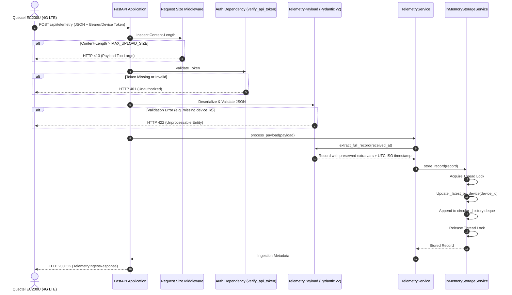
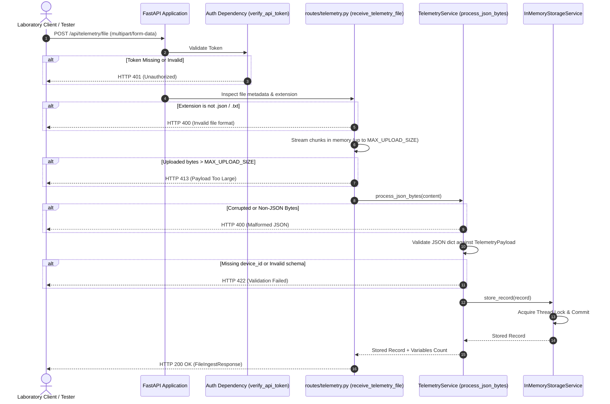
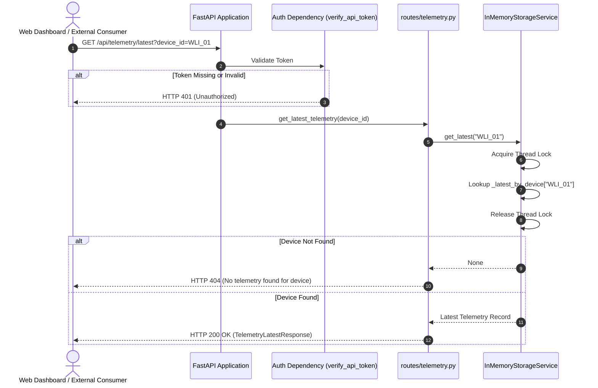

# HTTPS Receiver — API Data Flow Specification

## 1. Overview

This document specifies the end-to-end data flows, sequence interactions, and transformation pipelines for the **Panorama Water Tank HTTPS Receiver REST API**.

---

## 2. Telemetry Ingestion Flow (Direct JSON POST)

The primary production ingestion pathway for the Quectel EC200U cellular module.



---

## 3. Telemetry Ingestion Flow (Multipart File Upload)

The laboratory testing pathway for uploading telemetry batches or diagnostic test files.



---

## 4. Telemetry Query Flow (Latest & History)



---

## 5. Data Transformation Pipeline

```
Raw JSON Byte Stream (HTTP Request)
           │
           ▼
[FastAPI / Starlette Deserialization]
           │
           ▼
[TelemetryPayload Model Validation]
  ├── Standard Fields: device_id, water_level_cm, water_level_percentage,
  │                    raw_voltage, sensor_status, latitude, longitude,
  │                    gps_valid, battery_voltage, alarm_status
  └── Dynamic Extra Fields: model_extra (preserves unknown keys & types)
           │
           ▼
[TelemetryService Transformation]
  ├── Injects: received_at = datetime.now(timezone.utc).isoformat()
  ├── Preserves: device timestamp (if provided by STM32)
  └── Consolidates into single complete Python dict
           │
           ▼
[InMemoryStorageService Commit]
  ├── Thread-safe copy into _latest_by_device[device_id]
  └── Thread-safe append into circular buffer _history (deque maxlen=1000)
           │
           ▼
[HTTP Response Serialization]
  └── Returns clean response model containing metadata and ingested record
```

---

## 6. Concurrency & Error Propagation Matrix

| Failure Condition | Detection Point | HTTP Status | Response Payload Summary |
|---|---|---|---|
| Missing Auth Header | `verify_api_token` | `401 Unauthorized` | `{"detail": "Unauthorized: Missing API token..."}` |
| Bad API Token | `verify_api_token` | `401 Unauthorized` | `{"detail": "Unauthorized: Invalid API token provided."}` |
| Payload > Limit | `limit_request_size` | `413 Payload Too Large` | `{"status": "error", "message": "Payload size exceeds limit..."}` |
| Non-JSON File | `receive_telemetry_file` | `400 Bad Request` | `{"detail": "Invalid file format..."}` |
| Malformed JSON File | `process_json_bytes` | `400 Bad Request` | `{"detail": "Malformed JSON: ..."}` |
| Missing `device_id` | `TelemetryPayload` validator | `422 Unprocessable` | Standard Pydantic field validation error |
| Non-existent Device | `get_latest_telemetry` | `404 Not Found` | `{"detail": "No telemetry found for device: ..."}` |
| Server Internal Error | Global Exception Handler | `500 Internal Error` | Standard JSON error response |
