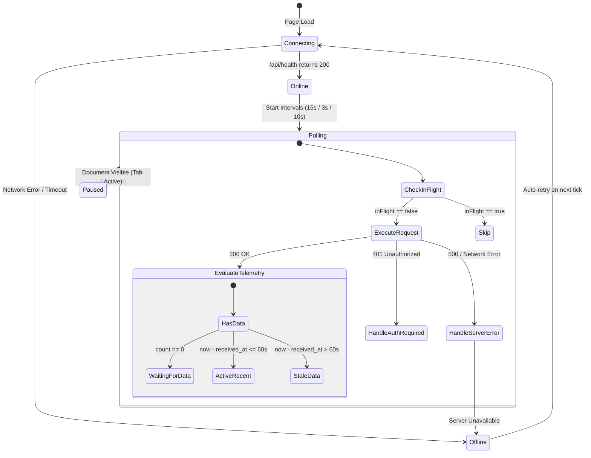

# HTTPS Laboratory Dashboard — Architecture Specification

## 1. Executive Summary

The **HTTPS Laboratory Dashboard** is an embedded, lightweight, and high-density IoT diagnostic tool designed for testing cellular telemetry communication from the **Quectel EC200U-CN** 4G LTE modem and **STM32** master microcontroller.

The dashboard is served directly by the FastAPI backend from `HTTPS_Server/backend/static/` using vanilla HTML5, CSS3, and modern modular JavaScript (ES6+). It eliminates heavy client-side frameworks (no React, Vue, Angular, or Node.js) and third-party CDN dependencies.

---

## 2. Component Decomposition & Directory Structure

```
HTTPS_Server/backend/static/
│
├── index.html              # Semantic HTML5 layout and accessibility markup
│
├── css/
│   └── style.css           # Industrial light-mode styling, responsive breakpoints
│
└── js/
    ├── api.js              # Network client, request timeout, in-memory token store
    ├── dashboard.js        # Server health, polling engine, visibility & stale tracking
    ├── telemetry.js        # Dynamic variable extraction, variable table, GPS, history, raw JSON
    └── app.js              # Coordinator: live clock, auth UI, manual POST, file upload, event monitor
```

### Module Responsibilities:

1. **`api.js` (Network & Communication Layer):**
   - Manages a private, in-memory `_apiToken` variable. Zero persistence in `localStorage`, `sessionStorage`, or console outputs.
   - Wraps the native `fetch()` API with `AbortController` timeout enforcement (8,000ms default).
   - Injects `Authorization: Bearer <token>` automatically on authenticated routes (`/api/telemetry`, `/api/telemetry/file`, `/api/telemetry/latest`, `/api/telemetry/history`).
   - Dispatches sanitized network telemetry events to the API Communication Monitor without exposing tokens.

2. **`dashboard.js` (System State & Polling Controller):**
   - Tracks server availability (`ONLINE`, `OFFLINE`, `CONNECTING`, `ERROR`) via `/api/health` and `/api/system/info`.
   - Distinguishes server health from device activity (`WAITING FOR DEVICE DATA`, `ACTIVE / RECENT`, `STALE DATA`).
   - Implements staggered controlled polling:
     - Health & System Info: 15 seconds
     - Latest Telemetry: 3 seconds
     - Communication History: 10 seconds
   - Enforces in-flight request guards (`_inFlightHealth`, `_inFlightTelemetry`, `_inFlightHistory`) to prevent overlapping requests.
   - Listens to document visibility changes (`visibilitychange`), pausing polling when the tab is hidden and resuming when visible.

3. **`telemetry.js` (Dynamic Ingestion & Rendering Layer):**
   - Consumes `/api/telemetry/latest` and dynamically parses the received JSON payload.
   - Renders primary telemetry cards for recognized metrics (`water_level_cm`, `water_level_percentage`, `raw_voltage`, `battery_voltage`, `sensor_status`, `alarm_status`).
   - Dynamically captures all unrecognized firmware variables into visual metric cards.
   - Populates an interactive Variable Table with real-time text filtering, type detection, and one-click value copying.
   - Evaluates GNSS coordinates (`latitude`, `longitude`, `gps_valid`) and generates direct Google Maps deep-links.
   - Renders formatted, indented raw JSON with copy and file download actions.
   - Renders historical records from `/api/telemetry/history` with an inspector modal for full payload analysis.
   - Employs strict DOM methods (`textContent`, `createElement`) to ensure complete protection against Cross-Site Scripting (XSS).

4. **`app.js` (Interactive Controls & Event Coordinator):**
   - Maintains a live clock in the header.
   - Provides password-type token entry with show/hide and clear controls.
   - Provides Manual JSON POST testing with client-side syntax pre-validation and latency tracking.
   - Provides Multipart File Upload testing with client-side JSON preview before transmission.
   - Renders a bounded FIFO event log (last 50 requests) in the API Communication Monitor.

---

## 3. Dynamic Variable Extraction Architecture

```
Incoming JSON Payload (FastAPI GET /api/telemetry/latest)
                          │
                          ▼
            [telemetry.js: renderLatestTelemetry]
                          │
         ┌────────────────┴────────────────┐
         ▼                                 ▼
[Known Sensor Attributes]         [Dynamic Extra Attributes]
  ├── water_level_cm                ├── signal_csq (int)
  ├── water_level_percentage        ├── firmware_rev (str)
  ├── raw_voltage                   ├── ambient_temp_mcu (float)
  ├── battery_voltage               ├── relay_states (dict/object)
  ├── sensor_status                 └── diagnostic_codes (list)
  ├── alarm_status                                 │
  └── latitude / longitude                         ▼
         │                        [renderDynamicVariables]
         ▼                          ├── Variable Name
[Primary Metric Cards Grid]         ├── Native Formatted Value
                                    └── Data Type Badge
                                                   │
         ┌─────────────────────────────────────────┘
         ▼
[renderVariableTable]
  ├── Text Filter / Search
  ├── Data Type Classification (Integer, Float, Boolean, String, Object, Array)
  ├── One-Click Clipboard Copy
  └── Expandable Tree for Nested Objects/Arrays
```

---

## 4. Controlled Polling & Stale Data State Machine



---

## 5. Security & Isolation Architecture

1. **In-Memory Credential Handling:**
   - The API Token is held solely in JavaScript execution memory (`let _apiToken`).
   - It is never committed to `localStorage`, `sessionStorage`, or indexed DB.
   - Refreshing or closing the browser window completely wipes the credential.
   - Manual test logs, communication tables, and error alerts scrub all `Authorization` headers.

2. **XSS Defense (Cross-Site Scripting):**
   - Untrusted telemetry values from IoT edge devices are never rendered using `innerHTML`.
   - All variable names and values are inserted via `element.textContent` or explicit DOM node constructors (`document.createElement`).

3. **Denial-of-Service & Resource Management:**
   - Maximum 50 log items retained in client memory to prevent unbounded memory growth.
   - File uploads are validated locally for JSON syntax before triggering network transfers.
