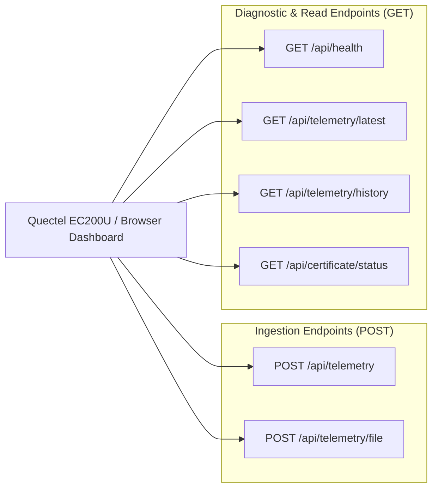
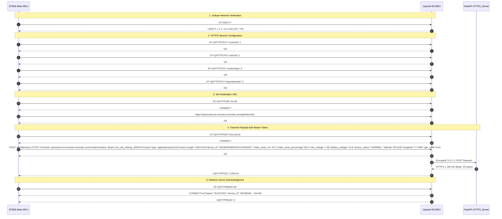
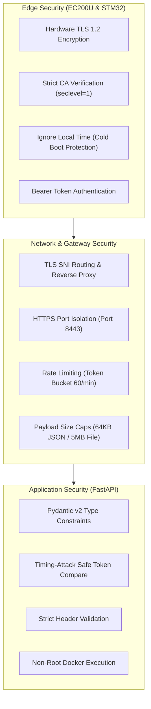
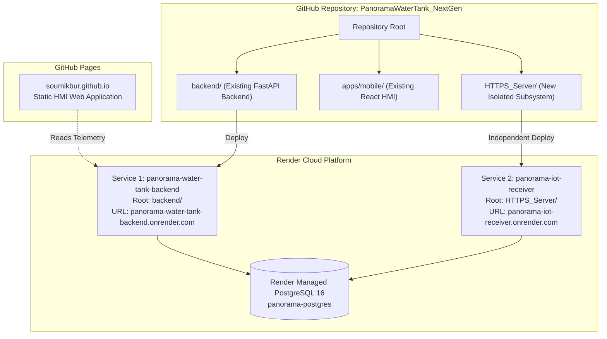
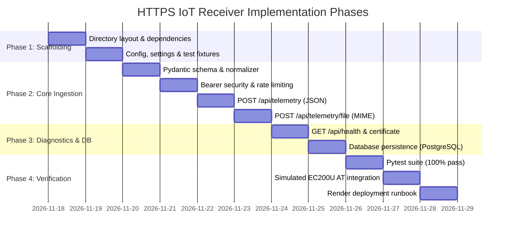

# TECHNICAL ARCHITECTURE SPECIFICATION
## Lightweight HTTPS IoT Data Receiver for Quectel EC200U & STM32
**Project Root:** `C:\Users\User\Documents\Antigravity_soumik\PanoramaWaterTank_NextGen`  
**Subsystem Target:** `HTTPS_Server/`  
**Hardware Profile:** STM32 Main MCU + Quectel EC200U-CN LTE/GNSS Gateway (ESP32 BLE-Only, BME280 Unused)  
**Document Version:** 1.0.0  
**Date:** November 17, 2026  
**Status:** Architecture Design Phase (Awaiting Internal Approval Before Implementation)

---

## 1. ARCHITECTURE OVERVIEW & COMMUNICATION TOPOLOGY

### 1.1 System Scope & Boundaries
The **HTTPS IoT Data Receiver** is a lightweight, dedicated, and isolated web service designed to receive, validate, authenticate, and ingest telemetry transmitted by railway water tank monitoring units.

It replaces the vulnerable and high-overhead MQTT cellular streaming link with an authenticated, encrypted, and firewall-friendly **HTTPS REST & File-Upload** pipeline.

```mermaid
flowchart TD
    subgraph CoachHardware["Coach Edge Hardware (Autonomous Module)"]
        Sensor["Hydrostatic 4-20mA Sensor<br/>(Submersible Diaphragm)"] -->|Current Loop| Shunt["Precision 100Ω Shunt Resistor<br/>(0.4V - 2.0V)"]
        Shunt -->|Analog Voltage| STM32["STM32 Main MCU<br/>(ADC, Median Filter, Volume Math)"]
        STM32 -->|UART AT Commands<br/>(115200 8N1)| EC200U["Quectel EC200U-CN Modem<br/>(LTE Cat-1 + GNSS Receiver)"]
        ESP32["ESP32 (BLE Only)"] -.->|BLE GATT Service| TechApp["Technician Commissioning App"]
    end

    subgraph CellularLink["Cellular & Internet Transport"]
        EC200U -->|4G LTE FDD/TDD Link| Tower["Cellular Base Station (BTS)"]
        Tower -->|TCP/IP Routing| Internet["Public Internet / Railway APN"]
    end

    subgraph ReceiverCloud["HTTPS_Server (Render Isolated Web Service)"]
        Internet -->|TLS 1.2+ (Port 443)| FastAPIRx["FastAPI IoT Receiver<br/>(HTTPS_Server/)"]
        FastAPIRx --> BearerAuth["Bearer Token / Header Security Guard"]
        BearerAuth --> SchemaVal["Pydantic v2 Contract Validator & Normalizer"]
        SchemaVal --> DBRepo["Database Repository Layer"]
        DBRepo --> PostgreSQL["PostgreSQL 16 Storage / SQLite Queue"]
        FastAPIRx --> Downstream["Web Dashboard / SCADA REST API"]
    end
```

### 1.2 Hardware Component Responsibilities

1. **STM32 (Main Microcontroller):**
   - **Role:** Master compute and real-time sensor acquisition engine.
   - **Sampling:** Samples 4-20mA hydrostatic sensor every 1.0 second via onboard 12-bit/16-bit ADC.
   - **Filtering:** Computes a 10-sample moving median and moving average to filter out water sloshing in transit.
   - **Math:** Computes water column height in centimeters and tank percentage based on calibrated physical geometry.
   - **Packaging:** Encodes telemetry into compact JSON or batch files.
   - **AT Driver:** Dispatches UART AT commands (`AT+QHTTP*`, `AT+QSSL*`, `AT+QFUPL*`) to the EC200U cellular gateway.

2. **Quectel EC200U-CN (Cellular + GNSS Gateway):**
   - **Role:** Autonomous communication and positioning coprocessor.
   - **Positioning:** Integrated GNSS engine continuously tracks GPS/GLONASS satellites, calculating latitude, longitude, and ground speed.
   - **Cellular Link:** Manages LTE Cat-1 PDP context activation (`AT+QIACT=1`).
   - **Security Engine:** Onboard SSL/TLS 1.2 cryptographic acceleration with CA certificate validation from non-volatile flash storage (`UFS:`).
   - **HTTPS Client:** Executes `AT+QHTTPURL`, `AT+QHTTPPOST`, and `AT+QHTTPREAD` sequences under hardware timer supervision.

3. **ESP32 (BLE-Only Subsystem):**
   - **Role:** Local technician configuration and depot testing.
   - **Isolation:** Operates exclusively as a Bluetooth Low Energy (BLE) peripheral.
   - **Restriction:** Has **NO internet access**, **NO cellular modem interface**, and **NO routing to the cloud**.

4. **BME280 Sensor:**
   - **Status:** **Completely unused / omitted**. No temperature, humidity, or atmospheric barometric pressure variables shall be ingested or processed.

---

## 2. API SPECIFICATION & ROUTING CONTRACT

The `HTTPS_Server` exposes 6 dedicated endpoints organized into Ingestion, Diagnostics, and Read paths:



### 2.1 Endpoint Catalog

| Method | Path | Content-Type | Auth Required | Purpose |
|:---:|---|:---:|:---:|---|
| **POST** | `/api/telemetry` | `application/json` | **Yes (Bearer)** | Primary real-time JSON telemetry frame submission. |
| **POST** | `/api/telemetry/file` | `multipart/form-data` | **Yes (Bearer)** | Batch / store-and-forward JSON file upload. |
| **GET** | `/api/health` | `application/json` | No (Public) | Multi-tier uptime, memory, and database health probe. |
| **GET** | `/api/telemetry/latest` | `application/json` | **Yes (Bearer)** | Retrieve most recent telemetry frame for active devices. |
| **GET** | `/api/telemetry/history` | `application/json` | **Yes (Bearer)** | Query historical time-series data with pagination. |
| **GET** | `/api/certificate/status` | `application/json` | No (Public) | Certificate fingerprint, expiration, and modem setup guide. |

---

### 2.2 Endpoint Detail & Contracts

#### 1. `POST /api/telemetry` (Primary Live Telemetry)
- **Headers:**
  - `Content-Type: application/json`
  - `Authorization: Bearer <API_SECRET_TOKEN>` (or `X-Device-Token: <API_SECRET_TOKEN>`)
- **Max Body Size:** 64 KB
- **Request Body:**
  ```json
  {
    "device_id": "0023004D4B42501120353332",
    "timestamp": "2026-11-17T07:45:00Z",
    "water_level_cm": 42.5,
    "water_level_percentage": 85.0,
    "raw_voltage": 1.68,
    "sensor_status": "NORMAL",
    "latitude": 28.6139,
    "longitude": 77.2090,
    "gps_valid": true,
    "battery_voltage": 12.8,
    "alarm_status": "NORMAL",
    "train_number": "12002",
    "coach_number": "B4"
  }
  ```
- **Responses:**
  - `200 OK`:
    ```json
    {
      "status": "SUCCESS",
      "message": "Telemetry processed successfully",
      "device_id": "0023004D4B42501120353332",
      "server_timestamp": "2026-11-17T07:45:01.124Z"
    }
    ```
  - `400 Bad Request`: Malformed JSON or unparseable payload.
  - `401 Unauthorized`: Missing or invalid bearer token.
  - `422 Unprocessable Entity`: Field validation failure (e.g. `water_level_percentage` out of `[0, 100]`).
  - `429 Too Many Requests`: Rate limit exceeded (> 60 req/min per device).

#### 2. `POST /api/telemetry/file` (Batch / File Upload)
- **Headers:**
  - `Content-Type: multipart/form-data; boundary=...`
  - `Authorization: Bearer <API_SECRET_TOKEN>`
- **Max Body Size:** 5 MB
- **Form Fields:**
  - `file`: The telemetry JSON file (single frame or JSON array of queued frames).
  - `device_id` *(Optional)*: Device identifier if not embedded within the file.
- **Responses:**
  - `200 OK`:
    ```json
    {
      "status": "SUCCESS",
      "message": "File telemetry ingested successfully",
      "filename": "buffered_telemetry.json",
      "records_ingested": 18,
      "server_timestamp": "2026-11-17T07:45:02.050Z"
    }
    ```
  - `413 Payload Too Large`: Uploaded file exceeds 5 MB.
  - `422 Unprocessable Entity`: File contents could not be decoded as valid telemetry JSON.

#### 3. `GET /api/health` (Health Probe)
- **Headers:** None required.
- **Responses:**
  - `200 OK`:
    ```json
    {
      "status": "HEALTHY",
      "service": "Panorama-HTTPS-IoT-Receiver",
      "version": "1.0.0",
      "uptime_seconds": 84210,
      "database": {
        "status": "CONNECTED",
        "engine": "PostgreSQL 16",
        "latency_ms": 4.2
      },
      "system": {
        "memory_used_mb": 38.5,
        "cpu_percent": 1.2
      }
    }
    ```

#### 4. `GET /api/telemetry/latest` (Latest Device Reading)
- **Query Parameters:** `device_id` *(Optional)*. If omitted, returns latest reading for all registered devices.
- **Headers:** `Authorization: Bearer <API_SECRET_TOKEN>`
- **Responses:**
  - `200 OK`:
    ```json
    {
      "status": "SUCCESS",
      "device_id": "0023004D4B42501120353332",
      "latest_reading": {
        "timestamp": "2026-11-17T07:45:00Z",
        "water_level_cm": 42.5,
        "water_level_percentage": 85.0,
        "battery_voltage": 12.8,
        "sensor_status": "NORMAL",
        "latitude": 28.6139,
        "longitude": 77.2090,
        "age_seconds": 15
      }
    }
    ```

#### 5. `GET /api/telemetry/history` (Historical Series)
- **Query Parameters:**
  - `device_id`: Device UID (string, required)
  - `limit`: Number of points (integer, default `100`, max `1000`)
  - `start_time`: ISO 8601 string *(Optional)*
  - `end_time`: ISO 8601 string *(Optional)*
- **Headers:** `Authorization: Bearer <API_SECRET_TOKEN>`
- **Responses:**
  - `200 OK`: Time-series array with aggregate statistics (min, max, average level).

#### 6. `GET /api/certificate/status` (TLS Certificate Diagnostics)
- **Headers:** None required.
- **Responses:**
  - `200 OK`:
    ```json
    {
      "tls_version": "TLS 1.2 / TLS 1.3",
      "ca_issuer": "Let's Encrypt / DigiCert Global Root G2",
      "valid_from": "2026-01-01T00:00:00Z",
      "valid_until": "2027-01-01T00:00:00Z",
      "sha256_fingerprint": "9B:4C:E6:81:44:82:48:48:28:C2:54:CA:E2:B0:92:09:A6:65:76:89",
      "modem_provisioning_guide": {
        "step_1": "AT+QFUPL=\"cacert.pem\",1240,30",
        "step_2": "AT+QSSLCFG=\"cacert\",1,\"cacert.pem\"",
        "step_3": "AT+QSSLCFG=\"seclevel\",1,1"
      }
    }
    ```

---

## 3. DATA STRUCTURE & CONTRACT NORMALIZATION

### 3.1 Authoritative Telemetry JSON Schema
The `HTTPS_Server` defines a strict Pydantic v2 schema that enforces valid engineering bounds while supporting **backward-compatible field aliases** from existing edge firmware and allowing **dynamic additional variables** for future expansion.

```python
class TelemetryFrame(BaseModel):
    # Core Identification
    device_id: str = Field(..., description="Unique 24-character hexadecimal device UID / IMEI")
    timestamp: datetime = Field(default_factory=lambda: datetime.now(timezone.utc), description="UTC acquisition timestamp")

    # Water Level & Hydrostatic Measurements
    water_level_cm: float = Field(..., ge=0.0, le=500.0, description="Measured water height in centimeters")
    water_level_percentage: float = Field(..., ge=0.0, le=100.0, description="Calculated volume percentage [0-100%]")
    raw_voltage: Optional[float] = Field(None, ge=0.0, le=5.0, description="Raw 4-20mA shunt ADC input voltage in Volts")
    sensor_status: str = Field(default="NORMAL", description="Status flag: NORMAL, WARNING, CRITICAL, FAULT, DISCONNECTED")

    # Geolocation & Telematics (from Quectel GNSS)
    latitude: Optional[float] = Field(None, ge=-90.0, le=90.0, description="WGS84 latitude")
    longitude: Optional[float] = Field(None, ge=-180.0, le=180.0, description="WGS84 longitude")
    gps_valid: bool = Field(default=False, description="True if GNSS has 2D/3D fix with sats >= 4")

    # Power & Environmental Health
    battery_voltage: Optional[float] = Field(None, ge=0.0, le=30.0, description="Coach battery / backup cell voltage in Volts")
    alarm_status: str = Field(default="NORMAL", description="Consolidated alarm: NORMAL, LOW_WATER, CRITICAL_LOW, OVERFLOW, SENSOR_FAULT")

    # Consist Context (Optional)
    train_number: Optional[str] = Field(None, description="Railway train service number (e.g. 12002)")
    coach_number: Optional[str] = Field(None, description="Railway coach classification (e.g. B4)")

    # Dynamic Field Support: Allows auxiliary sensors without schema errors
    model_config = ConfigDict(extra="allow", populate_by_name=True)
```

### 3.2 Backward-Compatible Field Aliases
The edge firmware has used various abbreviated field names in previous revisions. The validator normalizes incoming payloads as follows:

| Target Canonical Field | Accepted Firmware Aliases | Normalization Logic |
|---|---|---|
| `device_id` | `uid`, `deviceId` | Automatically mapped to `device_id`. |
| `timestamp` | `dt`, `time` | ISO 8601 parsed; time-only strings appended to current UTC date. |
| `water_level_cm` | `cm1`, `height_cm` | Maps primary tank height in cm. |
| `water_level_percentage`| `wlp1`, `level_percent`| Maps primary tank percentage. Clamped to $[0.0, 100.0]\%$. |
| `raw_voltage` | `v1`, `analog_v` | Maps raw 4-20mA shunt sensor voltage. |
| `sensor_status` | `wlvl`, `wlv1`, `valid` | `true` $\rightarrow$ `"NORMAL"`, `false` $\rightarrow$ `"FAULT"`. |
| `latitude` | `lat` | Direct assignment with range check $[-90, 90]$. |
| `longitude` | `lon`, `long` | Reconciles legacy `long` and modern `lon`. |
| `battery_voltage` | `bat`, `v2`, `battery_v1`| If percentage ($\le 100$), converts to nominal voltage or stores directly. |
| `alarm_status` | `alarm`, `status` | Normalized to uppercase string enum. |
| `train_number` | `trno` | Strip whitespace, sanitized. |
| `coach_number` | `chno` | Strip whitespace, sanitized. |

> [!IMPORTANT]
> **No BME280 Variables:** Fields such as `temperature`, `humidity`, and `pressure` are **excluded** from required schemas. If sent dynamically by older hardware, they are captured safely under `extra` without triggering validation failures or polluting primary telemetry tables.

---

## 4. EC200U TRANSMISSION METHOD ANALYSIS

The testing requirements mandate comparing **Direct JSON POST** vs. **Multipart File Upload**.

```mermaid
flowchart TD
    subgraph TransmissionSelection["Quectel EC200U Transmission Strategy"]
        Choice{"Operating Condition"}
        Choice -->|Live Telemetry (30s-60s)| MethodA["Method A: Direct JSON POST<br/>(application/json)"]
        Choice -->|Tunnel / Dead-Zone Queue| MethodB["Method B: JSON File Upload<br/>(multipart/form-data)"]
    end

    subgraph EvaluationMethodA["Method A Characteristics"]
        A1["Lowest latency (single AT session)"]
        A2["Zero UFS flash memory wear"]
        A3["Minimal UART byte overhead"]
        A4["Recommended for 95% of operational time"]
    end

    subgraph EvaluationMethodB["Method B Characteristics"]
        B1["Store-and-forward batch buffering"]
        B2["Queued frames survived modem reboots"]
        B3["Higher UART & UFS overhead"]
        B4["Essential for offline recovery"]
    end

    MethodA --- EvaluationMethodA
    MethodB --- EvaluationMethodB
```

### 4.1 Comparative Technical Matrix

| Evaluation Parameter | Method A: Direct JSON POST (`/api/telemetry`) | Method B: Multipart File Upload (`/api/telemetry/file`) |
|---|---|---|
| **Content-Type** | `application/json` | `multipart/form-data; boundary=...` |
| **EC200U AT Command** | `AT+QHTTPPOST=<len>,<in_time>,<rsp_time>` | `AT+QFUPL` + `AT+QHTTPPOST` (or `AT+QHTTPPOSTFILE`) |
| **UFS Flash Storage Required**| **No** (Direct RAM buffer stream) | **Yes** (Requires writing file to `UFS:` first) |
| **UART Protocol Overhead** | Low ($\approx 280$ bytes per reading) | High ($\approx 550$ bytes including MIME headers & boundaries) |
| **Flash Wear on Modem** | **Zero** | Moderate (Repeated flash writes on cellular drop) |
| **Firmware Complexity (STM32)**| Very Simple (sprintf JSON $\rightarrow$ UART) | Moderate (Manage file upload, boundaries, and UFS cleanup) |
| **Network Data Consumption** | Minimum possible ($\approx 350$ bytes TCP payload) | Higher ($\approx 700$ bytes TCP payload per transaction) |
| **Batch Queuing Support** | Single frame per request | **Excellent** (Can package 50+ frames into single array file) |
| **Best Supported in EC200U** | **Superior** (Native `AT+QHTTPCFG="contenttype",4`) | Standard, but requires careful multipart encoding |

### 4.2 Engineering Recommendation
1. **Primary Operational Method:** Use **Method A (`POST /api/telemetry`)** for normal operational streaming every 30 to 60 seconds. It imposes the lowest cellular data cost, minimal latency, and zero flash degradation.
2. **Offline Recovery Fallback:** Use **Method B (`POST /api/telemetry/file`)** exclusively when recovering from extended cellular blackouts (e.g., long railway tunnels). The STM32 batches queued readings into `telemetry_queue.json`, uploads to EC200U flash via `AT+QFUPL`, and flushes the entire backlog in a single HTTP POST.
3. **Independent Verification:** Both endpoints will be implemented and tested independently with automated verification scripts.

---

## 5. EC200U AT COMMAND COMMUNICATION DESIGN

### 5.1 One-Time Modem Provisioning (Depot Setup)
Before deploying the coach, the Root CA certificate for the Render web service is written to the EC200U non-volatile UFS memory:

```ini
; Step 1: Upload CA Certificate to Modem UFS Storage (1,240 bytes)
AT+QFUPL="cacert.pem",1240,30
CONNECT
<Binary/PEM Data of Root CA>
+QFUPL: 1240,7a3b
OK

; Step 2: Verify File is Persisted in UFS
AT+QFLST="*"
+QFLST: "cacert.pem",1240
OK

; Step 3: Configure SSL Context 1 to Use CA Certificate
AT+QSSLCFG="sslversion",1,3
AT+QSSLCFG="ciphersuite",1,0xFFFF
AT+QSSLCFG="seclevel",1,1
AT+QSSLCFG="cacert",1,"cacert.pem"
AT+QSSLCFG="ignorelocaltime",1,1
OK
```

### 5.2 Runtime Transmission Flow (Direct JSON POST)



---

## 6. SECURITY ARCHITECTURE & DEFENSE-IN-DEPTH



### 6.1 Defense Layers & Controls

1. **Transport Layer Security (TLS 1.2+):**
   - Transport is encrypted using industry-standard TLS 1.2+.
   - Plain HTTP connections on port 80 are permanently rejected or automatically redirected.
   - Server private keys (`server.key`) are stored in environment variables or non-versioned local paths, never checked into Git.

2. **Strict Server Certificate Verification:**
   - Quectel EC200U security level is set to `seclevel=1`.
   - Modems reject self-signed or fraudulent certificates that do not chain to the installed Root CA.
   - `AT+QSSLCFG="ignorelocaltime",1,1` is configured so that modems booting before GPS/NITZ clock acquisition do not fail TLS validation due to 1970 epoch clock skew.

3. **Bearer Token Authentication:**
   - Ingestion endpoints require an HTTP header: `Authorization: Bearer <API_SECRET_TOKEN>`.
   - For UART byte efficiency on the modem, the custom header `X-Device-Token: <API_SECRET_TOKEN>` is also accepted.
   - Token comparison uses `secrets.compare_digest()` to eliminate timing-attack vulnerabilities.

4. **Rate Limiting & Flood Mitigation:**
   - An in-memory sliding-window rate limiter restricts requests to **60 requests per minute per device ID**.
   - If an edge device reconnects after a tunnel and floods requests, it receives HTTP 429 without crashing the application.

5. **Payload Size Restrictions:**
   - `POST /api/telemetry` rejects requests larger than **64 KB** (`HTTP 413`).
   - `POST /api/telemetry/file` enforces a hard cap of **5 MB** (`HTTP 413`).

6. **Defensive Error Handling:**
   - Internal stack traces and database credentials are never exposed in HTTP error bodies.
   - Errors return structured JSON: `{"status": "ERROR", "detail": "Human-readable description"}`.

---

## 7. HOSTING & DEPLOYMENT ARCHITECTURE



### 7.1 Multi-Service Isolation Topology
The new `HTTPS_Server` will run as a completely independent Render Web Service alongside the existing backend:

1. **GitHub Repository:**
   - Stored in the existing `PanoramaWaterTank_NextGen` repository within the subdirectory `HTTPS_Server/`.
   - Leaves all other directories (`backend/`, `apps/mobile/`, `PanoramaWaterTank_Capacitor/`) intact.

2. **Render Configuration for `HTTPS_Server`:**
   - **Service Name:** `panorama-iot-receiver`
   - **Environment:** Python 3.11
   - **Root Directory:** `HTTPS_Server/`
   - **Build Command:** `pip install -r requirements.txt`
   - **Start Command:** `uvicorn src.main:app --host 0.0.0.0 --port $PORT`
   - **Health Check Path:** `/api/health`
   - **Public URL:** `https://panorama-iot-receiver.onrender.com`

3. **Data Sharing with Existing HMI:**
   - Both the existing backend and the new `HTTPS_Server` connect to the same Render PostgreSQL database (`DATABASE_URL`).
   - When `HTTPS_Server` writes a new reading to `telemetry_readings`, it is instantly visible to the existing web dashboard.
   - The existing website on GitHub Pages continues operating without any modification.

---

## 8. PROJECT DIRECTORY STRUCTURE (`HTTPS_Server/`)

```
HTTPS_Server/
├── certs/
│   ├── .gitkeep
│   ├── cacert.pem                  # Root CA certificate for testing & modem flash
│   └── README.md                   # Instructions for certificate rotation
├── config/
│   ├── __init__.py
│   ├── .env.example                # Example environment variables
│   └── settings.py                 # Pydantic BaseSettings (Port, Token, DB)
├── docs/
│   ├── architecture/
│   │   └── HTTPS_RECEIVER_ARCHITECTURE.md # This authoritative architecture document
│   └── audit/
│       └── TECHNICAL_AUDIT_REPORT.md      # Phase 1 complete technical audit
├── src/
│   ├── __init__.py
│   ├── main.py                     # FastAPI entrypoint, middleware, lifespan
│   ├── schemas.py                  # Pydantic v2 telemetry contract & normalizers
│   ├── security.py                 # Bearer token verification & rate limiter
│   ├── database.py                 # Async SQLAlchemy engine & session factory
│   ├── repository.py               # Telemetry and Device database operations
│   └── routers/
│       ├── __init__.py
│       ├── telemetry.py            # POST /api/telemetry & POST /api/telemetry/file
│       ├── health.py               # GET /api/health
│       └── diagnostics.py          # GET /api/certificate/status
├── tests/
│   ├── __init__.py
│   ├── conftest.py                 # Pytest fixtures & test database setup
│   ├── test_telemetry_post.py      # Automated tests for JSON POST & validation
│   ├── test_telemetry_file.py      # Automated tests for multipart file upload
│   ├── test_security_auth.py       # Automated tests for bearer token & rate limiting
│   └── mock_ec200u_sim.py          # AT command sequence simulator
├── .dockerignore
├── .gitignore                      # Enforces excluding *.key, *.env, *.db
├── Dockerfile                      # Standalone container for local & Railway deploy
├── README.md                       # Subsystem runbook & AT command cheat-sheet
├── requirements.txt                # Lean dependencies (fastapi, uvicorn, pydantic)
└── run_server.py                   # Local development launcher
```

---

## 9. IMPLEMENTATION CHECKLIST & PHASED ROADMAP



### Phase 1: Subsystem Scaffolding
- [ ] Initialize `HTTPS_Server/` directories (`config/`, `src/`, `src/routers/`, `tests/`, `certs/`).
- [ ] Create `requirements.txt` with minimal dependencies (`fastapi`, `uvicorn`, `pydantic-settings`, `sqlalchemy`, `asyncpg`, `aiosqlite`, `python-multipart`, `pytest`, `httpx`).
- [ ] Create `.gitignore` to prevent secret/key leaks.
- [ ] Configure `config/settings.py` for environment variables.

### Phase 2: Ingestion & Security Engine
- [ ] Implement `src/schemas.py` with 11 core fields, backward-compatible aliases, and `extra="allow"`.
- [ ] Implement `src/security.py` with constant-time token comparison and token-bucket rate limiter.
- [ ] Implement `src/routers/telemetry.py` containing:
  - `POST /api/telemetry` (Direct JSON).
  - `POST /api/telemetry/file` (Multipart file upload).
- [ ] Implement `src/routers/health.py` and `src/routers/diagnostics.py`.

### Phase 3: Persistence & HMI Decoupling
- [ ] Implement `src/database.py` and `src/repository.py` to insert records into `telemetry_readings` and update `devices`.
- [ ] Implement `GET /api/telemetry/latest` and `GET /api/telemetry/history`.
- [ ] Validate zero dependencies on existing MQTT broker (`paho-mqtt` not imported).

### Phase 4: Automated Verification & Documentation
- [ ] Write unit test suite `tests/test_telemetry_post.py` (Valid payloads, aliases, bounds checking).
- [ ] Write unit test suite `tests/test_telemetry_file.py` (Multipart uploads, malformed files).
- [ ] Write unit test suite `tests/test_security_auth.py` (Invalid tokens, rate-limit triggers).
- [ ] Implement `tests/mock_ec200u_sim.py` simulating full AT command flow over HTTP.
- [ ] Generate Render deployment blueprint and operational runbook.

---
*Technical Architecture Specification completed. Subsystem ready for Phase 2 scaffolding and implementation upon review.*
