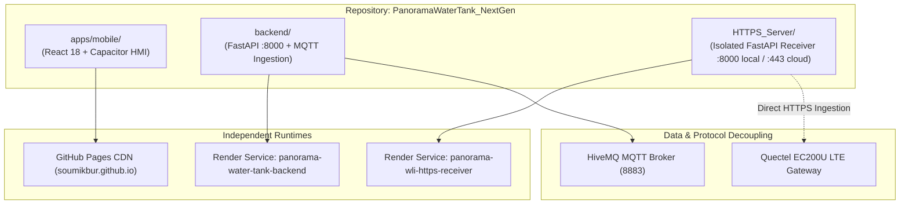

# Initial Subsystem Architecture & Multi-Tenant Isolation
## Panorama Water Tank Monitor — HTTPS Receiver Phase 03
**Document Version:** 1.0.0  
**Target Subsystem:** `HTTPS_Server/`  
**Date:** November 17, 2026

---

## 1. Architectural Independence & Isolation Boundaries

The `HTTPS_Server` is architected as a completely autonomous subsystem within the `PanoramaWaterTank_NextGen` repository. It operates under strict isolation boundaries to ensure zero interference with the existing web dashboard, Capacitor mobile application, and Python FastAPI backend:

### 1.1 Multi-Tier Isolation Matrix

| Boundary | Existing System | `HTTPS_Server` | Isolation Guarantee |
|---|---|---|---|
| **Directory** | `backend/`, `apps/mobile/` | `HTTPS_Server/` | Completely distinct folder trees; zero shared source files. |
| **Python Environment** | `backend/.venv` (Python 3.11) | `HTTPS_Server/.venv` (Python 3.14) | Isolated virtual environment and package site-packages. |
| **Dependencies** | 20+ packages (FastAPI, Alembic, Paho-MQTT, etc.) | 7 lightweight packages (FastAPI, Uvicorn, Pydantic, etc.) | Minimal surface area; `paho-mqtt` is not loaded. |
| **Frontend Assets** | React 18 + React Native Web + Leaflet | Semantic HTML5 + Vanilla CSS3 + Vanilla JS | Served from same-origin `/static` by FastAPI; no bundler required. |
| **Port & Networking** | Dev port `8000` / `5173` | Configurable port (`8000` default local, `$PORT` on Render) | Independent runtime processes. |
| **Cloud Deployment** | `panorama-water-tank-backend.onrender.com` | `panorama-wli-https-receiver.onrender.com` | Independent Render Web Service blueprint. |
| **Git & Versioning** | Shared Git repository | Local `.gitignore` inside `HTTPS_Server/` | Excludes `.venv`, secrets, and caches without altering root `.gitignore`. |

---

## 2. Component Responsibility

1. **`HTTPS_Server/backend/main.py`:**
   - Single-file ASGI entrypoint exposing `/api/health`, `/docs`, `/openapi.json`, and serving `static/index.html`.
   - Designed to run under Uvicorn without background threads or socket workers during initialization.
2. **`HTTPS_Server/backend/static/`:**
   - Laboratory testing dashboard. Provides real-time visual verification of server reachability, backend protocol (HTTP vs HTTPS), and version status.
3. **`HTTPS_Server/certificates/`:**
   - Documents the Render-managed TLS trust model and prepares for Root CA provisioning in Phase 06.
4. **`HTTPS_Server/tests/`:**
   - Autonomous Pytest test suite covering endpoints, static delivery, secret sanitization, and architectural isolation.

---

## 3. Phase 03 Boundary Status
In this initial phase, telemetry processing, database connections, and bearer authentication are deliberately not included. This establishes a clean, verified, regression-free baseline before Phase 04 telemetry endpoint development.
