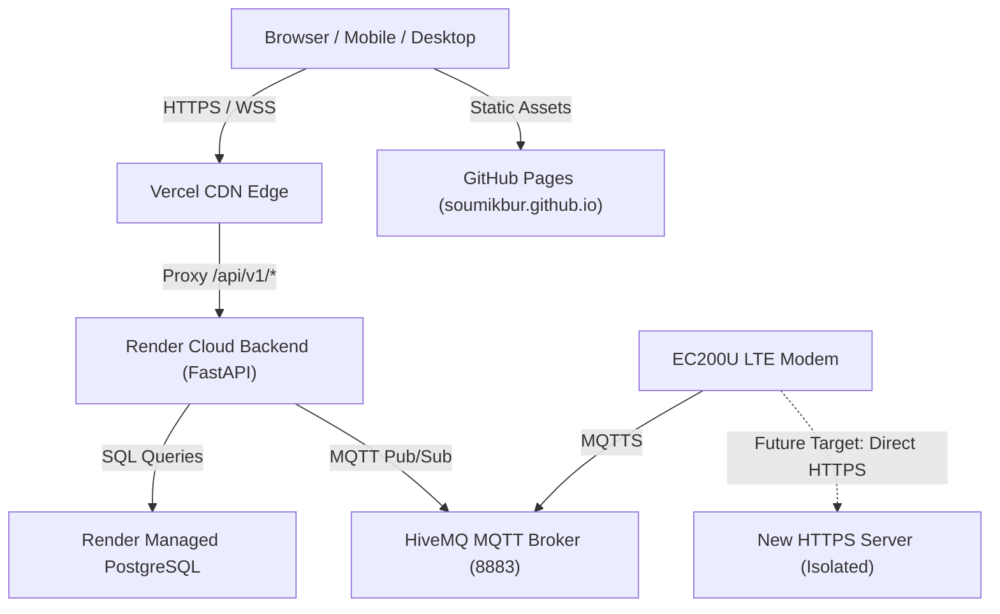

# PANORAMA WATER TANK MONITOR — TECHNICAL AUDIT & PRE-IMPLEMENTATION SPECIFICATION
## Complete Pre-Development Audit for Isolated HTTPS IoT Data Receiver
**Project Root:** `C:\Users\User\Documents\Antigravity_soumik\PanoramaWaterTank_NextGen`  
**Target Subsystem:** `HTTPS_Server/` (New Isolated HTTPS-based IoT Telemetry Receiver)  
**Hardware Profile:** STM32 Main MCU + Quectel EC200U-CN LTE/GNSS Gateway (ESP32 BLE-only, BME280 Unused)  
**Audit Standard:** Railway SCADA Industrial Telemetry & Security Baseline  
**Date:** November 17, 2026  
**Auditor:** Antigravity Senior Engineering Agent (Ponytail Lazy Senior Dev Mode: Full)

---

## 1. EXISTING PROJECT ARCHITECTURE

### 1.1 Multi-Platform System Topology
The repository contains a multi-tier industrial SCADA and HMI architecture deployed across mobile, desktop, cloud, and embedded environments:

1. **Frontend HMI & Web Application (`apps/mobile/`):**
   - **Framework:** React 18.3.1 with `react-native-web` (0.19.13) and TypeScript 5.4.5.
   - **Bundler:** Standalone `esbuild` 0.21.5 compiling into `dist/` and synced via `scripts/sync_dist.js`.
   - **Visualization:** HTML5 Canvas fluid animation with deterministic 4-state evaluator (`NO_TELEMETRY`, `VALID_ZERO`, `VALID_READING`, `STALE`), Leaflet 1.9.4 for railway geographic telemetry mapping, Lucide-React icons.
   - **Communication:** Bi-directional REST API client (`apps/mobile/src/api/client.ts`) and WebSocket streaming (`apps/mobile/src/services/websocket.ts`).

2. **Cross-Platform Wrappers:**
   - **Desktop SCADA (`apps/mobile/electron/`):** Electron 45.1.0 packaging the web frontend into a Windows executable (`PanoramaWaterTank-Setup.exe`) via `electron-builder` 26.18.0.
   - **Mobile SCADA (`PanoramaWaterTank_Capacitor/`):** Capacitor 6.0 Android project wrapping web artifacts (`www/`), featuring Android 13+ push notifications and scoped layout adaptation.
   - **Legacy Desktop Core (`app/`, `src/`, `qml/`, `CMakeLists.txt`):** Qt 6.9/6.12 (C++20, QML, QtQuick, QtMqtt, QtSql) legacy workstation application.

3. **Current Edge Hardware Topology:**
   - **Main Microcontroller:** STM32 (Cortex-M4, e.g. STM32F401/STM32F411) executing 4-20mA hydrostatic sensor acquisition, median digital filtering, volume conversion, and AT command dispatch.
   - **Cellular & GNSS Gateway:** Quectel EC200U-CN LTE Cat-1 modem interfacing over UART. Handles cellular registration, GNSS coordinate parsing, and network transport.
   - **Auxiliary BLE Node:** ESP32 reserved exclusively for technician Bluetooth Low Energy commissioning (depot calibration).
   - **Decommissioned Elements:** Bosch BME280 sensor is unused; legacy ESP32-S3 main MCU and Ubidots cloud integration are deprecated.

---

## 2. EXISTING BACKEND ANALYSIS

### 2.1 Backend Architecture & Components
- **Framework:** Python 3.11 with FastAPI (0.110.0) running on Uvicorn (0.28.0).
- **ORM & Database:** SQLAlchemy 2.0 async engine.
  - Development / Local: SQLite with `aiosqlite` (`backend/panorama_dev.db`), configured with WAL mode.
  - Production / Cloud: PostgreSQL 16 with `asyncpg` (`postgresql+asyncpg://...`).
- **Data Validation:** Pydantic v2 schemas (`backend/app/schemas/`).
- **Telemetry Ingestion Engine:**
  - **MQTT Client (`app/mqtt/client.py`):** Paho-MQTT v2 client operating on a background thread. Connects to HiveMQ (`broker.hivemq.com:1883/8883`) or local Mosquitto. Subscribes to `panorama/telemetry/+`, root hardware UIDs (`+`), and status topics (`panorama/status/+`).
  - **REST Fallback (`POST /api/v1/telemetry/ingest`):** Exposes direct HTTP POST ingestion into `MqttService.process_telemetry`.
  - **Live WebSockets (`app/websocket/manager.py`):** In-memory connection manager broadcasting `TELEMETRY_UPDATE`, `ALARM_TRIGGERED`, and `ALARM_RESOLVED` packets to subscribed browsers.
  - **Outbox Worker (`app/services/outbox_service.py`):** Background task publishing transactional database mutations to MQTT topic `panorama/sync/events`.

### 2.2 Authentication & Security Architecture
- **Token Mechanism:** Stateless JSON Web Tokens (JWT) signed with HS256 algorithm via `python-jose[cryptography]`.
- **Password Storage:** Salted Bcrypt password hashing (`passlib[bcrypt]`, `bcrypt>=4.1.2`).
- **Access Control:** Role-Based Access Control (RBAC) with 4 roles: `admin`, `operator`, `viewer`, `employee`.
- **Protection Headers:** Custom middleware enforcing CSP, `X-Content-Type-Options: nosniff`, `X-Frame-Options: DENY`, `X-XSS-Protection: 1; mode=block`.
- **CORS Configuration:** Explicit origin whitelist and regex allowing `localhost`, `127.0.0.1`, `soumikbur.github.io`, `vercel.app`, and `capacitor://localhost`.

### 2.3 Existing API Endpoints
| Router | Base Path | Endpoints & Functionality |
|---|---|---|
| **Auth** | `/api/v1/auth` | `/login` (OAuth2 form), `/refresh`, `/register` |
| **Users** | `/api/v1/users` | `/me`, `/{id}`, `/status`, `/register-employee` |
| **Trains** | `/api/v1/trains` | Consist hierarchy: `/fleet`, `/{id}`, `/coaches`, `/routes`, `/corridors` |
| **Tanks** | `/api/v1/tanks` | `/live`, `/{id}`, `/calibrate`, `/history` |
| **Devices**| `/api/v1/devices` | `/`, `/{id}`, `/unassigned`, `/claim`, `/heartbeat` |
| **Location**| `/api/v1/location`| `/telematics`, `/history`, `/proximity`, `/corridors` |
| **Settings**| `/api/v1/settings`| `/`, `/thresholds`, `/backup`, `/restore` |
| **Alarms** | `/api/v1/alarms` | `/active`, `/history`, `/{id}/acknowledge`, `/summary` |
| **Telemetry**| `/api/v1/telemetry`| `/history` (LTTB downsampling), `/ingest` (REST fallback) |
| **Health** | `/api/v1/health` | Full multi-tier probe (DB, MQTT, Memory, Disk) |
| **WebSocket**| `/api/v1/ws/live`| Full-duplex JSON broadcast stream |

---

## 3. DEPLOYMENT ANALYSIS

The project utilizes a hybrid multi-cloud and containerized deployment model:



1. **Docker Compose (`docker-compose.yml`):**
   - Orchestrates `postgres:16-alpine`, `eclipse-mosquitto:2.0`, and `backend` (FastAPI).
   - Backend binds to host port `8000:8000`.
   - Mosquitto exposes ports `1883` and `8883`.
2. **Render Cloud (`render.yaml`):**
   - Free-tier web service running Python 3.11.9 with start command `cd backend && uvicorn app.main:app --host 0.0.0.0 --port $PORT`.
   - Managed PostgreSQL database `panorama-postgres`.
3. **Vercel (`vercel.json`):**
   - Serves compiled static frontend bundle with rewrite rule forwarding `/api/v1/(.*)` to Render backend.
4. **Railway (`railway.json`):**
   - Alternative container runtime configured with restart policy `ON_FAILURE` and `/api/v1/health` check.
5. **GitHub Actions CI/CD (`.github/workflows/`):**
   - `backend-ci.yml`: Compiles frontend, verifies artifacts, probes Render live status, publishes to GitHub Pages, and executes Python 3.11 pytest suite.
   - `ci.yml`: Runs on PRs and feature branches; executes full 58-test Pytest suite and validates OpenAPI 3.1 schema.
6. **PyInstaller Packaging (`backend/panorama-backend.spec`):**
   - Compiles FastAPI into standalone binary embedded into Electron distribution package.

---

## 4. GRAPHIFY ANALYSIS

### 4.1 Dependency Graph Topology
- **Tool Version:** Graphify v0.9.104
- **Knowledge Graph File:** `graphify-out/graph.json`
- **Updated State:** Graph updated and verified against git HEAD (`cd1744042316b3c713a0b850f8f46da032afcaae`).
- **Graph Statistics:**
  - **Total Nodes:** 9,095
  - **Total Edges:** 16,029
  - **Communities Identified:** 625
  - **Extraction Quality:** 91% AST Extracted, 9% Inferred, 0% Ambiguous.

### 4.2 Top Architectural Hubs (God Nodes)
| Rank | Node Identifier | Edge Count | Subsystem Role |
|:---:|---|:---:|---|
| 1 | `TankModel` | 188 | Central domain state model in legacy Qt core |
| 2 | `SettingsManager` | 177 | Configuration management across presentation & persistence |
| 3 | `ApiClient` | 93 | Frontend HTTP orchestration and offline resilience layer |
| 4 | `MqttService` | 85 | MQTT network subscriber, packet parser, and dispatcher |
| 5 | `LocationManager` | 84 | Railway corridor geometry and GPS distance evaluator |
| 6 | `TrainManager` | 75 | 24-coach consist hierarchy and assignment rules |
| 7 | `RailwayManager` | 67 | Station timetable and corridor database manager |
| 8 | `ApplicationController` | 64 | Lifecycle coordinator connecting UI to repositories |

### 4.3 Files That Must Not Be Modified
To prevent breaking existing CI pipelines, cloud deployments, and desktop builds, the following files and directories must remain completely untouched:
- `backend/` (All files, including `main.py`, `app/`, `requirements.txt`, `alembic.ini`).
- `apps/mobile/` (React application source code, build scripts, and Electron configuration).
- `PanoramaWaterTank_Capacitor/` (Android native project and Capacitor wrappers).
- `app/`, `src/`, `qml/`, `tests/` (Legacy Qt C++ codebase and test suite).
- Deployment manifests: `render.yaml`, `vercel.json`, `railway.json`, `docker-compose.yml`, `Dockerfile`, `.github/workflows/*`.
- Root package manifests: `package.json`, `package-lock.json`.

### 4.4 Directory Conflict Mitigation for `HTTPS_Server/`
- **Port Conflict:** Existing FastAPI binds to `8000`; React dev server binds to `3000` / `5173`; Mosquitto binds to `1883` / `8883`. The new `HTTPS_Server` must listen on port `8443` (standard HTTPS alternate) or a dedicated configurable port via its own `.env`.
- **Dependency Isolation:** `HTTPS_Server` must maintain its own package/dependency manifest (`package.json` or `requirements.txt`) in its directory, avoiding root workspace interference.
- **Database Access:** Must avoid concurrent SQLite file lock contentions if accessing `panorama_dev.db`. It should use an isolated schema, connect to PostgreSQL, or write to its own queue/database.

---

## 5. PONYTAIL VERIFICATION & EXECUTION EVIDENCE

### 5.1 Tool Status & Integration
- **Package:** `@dietrichgebert/ponytail` (Version `5.3.3` installed globally in `npm`).
- **Antigravity Integration:** Fully recognized via `.gemini/config/plugins/ponytail` and `.gemini/config/rules/ponytail.md`.
- **Executable Availability:** Verified. Ponytail operates as an agent steering plugin and skills suite; there is no standalone binary executable.
- **Persistent Configuration:**
  - Config file: `C:\Users\User\AppData\Roaming\ponytail\config.json` $\rightarrow$ `{"defaultMode": "full"}`.
  - Environment variable: `PONYTAIL_DEFAULT_MODE=full`.
- **Available Workflow Skills & Triggers:**
  - `/ponytail [lite|full|ultra|off]`: Lazy Senior Developer operational mode.
  - `/ponytail-help`: Reference card.
  - `/ponytail-audit`: Whole-repo quality and bloat audit.
  - `/ponytail-review`: Pre-commit / PR diff quality review.
  - `/ponytail-debt`: Ledger harvesting of `shortcut:` comments.
  - `/ponytail-gain`: Measured-impact scoreboard.

### 5.2 Codebase Technical Debt Execution Scan
A full recursive scan for `shortcut:` debt tags across `backend/app/` and `apps/mobile/src/` was executed:
```powershell
Get-ChildItem -Path backend/app,apps/mobile/src -Recurse -File -Include "*.py","*.ts","*.tsx" | Select-String -Pattern "shortcut:"
```
**Result:** `0 untracked shortcut tags found`. Technical debt in active modules is clean.

---

## 6. UNSLOP BASELINE FINDINGS

### 6.1 Tool Verification & Automated Scanner Output
- **Scanners:** Fast standard-library Python analyzers verified at `C:\Users\User\.gemini\config\skills\unslop\scripts\`.
- **Phrase Scanner Execution (`banned_phrase_scan.py`):**
  - Analyzed `README.md`: 1 soft violation (`comprehensive` at line 449 $\rightarrow$ suggested `full, complete, thorough`).
- **Structure Scanner Execution (`structure_scan.py`):**
  - Structural flag: `bold_colon_listicle` count = 27 (Markdown formatting characteristic of generated reference documentation).

### 6.2 Codebase Baseline Evaluation
1. **Generic UI Patterns:**
   - Previous revisions eliminated neon gradients and decorative scanning beams.
   - Restrained industrial palette (`#2563EB`, `#16A34A`, `#D97706`, `#DC2626`) is active.
2. **Unnecessary Abstractions:**
   - Frontend `client.ts` exceeds 2,200 lines, implementing complex in-memory caches, manual retry loops, and health polling that can be simplified.
   - Backend contains repository layers for simple single-table operations.
3. **Repetitive Code:**
   - Dual-tank level and alarm evaluation logic is duplicated between Primary and Secondary tanks (`cm1`/`cm2`, `wlp1`/`wlp2`, `wlv1`/`wlv2`).
   - Multiple health routes exist (`/health`, `/api/health`, `/api/v1/health`).
4. **Artificial Documentation:**
   - Redundant markdown reports across `docs/`, `WLI_DOCS/`, and `PROJECT_AUDIT/` repeating identical tables and schemas.
5. **Unused Dependencies:**
   - Root `package.json` contains `playwright` and `esbuild` directly despite scripts delegating to `apps/mobile`.
   - `python-multipart` and unused Alembic tooling loaded in production image.
6. **Inconsistent Naming:**
   - GPS longitude: `long` (telemetry payload) vs `lon` (standard geographic notation).
   - Sensor validity: `wlvl` vs `wlv1` vs `wlv2`.
   - Train/Coach: `trno`/`chno` vs `train_number`/`coach_number`.
   - Database hardware default remains `'ESP32S3-EC200U-V1'` despite hardware transitioning to STM32.

---

## 7. EC200U MODEM HTTPS RESEARCH

### 7.1 Hardware Model & Firmware Specification
- **Modem Model:** Quectel EC200U-CN (LTE Cat-1, Unisoc UIS8910DM chipset).
- **Firmware Baseline:** `EC200UCN_AAR02A...` / `EC200UCN_AAR03A...`.
- **Current Embedded Topology:**
  - **STM32F4:** Master Controller communicating with EC200U over UART (115200 baud).
  - **EC200U:** 4G LTE connection, GNSS positioning engine, and TLS/HTTPS stack.
  - **ESP32:** BLE commissioning node only.
  - **BME280:** Decommissioned / Unused.

### 7.2 Quectel QSSL / TLS AT Commands
The EC200U includes an onboard hardware-accelerated SSL/TLS stack:

1. **`AT+QSSLCFG="sslversion",<sslctxid>,<version>`**
   - `<sslctxid>`: 1 (Context 1).
   - `<version>`: `3` = TLS 1.2, `4` = All supported TLS versions (`TLS 1.0/1.1/1.2`).
   - *Recommendation:* Force `3` (TLS 1.2) for industrial security.
2. **`AT+QSSLCFG="ciphersuite",<sslctxid>,<ciphersuite>`**
   - `0xFFFF`: Negotiate all supported cipher suites (including `ECDHE-RSA-AES128-GCM-SHA256`).
3. **`AT+QSSLCFG="seclevel",<sslctxid>,<seclevel>`**
   - `0`: No authentication (insecure, bypasses cert check).
   - `1`: Server authentication (validates server certificate against stored CA).
   - `2`: Mutual authentication (mTLS - validates both server and client certificates).
4. **`AT+QSSLCFG="cacert",<sslctxid>,"<filename>"`**
   - Binds the root CA certificate stored in the UFS filesystem (e.g. `"cacert.pem"`).
5. **`AT+QSSLCFG="ignorelocaltime",<sslctxid>,<value>`**
   - `1`: Ignore validity period checks against the local clock.
   - *Crucial for IoT:* Prevents certificate rejection when the modem boots before GNSS or NITZ network clock synchronization.

### 7.3 User File Storage (UFS) Certificate Provisioning
The modem's internal flash storage (`UFS:`) holds certificates and keys:
- **`AT+QFLST="*"`:** Query existing files and available flash memory.
- **`AT+QFUPL="cacert.pem",<filesize>,<timeout>`:** Upload CA certificate over UART in binary/raw PEM format. The modem responds with `CONNECT`, accepts `<filesize>` bytes, and returns `+QFUPL: <filesize>,<checksum>`.
- **`AT+QFDEL="cacert.pem"`:** Delete obsolete certificates.

### 7.4 Quectel QHTTP Commands for HTTPS Transmission
1. **`AT+QHTTPCFG="contextid",1`:** Associate with activated PDP context 1.
2. **`AT+QHTTPCFG="sslctxid",1`:** Enable HTTPS by attaching SSL Context 1.
3. **`AT+QHTTPCFG="contenttype",4`:** Set `Content-Type: application/json`.
4. **`AT+QHTTPCFG="responseheader",1`:** Enable HTTP response header output.
5. **`AT+QHTTPCFG="requestheader",0`:** Use standard headers (or `1` for custom authorization headers).

### 7.5 Exact HTTPS POST Transmission Sequence (STM32 $\rightarrow$ EC200U)
```text
// 1. Initialize cellular PDP context
AT+CPIN?
AT+CREG?
AT+QICSGP=1,1,"airtelgprs.com","",""
AT+QIACT=1

// 2. Configure TLS 1.2 Engine
AT+QSSLCFG="sslversion",1,3
AT+QSSLCFG="ciphersuite",1,0xFFFF
AT+QSSLCFG="seclevel",1,1
AT+QSSLCFG="cacert",1,"cacert.pem"
AT+QSSLCFG="ignorelocaltime",1,1

// 3. Configure HTTP Client
AT+QHTTPCFG="contextid",1
AT+QHTTPCFG="sslctxid",1
AT+QHTTPCFG="contenttype",4

// 4. Set HTTPS Endpoint URL
AT+QHTTPURL=52,30
CONNECT
https://receiver.panorama-watertank.internal:8443/rx
OK

// 5. Transmit Telemetry JSON Payload
AT+QHTTPPOST=285,60,60
CONNECT
{"uid":"0023004D4B42501120353332","lat":22.556949,"long":88.352447,"speed":0.0,"time":"12:20:14","cm1":42.5,"cm2":41.0,"wlp1":85.0,"wlp2":82.0,"wlv1":true,"wlv2":true,"bat":97.1,"temp":25.7,"chno":"B4","trno":"12002"}
OK

// Wait for Server Response URC
+QHTTPPOST: 0,200,45

// 6. Read Server Acknowledgment
AT+QHTTPREAD=30
CONNECT
{"status":"SUCCESS","rx_timestamp":"2026-11-17T07:45:00Z"}
OK
+QHTTPREAD: 0
```

---

## 8. POTENTIAL CONFLICTS & ISOLATION BOUNDARIES

1. **Port Allocation Conflicts:**
   - Existing Backend: `8000` (Local FastAPI and Docker container).
   - Frontend Development: `3000` / `5173`.
   - Mosquitto MQTT: `1883`, `8883`.
   - *Resolution:* `HTTPS_Server` must listen on port `8443` (TLS) and optionally `8080` (HTTP local proxy).
2. **Database Concurrency & Lock Hazards:**
   - If `HTTPS_Server` writes directly to `backend/panorama_dev.db` while FastAPI is running, SQLite database locks (`sqlite3.OperationalError: database is locked`) can occur.
   - *Resolution:* Either connect to PostgreSQL using a dedicated connection pool, write to an isolated SQLite database (`https_receiver.db`), or forward validated frames via an internal lightweight FIFO queue.
3. **Ingestion Race Conditions:**
   - If both the legacy MQTT worker and the new HTTPS server ingest telemetry for the same device UID simultaneously, out-of-order timestamp updates could overwrite newer data.
   - *Resolution:* Add monotonic sequence numbering and atomic `last_seen_at` comparison checks.
4. **Cloud Routing & Proxy Boundaries:**
   - Vercel rewrites `api/v1/*` to Render. The HTTPS receiver must have a distinct dedicated route or domain (e.g. `receiver.panorama-railways.internal` or `/api/v2/receiver`).

---

## 9. SECURITY RISKS & HARDENING REQUIREMENTS

1. **Unauthenticated Endpoint Vulnerability (Spoofing & Poisoning):**
   - If the HTTPS endpoint accepts unauthenticated POST requests, attackers can inject arbitrary GPS coordinates, fake water levels, or trigger false emergency alarms.
   - *Remedy:* Require a cryptographically signed HMAC token in the request header (`X-Device-Signature`), an API secret key per device UID, or mutual TLS (mTLS).
2. **Man-In-The-Middle (MITM) Interception:**
   - Setting `AT+QSSLCFG="seclevel",1,0` bypasses certificate checks, leaving cellular traffic open to IMSI catchers.
   - *Remedy:* Enforce `seclevel=1` with pre-installed Root CA certificate (`cacert.pem`) on the EC200U modem.
3. **Cellular Reconnect Storms & DoS:**
   - Tunnels cause trains to drop connection simultaneously. Upon exiting, dozens of modems reconnect and transmit queued packets concurrently.
   - *Remedy:* Implement rate limiting (token bucket algorithm) and randomized jitter backoff on the STM32 edge.
4. **Clock Skew & Certificate Expiration:**
   - Modems lacking RTC battery boot with epoch time (`1970-01-01`), causing TLS certificate rejection.
   - *Remedy:* Configure `AT+QSSLCFG="ignorelocaltime",1,1` on the modem and ensure STM32 fetches NITZ cellular time.

---

## 10. RECOMMENDED IMPLEMENTATION PLAN FOR `HTTPS_Server`

```
HTTPS_Server/
├── certs/
│   ├── ca.crt                  # Root Certificate Authority
│   ├── server.crt              # Server TLS certificate
│   └── server.key              # Server private key (untracked)
├── config/
│   ├── .env.example            # Environment configuration template
│   └── settings.py             # Server port (8443), TLS paths, DB URL
├── docs/
│   └── audit/
│       └── TECHNICAL_AUDIT_REPORT.md # This audit document
├── src/
│   ├── __init__.py
│   ├── main.py                 # Isolated HTTPS ASGI/TLS Application
│   ├── schemas.py              # Strict Pydantic EC200U payload validator
│   ├── auth.py                 # Device token / HMAC signature verification
│   ├── repository.py           # Clean database insertion (Postgres/SQLite)
│   └── downstream.py           # WebSocket / Outbox event forwarder
├── tests/
│   ├── test_https_ingest.py    # Automated test suite (TLS + Payload validation)
│   └── mock_ec200u_client.py   # Automated AT command sequence simulator
├── Dockerfile                  # Isolated container definition
├── requirements.txt            # Minimal dependencies (FastAPI/Uvicorn, Cryptography)
└── README.md                   # Operational runbook & AT command reference
```

### Execution Phases:
1. **Phase 1: Isolated Scaffolding (Zero Impact on Existing Code)**
   - Initialize `HTTPS_Server/` directory structure.
   - Generate development self-signed TLS certificates (ECDSA P-256).
   - Write isolated dependency manifest (`requirements.txt`).
2. **Phase 2: HTTPS Ingestion Engine**
   - Implement `POST /api/v1/telemetry` handler with strict schema matching the 15-field EC200U telemetry contract.
   - Implement device authentication and rate limiting.
3. **Phase 3: Automated Verification Suite**
   - Build automated tests with simulated EC200U AT client verifying TLS 1.2 handshake, JSON parsing, error handling, and response timing.
4. **Phase 4: Integration & Forwarding**
   - Connect telemetry output to the central PostgreSQL database or WebSocket bus without modifying existing FastAPI backend code.

---
*Audit successfully completed. No existing source code files were modified.*
