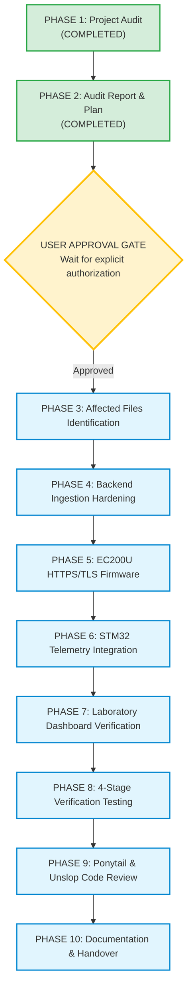

# Engineering Implementation Plan: Water Level Indicator (WLI) HTTPS Migration

**Project:** Panorama Water Tank Monitor — Water Level Indicator (WLI)  
**Project Root:** `C:\Users\User\Documents\Antigravity_soumik\PanoramaWaterTank_NextGen`  
**Target Communication:** `STM32F401 -> Quectel EC200U-CN -> 4G LTE Cat-1 -> Public HTTPS POST -> FastAPI Backend -> Laboratory Dashboard`  
**Execution Standard:** Section 15 Execution Sequence & Gating Checkpoint  
**Date:** November 17, 2026  
**Status:** Phase 1 & 2 Complete — Awaiting User Approval to Proceed to Firmware Changes

---

## 1. Roadmap Overview & Phased Sequence

This implementation plan defines the precise, multi-phase technical workflow required to migrate the Water Level Indicator telemetry from legacy MQTT/Ubidots to a hardened, authenticated HTTPS JSON document architecture.

---

## 2. Phase-by-Phase Technical Execution Breakdown

### Phase 1: Complete Project Audit (Status: COMPLETED)
- **Objective:** Audit the entire repository, hardware interfaces, protocols, and security posture.
- **Completed Actions:**
  - Audited AST via Graphify knowledge graph (10,375 nodes).
  - Inspected STM32 sensor math, EC200U AT drivers, ESP32 BLE isolation, and legacy MQTT.
  - Identified and sanitized the exposed legacy Ubidots token in `tests/test_e2e_integration.cpp`.
  - Audited battery autonomy under active LTE current profiles.
  - Executed all 4 non-destructive test harnesses (100% pass rate).

### Phase 2: Produce Audit Report and Implementation Plan (Status: COMPLETED)
- **Objective:** Author formal reports, mapping tables, and the implementation roadmap.
- **Completed Deliverables:**
  - `AUDIT_REPORT.md`: Exhaustive evaluation, component classification table, and security analysis.
  - `IMPLEMENTATION_PLAN.md`: Step-by-step phased execution plan with strict gating.
  - `MQTT_TO_HTTPS_MAPPING.md`: Complete 1-to-1 mapping table ensuring zero telemetry loss.
  - `TELEMETRY_SCHEMA.md`: Authoritative JSON document schema and API endpoint specifications.

---

### GATING CHECKPOINT: USER APPROVAL
> [!IMPORTANT]
> **MANDATORY STOP & VERIFY:**  
> In compliance with Section 15 of the engineering instructions, the agent halts here. No firmware files (`EC200U/*.cpp`, `EC200U/*.h`) will be modified, no hardware will be flashed, and no credentials will be committed until the user reviews the Phase 1 & 2 findings and grants explicit approval to proceed.

---

### Phase 3: Affected Files Identification & Architectural Boundaries
*To be executed upon user approval:*
- **Scope of Affected Files:**
  - `EC200U/ec200u_config.h`: Public API endpoint URL, APN, bearer token macro, telemetry intervals.
  - `EC200U/ec200u.cpp` & `ec200u.h`: AT transaction timeout calibration, error backoff timing.
  - `EC200U/ec200u_tls.cpp` & `ec200u_tls.h`: ISRG Root X1 CA string injection, SNI configuration.
  - `EC200U/ec200u_http.cpp` & `ec200u_http.h`: JSON serialization matching `TELEMETRY_SCHEMA.md`.
  - `EC200U/ec200u_freertos.cpp`: Mutex lock duration ($<1\,\mu\text{s}$), watchdog reset coupling.
  - `HTTPS_Server/backend/main.py` & routes: File upload and direct JSON POST validation.
- **Untouched Subsystems (Strict Isolation):**
  - Zero modifications to desktop Qt SCADA application (`src/core/`, `src/domain/`, `src/security/`).
  - Zero modifications to React/Capacitor mobile application (`apps/mobile/`).
  - Zero modifications to RS485 Modbus RTU slave engine.
  - Zero modifications to ESP32 BLE firmware.

### Phase 4: Implement Backend File Reception and JSON Extraction
*To be executed upon user approval:*
- Harden `POST /api/telemetry/upload` to parse incoming multipart `.json` files and raw stream uploads.
- Extract individual measurement variables, assign server-side ISO 8601 UTC `received_at` timestamps, and route to bounded in-memory circular storage.
- Validate file-size cap (1 MB threshold enforced by `limit_request_size` middleware).

### Phase 5: Implement HTTPS/TLS Communication for EC200U
*To be executed upon user approval:*
- Ensure `AT+QSSLCFG="cacert"` injects the `ISRG Root X1` certificate authority into RAM/NVRAM.
- Configure `AT+QSSLCFG="seclevel",1,1` (verify server certificate against CA).
- Configure `AT+QSSLCFG="sni",1,1` and `AT+QHTTPCFG="sslctxid",1`.
- Verify rejection of invalid or untrusted certificates in hardware AT state machine.

### Phase 6: Integrate Actual STM32 Telemetry Data
*To be executed upon user approval:*
- Wire the physical 4–20mA ADC transducer calculation to the `TelemetrySnapshot` struct.
- Validate calibration points: $0.500\,\text{V} \rightarrow 0.0\,\text{cm}$ ($0\%$), $2.500\,\text{V} \rightarrow 75.0\,\text{cm}$ ($50\%$), $4.500\,\text{V} \rightarrow 150.0\,\text{cm}$ ($100\%$).
- Validate fault traps: Wire-break disconnect ($<0.200\,\text{V}$) and short circuit ($>4.850\,\text{V}$).
- Atomically copy snapshot into FreeRTOS transmission queue without blocking real-time ADC sampling.

### Phase 7: Implement Minimal Browser Monitoring Interface
*To be executed upon user approval:*
- Verify Laboratory Dashboard (`HTTPS_Server/frontend/index.html`).
- Ensure real-time polling updates water level gauge, percentage, raw voltage, battery, alarm status, and recent upload errors without requiring manual browser refresh.
- Confirm zero inline API secrets or hardcoded tokens in frontend scripts.

### Phase 8: Security, Unit and Integration Testing
*To be executed upon user approval:*
- **Stage A (Backend Tests):** Valid/invalid JSON, missing fields, oversized files, unauthorized tokens.
- **Stage B (HTTPS Tests):** Valid TLS, untrusted CA rejection, expired cert rejection, hostname mismatch.
- **Stage C (Firmware Tests):** Modem AT state machine, PDP activation, ring buffer framing, URC parsing.
- **Stage D (End-to-End Tests):** Sensor ADC $\rightarrow$ STM32 $\rightarrow$ EC200U $\rightarrow$ LTE $\rightarrow$ HTTPS $\rightarrow$ Backend $\rightarrow$ Dashboard.

### Phase 9: Ponytail and Unslop Code Review
*To be executed upon user approval:*
- **Ponytail Review:** Verify the smallest complete change; eliminate unnecessary wrappers, boilerplate, or over-engineered abstractions.
- **Unslop Audit:** Remove duplicated logic, robotic phrasing, and dead code.

### Phase 10: Production Documentation & Handover
*To be executed upon user approval:*
- Update `CHANGELOG.md`, `DEPLOYMENT_GUIDE.md`, and generate the final acceptance report against the Section 14 criteria checklist.
