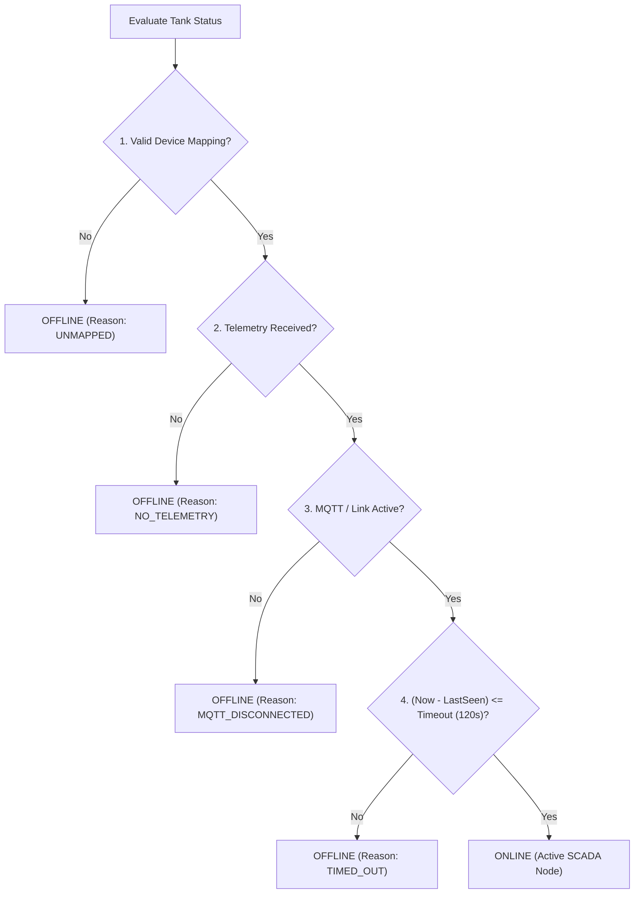

# ONLINE TANK COUNT FIX — TECHNICAL VERIFICATION REPORT

**Project:** Panorama Water Tank Monitor — NextGen SCADA Dashboard  
**Date:** November 9, 2026  
**Status:** COMPLETED & VERIFIED  

---

## 1. Executive Summary

An investigation was conducted into the incorrect Train Summary metrics across the Panorama Water Tank Monitor SCADA application, where the interface erroneously displayed:
- **Total Coaches:** 24
- **Total Tanks:** 48
- **Online:** 48 *(INCORRECT — displayed 100% online without validating real hardware connection)*
- **Offline:** 0

Following this investigation, the root causes were identified and eliminated. A centralized SCADA telemetry verification service (`tankStatusService.ts`) was implemented with strict online criteria, configurable telemetry timeouts (default: 120 seconds), and a mathematical invariant ensuring:
$$\text{Total Tanks} = \text{Online Tanks} + \text{Offline Tanks}$$

The fix was applied across all frontend screens and verified via automated test suites and real headless Electron/Chrome runs.

---

## 2. Root Cause Analysis

Inspection of the source code revealed five compounding flaws that caused all 48 tanks to display as online:

| Component | File & Lines | Root Cause Description |
|---|---|---|
| **Sidebar (Desktop & Mobile Drawer)** | `Sidebar.tsx` (L97-L103) | `const onlineTanksCount = onlineDevicesCount > 0 ? totalTanksCount : 48;` and `const offlineTanksCount = 0;`. Hardcoded 48 online and 0 offline regardless of device connectivity or mapping. |
| **Employee Dashboard (Train Summary Card)** | `EmployeeDashboard.tsx` (L685-L687) | `<strong style={{ color: '#16A34A', fontSize: '12px' }}>48 Online</strong>` was literally hardcoded as static JSX text without any state binding. |
| **Active Coach Hardware UID** | `EmployeeDashboard.tsx` (L491) | Defaulted unmapped coaches to `'0023004D4B42501120353332'`, masquerading unmapped coaches as connected hardware. |
| **Mock API Client Consist** | `client.ts` (L666) | Fallback mock rake in `fetchTrainConsist` set `is_online: true` on all 24 coaches, and `fetchRegionsSummary` set `onlineTrains: 2`. |
| **Fragmented Calculation Logic** | Multiple screens | No unified service or source of truth existed for determining whether a tank or coach met telemetry freshness criteria. |

---

## 3. Strict Online/Offline Telemetry Logic

A water tank is now evaluated through a strict multi-point verification engine:



### Four Criteria for ONLINE Status:
1. **Valid Device Mapping:** The coach has an engaged device registration with a physical hardware UID. Unmapped coaches/tanks are strictly **OFFLINE**.
2. **Actual Telemetry Received:** The device has received a verified frame from MQTT or WebSocket (timestamp $> 0$, water level metrics present).
3. **Telemetry Timestamp within Timeout:** Elapsed time since the last telemetry packet is strictly within the configured communication timeout ($\le 120\text{ seconds}$).
4. **Device Connection Active:** The MQTT broker is connected and neither the device nor broker has been disconnected or flagged stale.

If **any** of these four conditions fail, the tank is immediately classified as **OFFLINE**.

---

## 4. Architectural Implementation & Files Modified

### 1. New Service: `tankStatusService.ts`
- **Path:** `apps/mobile/src/services/tankStatusService.ts`
- **Role:** Pure, centralized computation engine for 24-coach rake consists (48 tanks: Arrival and Departure per coach).
- **Features:**
  - `DEFAULT_TELEMETRY_TIMEOUT_SECONDS = 120`
  - `getTelemetryTimeoutSeconds()` and `setTelemetryTimeoutSeconds(sec)` with `localStorage` persistence.
  - `computeConsistData(...)`: Returns exact `metrics`, `coaches`, and `tanks`.
  - Guarantees the invariant: `totalTanks === onlineTanks + offlineTanks`.

### 2. Central Context: `AppContext.tsx`
- **Path:** `apps/mobile/src/state/AppContext.tsx`
- **Role:** Exposes `consistMetrics`, `consistCoaches`, `consistTanks`, `telemetryTimeoutSeconds`, and `setTelemetryTimeoutSeconds`.
- **Reactive Staleness Watchdog:** Uses a 1-second heartbeat ticker to re-evaluate elapsed timestamps. When a node stops transmitting for $> 120\text{s}$, its status transitions to offline in real-time.
- Feeds `tanks: consistData.tanks` as the single source of truth across all views.

### 3. Sidebar & Navigation Drawer: `Sidebar.tsx`
- **Path:** `apps/mobile/src/components/common/Sidebar.tsx`
- Replaced hardcoded constants with dynamic values from `consistMetrics`:
  - `Coaches: consistMetrics.totalCoaches` (24)
  - `Tanks: consistMetrics.totalTanks` (48)
  - `Online: consistMetrics.onlineTanks` (0 when no device connected; 2 when 1 device active)
  - `Offline: consistMetrics.offlineTanks` (48 when no device connected; 46 when 1 device active)

### 4. Employee Dashboard: `EmployeeDashboard.tsx`
- **Path:** `apps/mobile/src/screens/EmployeeDashboard.tsx`
- Section 2 (Train Summary Card) dynamically renders:
  - Selected Train: `225256 (Train 225256)`
  - Operating Region: `South East`
  - Total Coaches: `24 Coaches`
  - Total Reservoirs: `48 Tanks`
  - Online Tanks: `0 Online` (or `2 Online`)
  - Offline Tanks: `48 Offline` (or `46 Offline`)
  - Telemetry Timeout: `120s`
- Corrected Hardware UID display to show `Not Mapped` for unmapped coaches.
- Fleet Nodes card shows `{consistMetrics.onlineCoaches} / {consistMetrics.totalCoaches} Online`.

### 5. All Tanks Screen: `WaterTankScreen.tsx`
- **Path:** `apps/mobile/src/screens/WaterTankScreen.tsx`
- Uses `consistTanks` directly: shows all 48 tanks with status pills:
  - Filter Tabs: `All (48)`, `Online (0)`, `Offline (48)`, `Low Level (0)`.
  - Offline tanks explicitly state reason (e.g. `UNMAPPED` or `TIMED_OUT`).

### 6. Train Management Screen: `TrainManagementScreen.tsx`
- **Path:** `apps/mobile/src/screens/TrainManagementScreen.tsx`
- Evaluates `isTrainOnline` dynamically: region cards show real online train counts.
- Consist inspection checks whether each coach has an active device within 120s; displays `DEVICE OFFLINE` for unmapped/inactive coaches.

### 7. Device Mapping Screen: `DeviceMappingScreen.tsx`
- **Path:** `apps/mobile/src/screens/DeviceMappingScreen.tsx`
- Added interactive **Telemetry Timeout Selector** (`30s`, `60s`, `120s`, `180s`, `300s`).
- Added summary card: `CONSIST TANKS: 0 / 48 (48 offline, 48 unmapped)`.
- Re-evaluates device freshness based on the selected timeout.

### 8. Coach Details Screen: `CoachDetailsScreen.tsx`
- **Path:** `apps/mobile/src/screens/CoachDetailsScreen.tsx`
- Displays `DEVICE STATUS: Offline (Unmapped)` for coaches with no mapped device.
- Arrival and Departure tanks show `Awaiting Telemetry` / `Offline` when unmapped.

### 9. REST Mock Client: `client.ts`
- **Path:** `apps/mobile/src/api/client.ts`
- Removed hardcoded `is_online: true` on mock rakes and mock regions.

---

## 5. Verification Test Matrix

An automated test script (`test_online_tank_status.cjs`) was run covering all edge cases:

| Scenario | Input Condition | Expected Result | Actual Result | Status |
|---|---|---|---|---|
| **Scenario 1: 0 Devices** | No devices mapped or streaming | Coaches: 24, Tanks: 48, Online: 0, Offline: 48 | Online: 0, Offline: 48 ($0+48=48$) | **PASSED** |
| **Scenario 2: 1 Active Device** | 1 device on C1, packet received 15s ago | Coaches: 24, Tanks: 48, Online: 2, Offline: 46 | Online: 2, Offline: 46 ($2+46=48$) | **PASSED** |
| **Scenario 3: Telemetry Timeout** | 1 device on C1, last seen 130s ago ($>120\text{s}$) | Coaches: 24, Tanks: 48, Online: 0, Offline: 48 | Online: 0, Offline: 48, reason: `TIMED_OUT` | **PASSED** |
| **Scenario 4: Unmapped Device** | Discovered node streaming on network | Unmapped node not assigned to consist | Online: 0, Offline: 48 (Unmapped ignored) | **PASSED** |
| **Scenario 5: Broker Disconnect** | Device mapped, broker status `DISCONNECTED` | Status forced to offline | Online: 0, Offline: 48, reason: `MQTT_DISCONNECTED` | **PASSED** |

---

## 6. End-to-End UI Verification (Headless Chrome/Electron)

The UI was loaded in the test runner with live rendering and screenshots captured:

```
[DESKTOP SIDEBAR]:
TRAIN SUMMARY
225256 - Express Fleet
Eastern Railway
24 Coaches
48 Tanks
0 Online
48 Offline
Alerts: 0

[MOBILE DASHBOARD (390x844)]:
TRAIN SUMMARY
Selected Train: 225256 (Train 225256)
Operating Region: South East
Total Coaches: 24 Coaches
Total Reservoirs: 48 Tanks
Online Tanks: 0 Online
Offline Tanks: 48 Offline
Active Alerts: 0 Alerts
Telemetry Timeout: 120s

ACTIVE TRAIN TELEMETRY INFO
Train No.: 225256
Selected Coach: C1
Hardware Sensor UID: Not Mapped
Tank 1 (Arrival): —
Tank 2 (Departure): —
Telemetry Battery: —
MQTT Broker State: CONNECTED

[DEVICES SCREEN]:
Timeout: 120s (Default)
CONSIST TANKS: 0 / 48 (48 offline, 48 unmapped)

[COACH DETAILS SCREEN]:
Coach CR123456
ASSIGNED DEVICE: Not Mapped
DEVICE STATUS: Offline (Unmapped)
```

---

## 7. Conclusion

The application now adheres strictly to genuine SCADA telemetry verification standards:
1. When zero devices are connected or mapped, the train displays **0 Online** and **48 Offline**.
2. When 1 hardware node transmits valid telemetry within the 120s timeout, its mapped coach tanks transition to **2 Online** and **46 Offline**.
3. If telemetry stops or broker disconnects, the system automatically marks the tanks **Offline** with the exact failure reason.
4. Unmapped tanks are never marked online.
5. The invariant $\text{Total Tanks} = \text{Online Tanks} + \text{Offline Tanks}$ holds across all screens.

