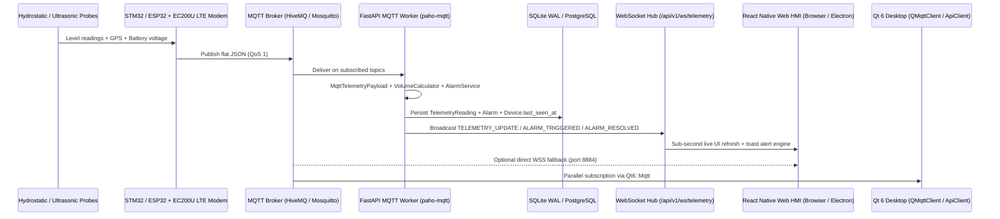

# API, MQTT & Hardware Communication Architecture

---

## 1. End-to-End Telemetry & Control Flow



---

## 2. MQTT Broker Configuration & Topic Map

### Default Broker Settings
- **FastAPI Backend (`backend/app/core/config.py`, `backend/.env`):**
  - Default host: `broker.hivemq.com` (`MQTT_BROKER_PORT=1883`, `MQTT_TLS_PORT=8883`, `MQTT_USE_TLS` configurable).
  - Local Mosquitto broker is also configured via `config/mosquitto.conf` (listener `1883`, anonymous allowed) and observed listening on `127.0.0.1:1883` on this office desktop.
- **Frontend Browser Client (`apps/mobile/src/services/mqttService.ts`):**
  - Connects via `paho-mqtt 1.1.0` over **WebSocket Secure (`WSS`, port `8884`)** directly to HiveMQ when direct browser MQTT is active.
- **Qt 6 Desktop Client (`src/telemetry/MqttService.cpp`):**
  - Uses `QMqttClient` (`Qt6::Mqtt`) on TCP `1883` or TLS `8883`.

### Active Subscriptions vs Documentation Drift
- **NextGen Backend (`backend/app/mqtt/client.py`):**
  - Subscribes to configured `MQTT_TELEMETRY_TOPIC_FILTER` (`panorama/telemetry/#`), `MQTT_STATUS_TOPIC_FILTER` (`panorama/status/#`), **plus literal device UID topic `"0023004D4B42501120353332"`**.
- **Qt Desktop App (`src/telemetry/MqttConfig.h`):**
  - Default telemetry topic filter observed as `stm32f411/ec200u/telemetry` (configurable).
- **Note on `docs/architecture/MQTT_ARCHITECTURE.md`:** Docs describe `panorama/commands/{device_uid}` and `panorama/broadcast/emergency`, plus nested JSON. Active code uses flat JSON keys documented below.

---

## 3. Telemetry Payload Schemas (Observed in Code)

### Live Flat JSON Payload (Hardware / `mqttService.ts` / `parser.py`)
Example contract seen in `apps/mobile/src/services/mqttService.ts` and `backend/app/schemas/telemetry.py`:

```json
{
  "uid": "0023004D4B42501120353332",
  "trno": "225256",
  "chno": "CR123456",
  "wlp1": 12.1,
  "wlp2": 0.0,
  "cm1": 120.8,
  "cm2": 0.0,
  "wlv1": true,
  "wlv2": false,
  "bat": 83.6,
  "lat": 22.557279,
  "long": 88.352432,
  "speed": 3.4,
  "time": "12:15:39"
}
```
Supported alternate/alias keys accepted by `MqttTelemetryPayload`: `wlvl` -> `wlv1`, `lon` -> `long`, `alt`, `sats`, `v1`, `v2`, `dt`.

### Qt `MqttService.cpp` Adapter Differences
`src/telemetry/MqttService.cpp` parses `uid`, `lat`, `long`/`lon`, `alt`, `speed`, `dt`, `time`, `wlp1`, `wlp2`, `wlv1`, `wlv2`, `chno`:
- Does **not** parse `cm1`, `cm2`, `bat`, `trno`, or `wlvl`.
- Falls back from `wlp1` (`wlv1 == true`) to `wlp2` (`wlv2 == true`), computing height & liters against hardcoded `kAssumedTankHeightCm = 50.0` and `kAssumedTankCapacityL = 60.0`.

---

## 4. Water Level Geometry & Alarm Logic

- **NextGen Volume Engine (`backend/app/services/calculator.py`):**
  - Computes water height (cm), tank fill percentage, and volume (L) from configured vessel dimensions (`DEFAULT_TANK_CAPACITY_LITERS=20.0`, `DEFAULT_TANK_HEIGHT_CM=50.0`, `DEFAULT_TANK_AREA_M2=0.04`, or per-tank DB record).
  - Assigns 4-tier capacity ranks: `LOW`, `MODERATE`, `GOOD`, `HIGH` *(differs from older doc terms `FULL`/`ADEQUATE`)*.
- **Backend Alarm Evaluator (`backend/app/services/alarm_service.py`):**
  - Default thresholds (`config.py`): `DEFAULT_WARNING_THRESHOLD=20`, `DEFAULT_CRITICAL_THRESHOLD=10`, `DEFAULT_OVERFLOW_THRESHOLD=100`.
  - Triggers: `SENSOR_FAULT`, `CRITICAL_LOW`, `WARNING_LOW`, `OVERFLOW`, and `VOLTAGE_FAULT` (`< 10.5V`).
  - Auto-resolves `"OPEN"` alarms on recovery inside `backend/app/mqtt/client.py`.
- **Client Notification Engine (`apps/mobile/src/services/alertNotificationService.ts`):**
  - Deduplicates repeated alerts with cooldown suppression and respects the 7 granular toggle keys (`alarm.master_enabled`, etc.).

---

## 5. FastAPI REST & WebSocket API Endpoints (`/api/v1`)

| Module | Key Endpoints | Auth / Access |
| :--- | :--- | :--- |
| **`auth.py`** | `POST /auth/login`, `POST /auth/logout`, `POST /auth/register`, `GET /auth/me` | Public login/register; Bearer JWT + `token_version` |
| **`users.py`** | `GET /users`, `POST /users`, `PATCH/PUT /users/{id}`, `POST /users/{id}/reset-password`, `POST /users/{id}/approve|reject` | `ADMIN` only |
| **`devices.py`** | `GET/POST/DELETE /devices`, coach binding & online status | Authenticated / Admin write |
| **`trains.py`** | `GET/POST/DELETE /trains`, consist hierarchy | Authenticated / Admin write |
| **`tanks.py`** | `GET /tanks`, `GET /tanks/live`, `PATCH /tanks/{id}` | Authenticated |
| **`telemetry.py`** | `GET /telemetry/history` (`range=12h|24h|7d`, LTTB ~100 pts), ingestion helper | Authenticated |
| **`alarms.py`** | `GET /alarms`, `GET /alarms/stats`, `POST /alarms/{id}/acknowledge`, **`POST /alarms/clear`** | Authenticated |
| **`settings.py`** | `GET /settings`, `PUT /settings`, alarm toggle keys (`alarm.*_enabled`) | Admin write |
| **`location.py`** | `GET /location`, corridor stations (`HWH`–`ASN`), train GPS & Haversine track distance (`1.12x` winding factor) | Authenticated |
| **`export.py`** | `GET /export/csv` (RFC 4180 + formula-injection neutralization) | Authenticated |
| **`ws.py`** | `WS /api/v1/ws/telemetry`, `WS /api/v1/ws/alarms` | WebSocket push (`TELEMETRY_UPDATE`, `ALARM_TRIGGERED`, `ALARM_RESOLVED`) |
| **`health.py`** | `GET /health` | Public health check |

---

## 6. Direct Hardware / Third-Party HTTP Integrations

| Integration | NextGen (`apps/mobile` + `backend`) | Qt 6 Desktop (`src/networking/ApiClient.cpp`) |
| :--- | :--- | :--- |
| **Firmware Source Location** | No firmware `.c`/`.cpp` exists inside `PanoramaWaterTank_NextGen` (hardware/modem tooling lives in sibling folders e.g. `EC200U_Development`, `WLI_PCB_FINAL`) | Same |
| **Direct ESP32 REST** | Settings stores `device.host` (`192.168.4.1`) UI-side | Polls `/status`, `/health`, `/history`, `/sync`, `/sync/ack`, `/config` at default `192.168.1.219:80` |
| **Ubidots Cloud** | Stored in Settings DB (`settings.py`, `SettingsScreen.tsx`) & CSP whitelist only; **not actively polled/pushed** | Actively queries `/api/v2.0/devices/~{label}/_/values/last` and `/api/v1.6/devices/{label}/{var}/values` with `X-Auth-Token` |
| **Map Tiles / Routing** | **Leaflet 1.9.4** using OpenStreetMap (`tile.openstreetmap.org`) and Esri World Imagery | Custom Web Mercator tiles (`LocationMap.qml`) + Google Maps Directions API (`LocationManager.cpp`) |

