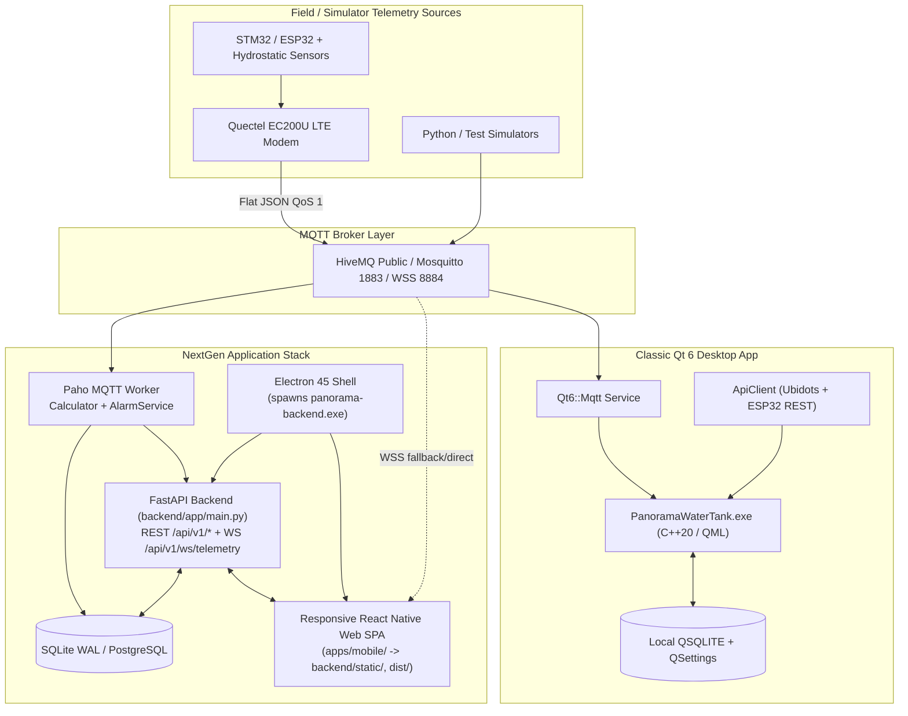

# Project Overview — Panorama Water Tank NextGen

> **Source of Truth:** `C:\Users\User\Documents\Antigravity_soumik\PanoramaWaterTank_NextGen`  
> **Git State at Analysis:** Branch `main`, commit `2f96886` (`2026-11-12 02:25:08 +0530`), plus 3 trailing-newline uncommitted working-tree edits  
> **Scope Note:** Analysis-only documentation derived directly from current source code, build configs, and local environment verification.

---

## 1. Executive Summary

**Panorama Water Tank NextGen** is an Industrial IoT SCADA & HMI platform for real-time water level monitoring, consist/coach tracking, alarm evaluation, historical trending, and CSV reporting across Indian Railway passenger coaches (focused on a 10-station Eastern Railway mainline corridor between Howrah Junction `HWH` and Asansol `ASN`, plus configurable fleet trains).

A critical finding of this analysis is that the repository is an **actively maintained dual-stack codebase**:

1. **NextGen Web / Mobile-Responsive / Electron Stack (Primary Active Development):**
   - **Backend (`backend/`):** Python 3.14 / FastAPI async server with SQLAlchemy 2.0 ORM (SQLite WAL for local/desktop or PostgreSQL 16 via `asyncpg`), Paho-MQTT ingestion worker, LTTB history downsampler, SCADA alarm engine, and WebSocket hub.
   - **Frontend HMI (`apps/mobile/`):** Single responsive React 18 + TypeScript + `react-native-web` + Leaflet SPA bundled with **`esbuild`** (deployed statically to `backend/static/`, `dist/`, and GitHub Pages for mobile/desktop browsers).
   - **NextGen Desktop Shell (`apps/mobile/electron/`):** **Electron 45.1.0** Chromium shell with context-isolated `preload.cjs` that spawns the PyInstaller-frozen backend (`panorama-backend.exe`) or falls back to `backend/venv` / `backend/.venv`.

2. **Classic / Native Qt 6 C++20 & QML Desktop Application (Maintained Alongside NextGen):**
   - **Desktop App (`app/`, `src/`, `qml/`):** Native Windows application compiled with **Qt 6.12.0** (`Quick`, `QuickControls2`, `Svg`, `Network`, `Sql`, `Mqtt`) and **C++20** (`PanoramaWaterTank.exe`). Still receives updates (e.g., `src/domain/TankModel.cpp` was modified in latest commit `2f96886`).
   - Uses local `QSQLITE`, `QSettings`, `Qt6::Mqtt` (`QMqttClient`), direct Ubidots REST API v1.6/v2.0 polling, direct ESP32 REST polling (`192.168.1.219`), and a custom Web Mercator tile renderer (`LocationMap.qml`) with Google Maps Directions API integration (`LocationManager.cpp`).

There is **no native Android (Java/Kotlin/Gradle) or iOS project** in this repository. Mobile access is delivered via the responsive `react-native-web` PWA/SPA and WebSocket/WSS-MQTT browser connectivity.

---

## 2. Technology Stack Matrix (Verified Versions)

| Layer | NextGen Stack (`backend/` + `apps/mobile/`) | Qt Desktop Stack (`app/` + `src/` + `qml/`) |
| :--- | :--- | :--- |
| **Languages** | Python 3.14, TypeScript `^5.4.5`, JavaScript/CSS | C++20, QML (Qt Quick) |
| **Core Frameworks** | FastAPI `0.162.0`, React `18.3.1`, `react-native-web 0.19.13` | Qt `6.12.0` (`Core`, `Gui`, `Quick`, `QuickControls2`, `Svg`, `Network`, `Sql`, `Mqtt`) |
| **Desktop Packaging** | Electron `^45.1.0`, `electron-builder ^26.18.0`, PyInstaller `6.22.3` | CMake (`>= 3.24`, installed `4.4.4`), Ninja (`1.13.2`), MinGW `g++` `13.1.0` |
| **Build / Bundler** | **`esbuild ^0.21.5`** (`apps/mobile/scripts/build.cjs`), `npm` `11.19.0` | CMake + `qt_standard_project_setup` + `qt_add_qml_module` |
| **Databases** | SQLite 3 (WAL mode via `aiosqlite 0.22.1`) / PostgreSQL 16 (`asyncpg 0.32.0`), SQLAlchemy `2.1.6`, Alembic `1.20.1` | Local SQLite (`QSQLITE`) + `QSettings` |
| **MQTT Client** | Backend: `paho-mqtt 2.1.0` (`CallbackAPIVersion.VERSION2`) Frontend: `paho-mqtt 1.1.0` (WSS port `8884`) | `Qt6::Mqtt` (`QMqttClient`) over TCP `1883` / TLS `8883` |
| **HTTP / Realtime** | `uvicorn 0.54.0` REST `/api/v1/*` + native WebSocket `/api/v1/ws/telemetry` | `QNetworkAccessManager` (`ApiClient`) |
| **Mapping** | `leaflet 1.9.4` (OSM Street tiles + Esri World Imagery Satellite tiles) | Custom QML tile renderer (`LocationMap.qml`) + Google Maps API key support (`LocationManager`) |
| **Icons / UI** | `lucide-react 0.378.0`, custom SVG dual-wave fluid tank | Qt Quick `Shape` water wave, custom vector `Icons.qml` / `Theme.qml` |
| **Auth / Security** | `bcrypt` + `python-jose` (HS256 JWT + `token_version` revocation), CSP headers, rate limiter | Local `AuthManager` / `PermissionManager` (`Admin` / `User`) |
| **Testing** | Pytest `9.2.0` (58 Python tests), Node unit/Playwright scripts | CTest (6 C++ test executables via `Qt::Test`) |

---

## 3. High-Level Architecture

---

## 4. Major Implemented Capabilities

- **Dual Operating Roles (`ADMIN`, `EMPLOYEE`):**
  - **Admin Dashboard:** Fleet KPIs, dual arrival/departure tank visualizer, historical trend charts, train/coach consist management, device-to-coach mapping, user onboarding approval/rejection, audit logs, and system settings.
  - **Employee Dashboard (`EmployeeDashboard.tsx` / `UserLoginView.qml`):** Streamlined train/coach tank health monitoring, quick alerts, and read-focused operational view plus personal display scaling preferences.
- **Self-Service Employee Registration & Admin Approval:** Multi-step onboarding wizard (`RegisterScreen.tsx` -> `POST /api/v1/auth/register`) with encrypted document upload validation (`upload_validator.py`) and admin approval workflow (`/api/v1/users/{id}/approve|reject`).
- **Dual-Tank Vessel & Telemetry Modeling:** Supports dual hydrostatic probes (`cm1`/`cm2`, `wlp1`/`wlp2`, `wlv1`/`wlv2`, `bat`) and capacity rank tiers (`LOW`, `MODERATE`, `GOOD`, `HIGH`).
- **Real-Time Alert Engine + Toast Notifications:** Evaluates `CRITICAL_LOW`, `WARNING_LOW`, `OVERFLOW`, `SENSOR_FAULT`, `VOLTAGE_FAULT`, and offline conditions, with deduplicated client-side toast notifications (`alertNotificationService.ts` + `AlertToastBanner.tsx`).
- **Corridor GPS Tracking & Routing:** Live train tracking along the Eastern Railway corridor (`HWH` to `ASN`, 10 stations) with track distance calculation and ETA estimation.
- **Data Export & Reports:** RFC 4180 CSV export (`/api/v1/export/csv`) with formula-injection escaping, plus Qt `HistoryExporter`.

