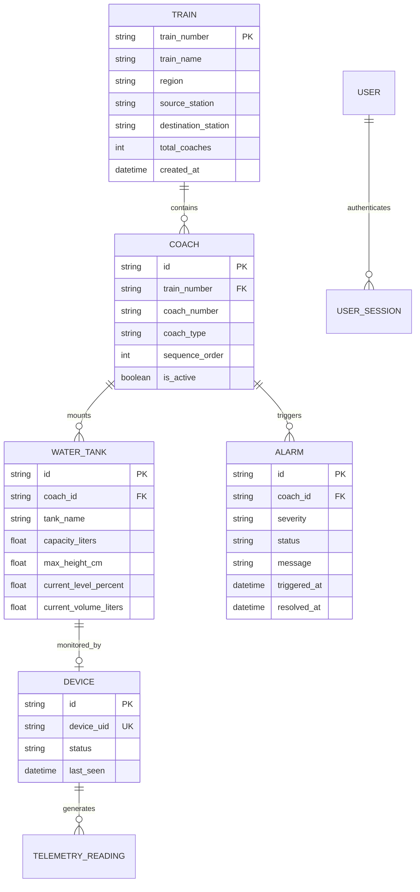

# Database Architecture & Persistence Specifications

**Project:** Panorama Water Tank Monitor (NextGen SCADA)  
**ORM Framework:** SQLAlchemy (Async Engine)  
**Database Backend:** SQLite (Development / Local) · PostgreSQL (Production)  

---

## 1. Schema ER Diagram

---

## 2. Integrity & Persistence Guarantees

1. **Foreign Key Enforcement:** Foreign keys with `ON DELETE CASCADE` ensure that deleting a train automatically cleans up its associated coaches, tanks, and alarms.
2. **Transaction Atomicity:** Multi-table mutations (e.g. creating a train with default coaches) execute inside explicit transactions (`async with db.begin():`).
3. **Lookup Seed Database:** Express trains database cache ([express_trains_db.json](file:///C:/Users/soumi/OneDrive/Documents/Antigravity/PanoramaWaterTank_NextGen/backend/data/express_trains_db.json)) pre-populates official Indian Railways train metadata for instant offline lookups.

