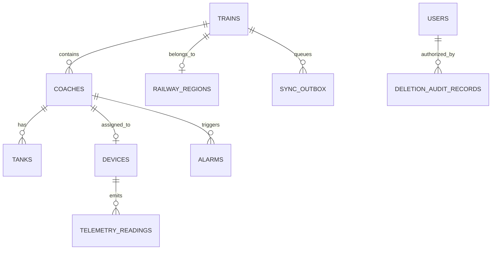

# DATABASE RETENTION & PERSISTENCE AUDIT: PANORAMA WATER TANK MONITOR
**Component:** Database Layer (SQLAlchemy 2.0 Async / PostgreSQL / SQLite WAL)  
**Production Target:** Render Managed PostgreSQL (`panorama-postgres`)  
**Development/Edge Target:** SQLite 3 in WAL Mode (`panorama_dev.db`)  
**Audit Standard:** Zero Data Loss & Permanent Retention Verification  
**Date:** November 15, 2026

---

## 1. PERSISTENCE ARCHITECTURE & ZERO-TTL VERIFICATION

The database schema is designed for continuous operational history retention without destructive purging.

### Zero-TTL Policy Audit
- **`telemetry_readings`:** Holds every incoming sensor reading (`device_uid`, `train_number`, `coach_number`, `water_level_percent`, `water_level_cm`, `battery_voltage`, `latitude`, `longitude`, `timestamp`). No TTL, auto-vacuum deletion, or retention limit is configured. Historical trends remain available indefinitely.
- **`trains` & `coaches`:** Core fleet definitions remain permanent. The application does not drop, wipe, or overwrite existing trains on reboot or redeployment.
- **`devices`:** Hardware registry retains device mapping and operational state (`AVAILABLE`, `ASSIGNED`, `MAINTENANCE`).
- **`settings`:** Key-value configuration persists across server restarts.
- **`audit_events` & `deletion_audit_records`:** Immutable append-only audit tables.



---

## 2. DELETION PROTECTION & AUDIT TRAIL

To comply with railway SCADA regulatory guidelines, accidental data destruction is blocked:

1. **Soft-Delete by Default:**
   - Entities (`trains`, `devices`, `tanks`) feature an `is_deleted: bool` column defaulting to `False`. Standard queries filter by `is_deleted == False`.
2. **Strict Admin-Only Hard Deletions:**
   - Hard deletion is restricted to users with the `ADMIN` role via `get_current_admin_user`.
3. **Immutable Audit Trail (`deletion_audit_records`):**
   - Whenever an entity is deleted, a record is inserted into `deletion_audit_records` recording:
     - `entity_type` (`TRAIN`, `COACH`, `DEVICE`, `USER`)
     - `entity_id`
     - `deleted_by` (Username / Employee ID)
     - `timestamp` (UTC ISO string)
     - `metadata_json` (Full snapshot of deleted entity state before removal).

---

## 3. TRANSACTIONAL OUTBOX PATTERN & IDENTIFIED DEFECT

The database incorporates a `sync_outbox` table to provide transactional event persistence:

### Table Schema (`sync_outbox`):
- `id`: Auto-increment integer primary key
- `event_id`: UUID unique event identifier
- `event_type`: Event string (`TRAIN_CREATED`, `COACH_UPDATED`, `DEVICE_ASSIGNED`, etc.)
- `entity_type`: String (`train`, `coach`, `device`, `tank`)
- `entity_id`: String
- `operation`: String (`CREATE`, `UPDATE`, `DELETE`)
- `payload_json`: Full JSON serialized entity snapshot
- `status`: String (`PENDING`, `PUBLISHED`, `FAILED`)
- `retry_count`: Integer
- `created_at` / `published_at`: Datetime UTC

### Critical Defect Identified: Unstarted Outbox Worker
In `backend/app/services/outbox_service.py`, the functions `flush_outbox_events()` and `outbox_worker_loop()` are defined:
```python
async def outbox_worker_loop(interval_seconds: float = 3.0) -> None:
    logger.info("Outbox worker loop started.")
    while True:
        try:
            flushed = await flush_outbox_events()
            await asyncio.sleep(interval_seconds)
        except asyncio.CancelledError:
            break
        except Exception as e:
            await asyncio.sleep(interval_seconds * 2)
```
**Audit Finding:** `lifespan` in `backend/app/main.py` never starts this background task!
- **Consequence:** Events inserted into `sync_outbox` remain permanently in `status = 'PENDING'`. Disconnected clients polling the outbox or relying on outbox re-transmissions receive no updates.
- **Required Fix:** Add `asyncio.create_task(outbox_worker_loop())` to `main.py` application startup.

---

## 4. SCHEMA MIGRATION & POSTGRESQL VS SQLITE COMPATIBILITY

### Production (PostgreSQL on Render):
- Uses connection pooling (`pool_size=10`, `max_overflow=20`, `pool_recycle=3600`).
- Strict relational constraints and foreign key enforcement.

### Development (SQLite in WAL Mode):
- Single-file database with WAL mode enabled (`PRAGMA journal_mode=WAL`).
- `PRAGMA busy_timeout=10000` prevents immediate locking errors during concurrent reads and writes.

### Programmatic Migration Flaw in `_sync_schema_migration()`:
- `_sync_schema_migration()` in `database.py` handles column additions dynamically for `users`, `trains`, `devices`, and `tanks`.
- **Omission:** It lacks column synchronization for `railway_regions` and `railway_zones`.
- **Remedy:** Add automatic column migration for `railway_regions` (`id`, `updated_at`) to guarantee cross-version backward compatibility.

---
*Database Retention & Persistence Audit completed.*
