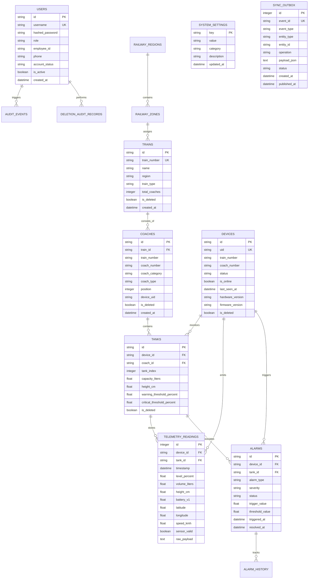

# Database Schema Documentation — Panorama Water Tank Monitor (NextGen)

**Authoritative Database**: PostgreSQL 16 (Production) / SQLite WAL Mode (Local Embedded Development)  
**ORM Framework**: SQLAlchemy 2.0 (Async Engine via `asyncpg` / `aiosqlite`)  
**Migration Tool**: Alembic (Revisions 001, 002, 003)  
**Schema Status**: AUDITED, NORMALIZED, AND PERSISTENT  

---

## 1. Relational Entity Diagram



---

## 2. Table Specifications

### 2.1 `users`
- Primary Key: `id` (UUID, String 36)
- Unique Constraints: `username`, `email`
- Default Seeded Accounts: `@admin` (Role: ADMIN), `@employee` (Role: EMPLOYEE)

### 2.2 `trains`
- Primary Key: `id` (UUID, String 36)
- Unique Constraint: `train_number` (String 32)
- Soft Deletion: `is_deleted` (Boolean default `False`)

### 2.3 `coaches`
- Primary Key: `id` (UUID, String 36)
- Foreign Key: `train_id` references `trains(id)` on delete CASCADE
- Indexes: `ix_coaches_train_id`, `ix_coaches_train_number`, `ix_coaches_coach_number`, `ix_coaches_device_uid`

### 2.4 `devices`
- Primary Key: `id` (UUID, String 36)
- Unique Constraint: `uid` (String 64)
- Operational States: `DISCOVERED`, `AVAILABLE`, `REGISTERED`, `ENGAGED`

### 2.5 `tanks`
- Primary Key: `id` (UUID, String 36)
- Foreign Keys: `device_id` references `devices(id)`, `coach_id` references `coaches(id)`
- Unique Index: `(device_id, tank_index)`

### 2.6 `telemetry_readings`
- Primary Key: `id` (BigInteger autoincrement)
- Foreign Keys: `device_id` references `devices(id)`, `tank_id` references `tanks(id)`
- High-Volume Index: `(device_id, timestamp DESC)`

### 2.7 `alarms` & `alarm_history`
- Primary Key: `id` (UUID, String 36)
- States: `OPEN`, `ACKNOWLEDGED`, `RESOLVED`

### 2.8 `sync_outbox`
- Primary Key: `id` (Integer autoincrement)
- Unique Constraint: `event_id` (UUID)
- Statuses: `PENDING`, `PUBLISHED`, `FAILED`

---

## 3. Database Connection Pooling Configuration

```python
engine_kwargs = {
    "echo": False,
    "future": True,
}
if is_sqlite:
    engine_kwargs["connect_args"] = {"check_same_thread": False, "timeout": 30.0}
    engine_kwargs["poolclass"] = NullPool
else:
    engine_kwargs["pool_size"] = 10
    engine_kwargs["max_overflow"] = 20
    engine_kwargs["pool_pre_ping"] = True
    engine_kwargs["pool_recycle"] = 3600
```
