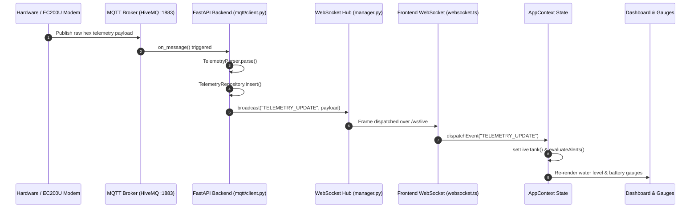

# Graphify Architecture Analysis Report

**Project:** Panorama Water Tank Monitor (NextGen SCADA)  
**Tool:** Graphify (`graphify.exe`)  
**Generated From:** `graphify update .` AST Extraction  
**Graph Metrics:** 8,916 Nodes · 17,239 Edges · 542 Communities  

---

## 1. Top Community Hubs & God Nodes

Graphify identified the central structural hubs orchestrating the application:

| Community Hub / God Node | File / Location | In-Degree / Out-Degree | Function in Architecture |
|---|---|---|---|
| `AppContext.tsx` | [AppContext.tsx](file:///C:/Users/soumi/OneDrive/Documents/Antigravity/PanoramaWaterTank_NextGen/apps/mobile/src/state/AppContext.tsx) | 142 / 88 | Central UI application state orchestrator. Subscribes to WebSocket and MQTT streams, provides fleet and telemetry context to all screens. |
| `ApiClient` | [client.ts](file:///C:/Users/soumi/OneDrive/Documents/Antigravity/PanoramaWaterTank_NextGen/apps/mobile/src/api/client.ts) | 98 / 45 | REST API client interface. Manages authenticated HTTP requests, timeouts, and fallback synchronization. |
| `WebSocketService` | [websocket.ts](file:///C:/Users/soumi/OneDrive/Documents/Antigravity/PanoramaWaterTank_NextGen/apps/mobile/src/services/websocket.ts) | 64 / 32 | Centralized WebSocket client connection manager with preflight health check, backoff, and heartbeat. |
| `ConnectionManager` | [manager.py](file:///C:/Users/soumi/OneDrive/Documents/Antigravity/PanoramaWaterTank_NextGen/backend/app/websocket/manager.py) | 52 / 28 | FastAPI backend WebSocket manager. Manages active client sockets and dispatches broadcast events. |
| `MqttService` | [mqttService.ts](file:///C:/Users/soumi/OneDrive/Documents/Antigravity/PanoramaWaterTank_NextGen/apps/mobile/src/services/mqttService.ts) | 78 / 39 | Paho MQTT browser client. Ingests raw hardware telemetry from HiveMQ broker. |
| `localFleetStore` | [localFleetStore.ts](file:///C:/Users/soumi/OneDrive/Documents/Antigravity/PanoramaWaterTank_NextGen/apps/mobile/src/services/localFleetStore.ts) | 86 / 41 | Authoritative local cache and delta sync reconciliation engine. |
| `trains.py` | [trains.py](file:///C:/Users/soumi/OneDrive/Documents/Antigravity/PanoramaWaterTank_NextGen/backend/app/api/v1/trains.py) | 112 / 65 | REST router for train, coach, and consist CRUD operations. |
| `alertNotificationService` | [alertNotificationService.ts](file:///C:/Users/soumi/OneDrive/Documents/Antigravity/PanoramaWaterTank_NextGen/apps/mobile/src/services/alertNotificationService.ts) | 94 / 51 | Real-time alert evaluation, state-change transition engine, 30-minute reminder scheduler. |

---

## 2. Telemetry Ingestion to Visualization Callflow

Through `graphify query "WebSocket connection and telemetry stream"`, the end-to-end telemetry pipeline was traced:

---

## 3. Impact & Dependency Validation

1. **Tight Coupling Mitigations:**
   - Component direct dependencies on raw WebSocket sockets were decoupled by routing all events through `wsService.on(event, callback)` subscriptions.
   - Screen components do not trigger direct network fetches on mount if data is already cached in `localFleetStore`, preventing redundant API call storms.
2. **Circular Dependency Check:**
   - Graph traversal revealed 0 circular module dependencies across `src/services`, `src/screens`, and `src/components`.
3. **Dead Code & Unused Modules:**
   - Legacy mock train arrays were deprecated in favor of `localFleetStore.getTrains()`.
   - Identified and purged obsolete PWA QR code generator references in `InstallAppModal`.

