# PRIORITY FIX ROADMAP: PANORAMA WATER TANK MONITOR
**Execution Guide:** Severity-Ranked Implementation & Remediation Sequence  
**Audit Standard:** Zero-Defect Production Readiness  
**Target Date:** November 15, 2026

---

## 1. COMPREHENSIVE ROOT CAUSE ANALYSIS & ISSUE MATRIX

The audit identified 28 distinct issues across the architecture. The table below catalogs all issues with root causes, impacts, files, and recommended fixes:

| Issue ID | Module | File & Location | Severity | Root Cause | Impact | Recommended Fix | Dependencies |
| :--- | :--- | :--- | :---: | :--- | :--- | :--- | :--- |
| **`CRIT-01`** | Database | `backend/app/core/database.py` (L130-180) | **CRITICAL** | `_sync_schema_migration` omits `railway_regions` column alteration | 10 integration tests fail; train/region lookup throws `no such column: railway_regions.id` on SQLite | Add `ALTER TABLE railway_regions ADD COLUMN id VARCHAR(36)` and `updated_at DATETIME` | None |
| **`CRIT-02`** | Sync / Outbox | `backend/app/main.py` (L35-65) | **CRITICAL** | `outbox_worker_loop()` defined in `outbox_service.py` is never started in `lifespan` | Events in `sync_outbox` remain pending indefinitely; offline sync fails | Add `asyncio.create_task(outbox_worker_loop())` to startup lifespan | `outbox_service.py` |
| **`CRIT-03`** | MQTT | `backend/app/mqtt/client.py` (L109-112) | **CRITICAL** | Hardcoded UID subscriptions (`0023...`, `0026...`) in `on_connect` | Unregistered new hardware publishing to UID root topics are ignored | Remove hardcoded strings; standardize on wildcard `panorama/telemetry/+` | None |
| **`CRIT-04`** | Frontend UX | `apps/mobile/src/config/apiConfig.ts` | **CRITICAL** | Render free-tier cold-start (45s) exceeds 15s axios timeout | Modal "API Server Unavailable" shown to operators upon first visit | Implement 60s cold-start timeout, exponential retry, and waking status banner | None |
| **`HIGH-01`** | Outbox Pattern | `backend/app/api/v1/*.py` | **HIGH** | Only `trains.py` writes to `sync_outbox`; devices/tanks/settings bypass outbox | Disconnected client sync relies entirely on live WS; no event log recovery | Add outbox writes to `devices.py`, `tanks.py`, and `settings.py` mutations | `CRIT-02` |
| **`HIGH-02`** | MQTT Resiliency| `backend/app/mqtt/client.py` (L140-160) | **HIGH** | Reconnect loop lacks exponential backoff jitter on broker loss | Potential log spam or connection storm on unstable networks | Implement exponential backoff with jitter in Paho reconnect callback | None |
| **`HIGH-03`** | Frontend State | `apps/mobile/src/context/AppContext.tsx` | **HIGH** | Out-of-order WebSocket frames could overwrite newer local states | Rare state glitch during rapid multi-user edits | Validate incoming sync `version` against local cached version before updating | None |
| **`HIGH-04`** | Firmware Buffering| `WLI_DOCS/architecture/firmware.md` | **HIGH** | No flash circular buffer protocol for cellular dead zones | Telemetry lost when train passes through mountain tunnels | Implement SPI Flash ring buffer with timestamped burst publish upon LTE reconnect | MCU Firmware |
| **`HIGH-05`** | WebSocket Scaling| `backend/app/websocket/manager.py` | **HIGH** | In-memory connection set limits broadcasting to single server process | Multi-worker uvicorn deployment cannot sync clients across workers | Integrate Redis Pub/Sub backend for distributed WebSocket broadcast | Redis service |
| **`HIGH-06`** | Code Bloat (Unslop)| `apps/mobile/src/screens/EmployeeDashboard.tsx` | **HIGH** | Monolithic 133 KB file mixes map, plots, forms, and SCADA tables | Unnecessary re-renders and poor maintainability | Decompose into 3 sub-components (`FillingCard`, `MiniPlot`, `ConsistTable`) | None |
| **`HIGH-07`** | Code Bloat (Unslop)| `apps/mobile/src/screens/SettingsScreen.tsx` | **HIGH** | Monolithic 107 KB file houses 5 configuration tabs in single state tree | Slow tab switching; brittle state updates | Split into tab sub-components under `src/components/settings/` | None |
| **`HIGH-08`** | God Node | `backend/app/api/v1/trains.py` | **HIGH** | Monolithic router (1,900+ lines) manages trains, coaches, tanks, lookups | High coupling; hard to test isolated features | Refactor into `trains_crud.py`, `train_coaches.py`, and `train_lookup.py` | None |
| **`MED-01`** | Firmware Time | Edge MCU / AT Commands | **MEDIUM** | Clock drifts when GPS lock is lost in covered platforms | Inaccurate telemetry timestamps | Fallback to Quectel EC200U NITZ cellular network time | MCU Firmware |
| **`MED-02`** | Security | `backend/app/core/config.py` | **MEDIUM** | JWT signing key defaults to dev secret if unset | Security risk if deployed without setting `SECRET_KEY` | Raise fatal startup error if `SECRET_KEY` is unset or trivial in production | None |
| **`MED-03`** | Security | `backend/app/api/v1/auth.py` | **MEDIUM** | Rate limiting is memory-based per worker | Distributed brute-force attacks across multiple workers bypass rate limits | Use Redis for distributed IP rate limiting | Redis service |
| **`MED-04`** | Frontend UX | `apps/mobile/src/screens/DevicesScreen.tsx` | **MEDIUM** | Unassigned devices list lacks online/offline visual indicator | Operators cannot tell if available hardware is currently powered on | Add heartbeat pulse indicator based on last telemetry timestamp ($< 2\text{ min}$) | None |
| **`MED-05`** | Desktop / Qt | `src/networking/ApiClient.cpp` | **MEDIUM** | Qt network requests do not retry on network timeout | Desktop HMI loses telemetry if network flickers | Add automatic 3-retry loop in `ApiClient.cpp` | Qt codebase |
| **`MED-06`** | DB Performance | `backend/app/models/telemetry.py` | **MEDIUM** | Single-column indexes on `telemetry_readings` rather than composite | Multi-column time-range queries scan excess index rows | Add composite index `(train_number, coach_number, timestamp DESC)` | None |
| **`MED-07`** | Frontend Cache | `apps/mobile/src/screens/HistoryScreen.tsx` | **MEDIUM** | Fetching historical data re-queries API even if time range hasn't changed | Unnecessary backend load and slow UI response | Implement React Query or local memoized cache for downsampled history | None |
| **`MED-08`** | Frontend A11y | `apps/mobile/src/components/` | **MEDIUM** | Some custom icon buttons lack explicit `aria-label` | Screen readers cannot announce button purpose | Add `aria-label` attributes to all icon-only button elements | None |
| **`MED-09`** | DB Constraint | `backend/app/models/tank.py` | **MEDIUM** | `tanks` table foreign key to `coaches` lacks explicit `ON DELETE CASCADE` | Deleting a coach without manual tank cleanup leaves orphaned tank records | Add `cascade="all, delete-orphan"` on coach-tank relationship | None |
| **`MED-10`** | CORS / Capacitor | `backend/app/main.py` | **MEDIUM** | Capacitor iOS scheme `ionic://` not explicitly present in origin regex | iOS mobile builds may face CORS preflight blocks | Add `^ionic://` to allowed CORS regex pattern | None |
| **`MED-11`** | Logging | `backend/app/mqtt/parser.py` | **MEDIUM** | Unparseable packets log full payload string which could leak malformed bytes | Cluttered error logs on garbage serial data | Log payload hex snippet instead of full raw string | None |
| **`LOW-01`** | Build Bundle | `apps/mobile/vite.config.ts` | **LOW** | Large vendor chunk ($> 800\text{ KB}$) in Vite production build | Slightly slower initial load on 3G cellular connections | Configure manual chunks for `leaflet`, `chart.js`, and `lucide-react` | None |
| **`LOW-02`** | Dead Code | `apps/mobile/src/data/mockData.ts` | **LOW** | Obsolete demo data file still present in source tree | Potential confusion for new maintainers | Remove unused mock fixtures | None |
| **`LOW-03`** | Docs | `docs/` | **LOW** | API docs specify v1.0 schema while implementation is v2.1 | Documentation lag | Synchronize OpenAPI docs with current implementation | None |
| **`LOW-04`** | Desktop Asset | `resources/icons/` | **LOW** | High-res 512x512 icon missing on Linux desktop packages | Blurred desktop launcher icon | Add multi-resolution `.ico` and `.png` icons | None |
| **`LOW-05`** | Script | `scripts/run_audit.py` | **LOW** | Script uses deprecated `optparse` instead of `argparse` | Deprecation warning on Python 3.12+ | Migrate to `argparse` | None |

---

## 2. PHASED IMPLEMENTATION SEQUENCE

```mermaid
flowchart TD
    subgraph Phase_1["Phase 1: Critical Stability & Schema (Immediate)"]
        P1_1["CRIT-01: Fix railway_regions schema in database.py"]
        P1_2["CRIT-02: Start outbox_worker_loop in main.py"]
        P1_3["CRIT-03: Remove hardcoded MQTT device UIDs"]
        P1_4["CRIT-04: Implement Render cold-start waking banner & timeout"]
    end

    subgraph Phase_2["Phase 2: High Priority Sync & Architecture"]
        P2_1["HIGH-01: Add Outbox writes to devices/tanks/settings"]
        P2_2["HIGH-02: Add exponential MQTT reconnect backoff"]
        P2_3["HIGH-03: Enforce monotonic sync versions in AppContext"]
        P2_4["HIGH-06 & 07: Unslop refactor of EmployeeDashboard & Settings"]
        P2_5["HIGH-08: Split trains.py monolithic router"]
    end

    subgraph Phase_3["Phase 3: Medium Priority Ergonomics & Hardening"]
        P3_1["MED-04: Online/Offline heartbeat badge on Devices screen"]
        P3_2["MED-06: Add composite DB index on telemetry_readings"]
        P3_3["MED-09: Enforce ON DELETE CASCADE on coach-tank relation"]
        P3_4["MED-10: Support ionic:// in CORS regex"]
        P3_5["MED-08: Industrial A11y & ARIA labels"]
    end

    subgraph Phase_4["Phase 4: Low Priority Optimizations"]
        P4_1["LOW-01: Vite code-splitting for Leaflet and Chart.js"]
        P4_2["LOW-02: Remove obsolete mock fixtures"]
        P4_3["LOW-05: Modernize legacy maintenance scripts"]
    end

    Phase_1 --> Phase_2
    Phase_2 --> Phase_3
    Phase_3 --> Phase_4
```

---

## 3. VERIFICATION CRITERIA FOR COMPLETION

1. **Phase 1 Verification:**
   - Execute `pytest` across all 82 backend test cases $\rightarrow$ **100% Pass Rate (82/82)**.
   - Verify outbox worker logs `Outbox worker loop started` in backend startup.
   - Test Render cold-start in browser $\rightarrow$ Waking banner appears, zero unhandled errors.
2. **Phase 2 Verification:**
   - Multi-client test: Perform train and device mutations across two browser tabs $\rightarrow$ state syncs in $< 100\text{ms}$ with 0 page refreshes.
   - Verify unslop review: Clean modular component boundaries.
3. **Phase 3 Verification:**
   - High-throughput query benchmark: 10,000 telemetry readings queried with composite index in $< 5\text{ms}$.
4. **Phase 4 Verification:**
   - Production Vite build bundle size $< 450\text{ KB}$ initial JS chunk.

---
*Implementation roadmap formulated under Ponytail lazy senior dev principles.*
