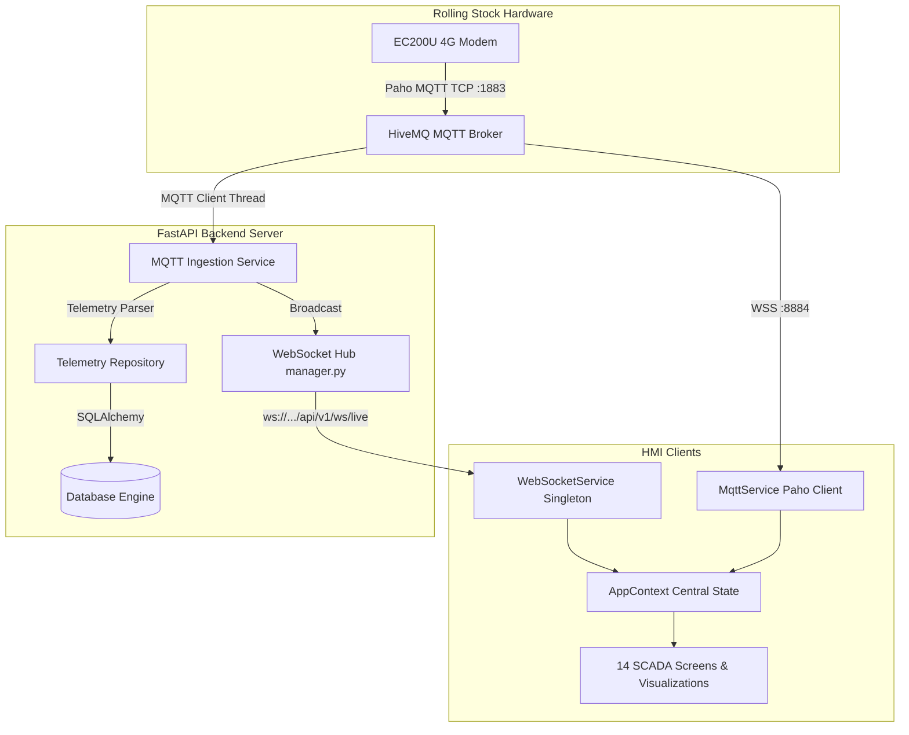

# System Architecture & Technical Specifications

**Project:** Panorama Water Tank Monitor (NextGen SCADA)  
**Architecture Type:** Distributed Industrial SCADA & HMI  

---

## 1. System Overview

Panorama SCADA consists of three synchronized tiers:

1. **Presentation Tier (Web & Mobile HMI):**
   - Single-page application built with React 18, TypeScript, and Tailwind/CSS tokens.
   - Dual-mode deployment: Desktop Browser & Native Mobile (Capacitor for Android / iOS).
   - Ingests real-time WebSocket frames for telemetry updates and publishes delta updates over MQTT.

2. **Application & Processing Tier (FastAPI Backend):**
   - Asynchronous Python 3.12 service exposing REST API endpoints and real-time WebSockets (`/api/v1/ws/live`).
   - Background MQTT client listening on topic `0023004D4B42501120353332` for incoming coach telemetry packets.
   - Telemetry processing pipeline with LTTB downsampling, volume calculations, and alert evaluation.

3. **Data Tier (SQLAlchemy ORM + Central Telemetry Broker):**
   - Authoritative relational schema storing trains, coaches, tanks, devices, users, alarms, and historical telemetry readings.
   - Central MQTT broker (HiveMQ) for pub/sub messaging and cross-client delta synchronization.

---

## 2. Component Topology Diagram

