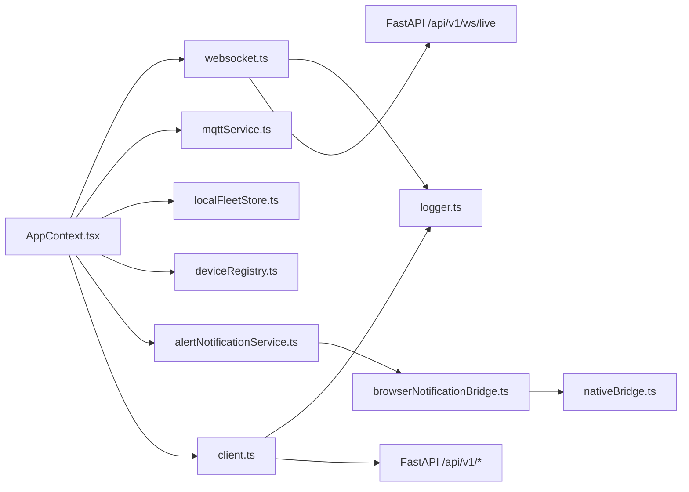

# System Dependency Map

**Project:** Panorama Water Tank Monitor (NextGen SCADA)  
**Analysis Method:** Graphify AST Dependency Extraction  

---

## 1. Key Component Dependencies & Interaction Matrix

### Module Responsibilities:
- **`AppContext`**: Root state provider for active trains, selected consist, alarms, telemetry, and connection status.
- **`websocket.ts`**: Single managed WebSocket connection to backend with ping-pong heartbeat and preflight check.
- **`client.ts`**: HTTP REST client handling JWT headers, 10s request abort timeouts, and fallback synchronization.
- **`localFleetStore.ts`**: Offline read-through cache for fleet metadata with dirty synchronization queues.
- **`alertNotificationService.ts`**: State evaluation engine for water levels, sensor faults, broker status, and 30-min reminders.
- **`logger.ts`**: Structured diagnostic logging with in-memory ring buffer and automated token/password redaction.

