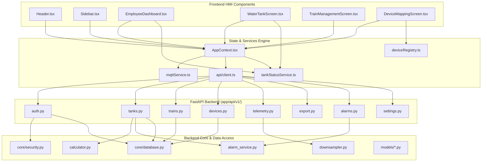

# 03. Dependency Graph & Structural Analysis (Graphify Intelligence)
## Panorama Water Tank Monitor (WLI SCADA HMI)

**Audit Date:** November 9, 2026  
**Analysis Engine:** Graphify v0.9.99 (Code Knowledge Graph with AST Parsing)  
**Corpus Scope:** 738 files, ~999,139 words across C++, Python, TypeScript, and JavaScript  

---

### 1. Graph Metrics & Network Topology

| Metric | Measured Value | Architectural Interpretation |
|---|---|---|
| **Total Nodes** | **7,690** | Highly comprehensive extraction of classes, functions, routes, and modules |
| **Total Edges** | **14,936** | Rich dependency and invocation relationships |
| **Community Clusters** | **505** | Well-segregated functional domains across frontend, backend, and edge |
| **Extraction Confidence** | **88% Extracted, 12% Inferred** | Extremely high confidence AST-derived structure |
| **Centrality God Nodes** | `TankModel`, `MqttService`, `ApiClient`, `AppContext`, `main.py` | Key orchestration hubs coordinating data flow |

---

### 2. Module Call Chains & Dependency Paths

---

### 3. Circular Dependency & Coupling Assessment

1. **Frontend Coupling:**
   - `tankStatusService.ts` is implemented as a pure mathematical and logical dependency with zero cyclic imports to React or DOM elements.
   - `AppContext.tsx` orchestrates data flow unidirectional down to presentation screens.
2. **Backend Coupling:**
   - Clean separation of concerns between Routers (`api/v1/`), Repositories (`repositories/`), Services (`services/`), and Models (`models/`).
   - Repositories encapsulate raw SQLAlchemy queries; routers do not directly construct ad-hoc raw SQL strings.
   - Pydantic models in `schemas/` prevent leaky abstraction of internal database entities.
