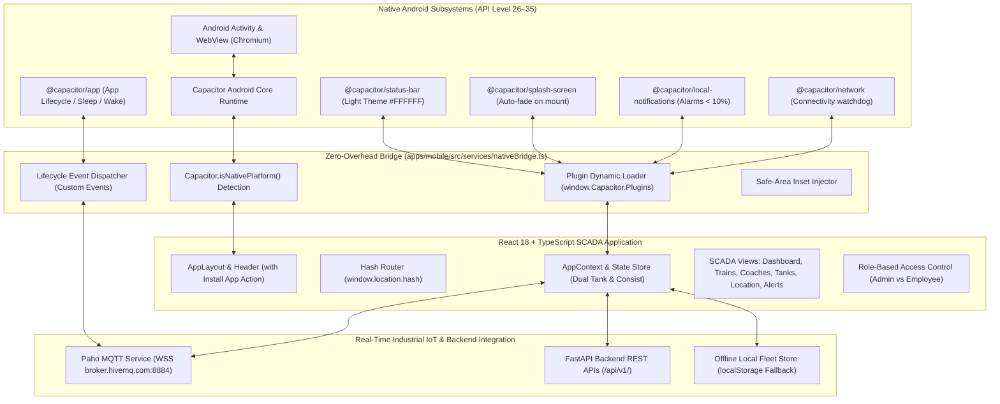
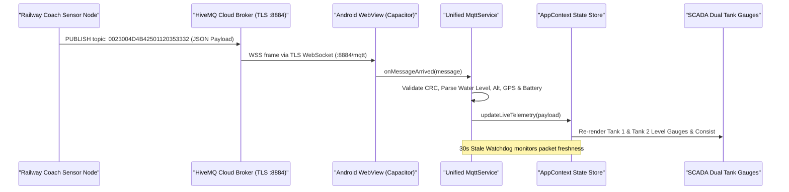
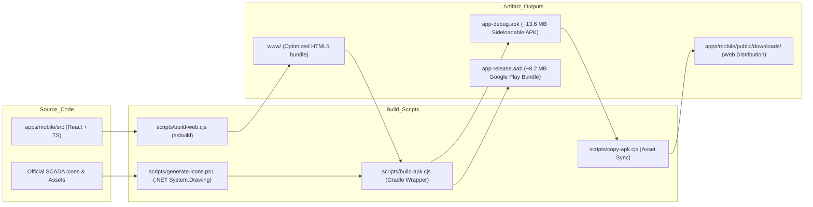

# Panorama Water Tank Monitor — Mobile Architecture Specification

**System:** Panorama Railway Coach Water Level Indicator & SCADA Console  
**Target Architecture:** Native Android (Capacitor 6 Container) + Mobile Web Application  
**App ID:** `com.panorama.watertankmonitor`  
**Document Revision:** 1.0 (November 2026)

---

## 1. High-Level Architecture Topology

The Panorama Mobile SCADA application utilizes a modern **hybrid architecture** that executes the high-performance React + TypeScript web application inside an optimized native Android WebView powered by **Capacitor 6**.

---

## 2. Core Architecture Components

### 2.1 The Native Android Shell (`PanoramaWaterTank_Capacitor/android`)
The native project is generated with Capacitor 6 and configured for compilation with Android Gradle Plugin (AGP) and Gradle 8.2.1 running on OpenJDK 17.

- **Target SDK:** Android 35 (`android-35`).
- **Minimum SDK:** Android 22 (`Android 5.1 Lollipop`), providing broad compatibility across older railway rugged terminals while supporting modern edge-to-edge Android 14/15 devices.
- **Application Class & Activity:** Standard `MainActivity` extending `com.getcapacitor.BridgeActivity`. Capacitor bootstraps the Chromium WebView and loads assets directly from `android/app/src/main/assets/public/` using the secure `https://localhost` scheme.
- **Network Security Configuration:** `res/xml/network_security_config.xml` strictly enforces TLS for all public domains while permitting cleartext traffic to loopback addresses (`127.0.0.1`, `localhost`, and `10.0.2.2`) for local backend development and emulator testing.

### 2.2 The Zero-Overhead Native Bridge (`nativeBridge.ts`)
To adhere to the **Ponytail Principle** (minimal, non-invasive code reuse), the web application in `apps/mobile` remains 100% agnostic to whether it is running in a desktop browser, a mobile browser, or the native Capacitor Android APK:

1. **Passive Feature Detection:** Inspects `window.Capacitor?.isNativePlatform()`. In a regular browser, all plugin hooks immediately no-op with zero CPU overhead and zero console spam.
2. **Dynamic Plugin Interfacing:** Communicates directly through `window.Capacitor.Plugins[PluginName]`. This avoids bundling heavy native wrappers inside the standard web distribution.
3. **Event Relay:** Translates Android lifecycle events (`appStateChange`) into clean JavaScript custom events (`panorama:app_resumed`, `panorama:app_paused`) that telemetry listeners can subscribe to.

### 2.3 Real-Time Telemetry & MQTT Pipeline
Industrial railway coaches publish real-time telemetry packets (water level percentages, tank heights in cm, battery voltages, modem signal RSSI, GPS coordinates, and speed) over MQTT.

- **Broker Connection:** WebSocket over TLS (`wss://broker.hivemq.com:8884/mqtt`).
- **Data Integrity:** Strict GPS coordinate validation (filtering NaN, null island `0,0`, out-of-range bounds, or invalid fix flags).
- **Background Watchdog:** If the Android OS suspends network sockets during deep sleep, the `appStateChange` listener detects resumption and forces an instantaneous MQTT ping and reconnection handshake if needed.

### 2.4 Critical Alarm & Notification Subsystem
The application evaluates telemetry thresholds continuously:

- **Critical Threshold:** Water level $< 10\%$.
- **Warning Threshold:** Water level $< 20\%$.
- **Overflow Threshold:** Water level $> 100\%$.
- **Hardware Faults:** Sensor disconnection (`ERR`), modem offline, or low battery voltage.

When an alarm triggers:
1. An animated on-screen alert banner appears with one-click acknowledgement.
2. In native Android mode, `nativeBridge.scheduleAlarmNotification()` generates an instant Android notification with the official SCADA icon (`ic_stat_panorama`), high priority channel, and audible chime.
3. In browser mode, fallback triggers the HTML5 `Notification` / Service Worker bridge.

---

## 3. UI/UX Design System & Mobile Viewport Strategy

### 3.1 Industrial SCADA Theme
The application adheres strictly to the Panorama Railway SCADA design specifications:
- **Surface:** Clean white `#FFFFFF` cards with `#F8FAFC` slate background.
- **Primary Accent:** Industrial Railway Blue `#2563EB` / `#1D4ED8`.
- **Status Indicators:** Live green `#16A34A` (connected), amber `#D97706` (stale), red `#DC2626` (offline/critical).
- **Typography:** Clean sans-serif (`Inter`, `-apple-system`, `Segoe UI`, `Roboto`).

### 3.2 Mobile-First Navigation
The top mobile header maintains a clean, clutter-free layout:
- **Left:** Hamburger menu toggle + Panorama logo icon.
- **Center:** Current dynamic section name (e.g., *Dashboard*, *Coach Details*, *Location*).
- **Right:**
  - **Install App:** Instant access to APK download and installation guide.
  - **Search:** Full-text fleet and device search with dedicated on-screen search trigger.
  - **Connection Status:** Real-time MQTT Live pill.
  - **Alerts Bell:** Active alarm counter badge.

---

## 4. Build Pipeline & Release Strategy

1. **Independent Build:** Running `npm run build` in `apps/mobile/` only builds the web console; running `npm run build:debug` in `PanoramaWaterTank_Capacitor/` builds the full Android app. Neither directory pollutes the other.
2. **Automated Asset Sync:** Whenever the APK is compiled, `copy-apk.cjs` mirrors the artifact to `apps/mobile/public/downloads/`, `dist/downloads/`, and `backend/static/downloads/` so the website's "Install App" button always downloads the latest build.

