<div align="center">


# PANORAMA WATER TANK MONITOR
### Industrial Railway Water Tank Monitoring and SCADA Management Platform

[](https://github.com/soumikbur/PanoramaWaterTank_NextGen/actions/workflows/ci.yml)
[](https://soumikbur.github.io/PanoramaWaterTank_NextGen/)
[](https://www.python.org/)
[](https://fastapi.tiangolo.com/)
[](https://react.dev/)
[](https://www.typescriptlang.org/)
[](https://mqtt.org/)
[](https://www.postgresql.org/)
[](https://www.electronjs.org/)
[](LICENSE)

<p align="center">
  <strong>Next-Generation Supervisory Control and Data Acquisition (SCADA) System for Long-Distance Passenger Rolling Stock</strong><br/>
  Continuous Hydrostatic Pressure Measurement • Multi-Coach Fleet Ingestion • Sub-Second MQTT Telemetry • Responsive Mobile & Desktop HMI
</p>

[Live Web HMI Demo](https://soumikbur.github.io/PanoramaWaterTank_NextGen/) • [Architecture Specification](docs/architecture/SYSTEM_ARCHITECTURE.md) • [API Documentation](docs/api/API_DOCUMENTATION.md) • [Security Policy](SECURITY.md)

</div>

---

## 1. Visual Showcase

The Panorama Water Tank Monitor features an industrial-grade human-machine interface (HMI) with high visual clarity, fluid SVG water dynamics, and full responsiveness across desktop supervisory workstations and handheld mobile maintenance tablets.

### Desktop Supervisory Workstations (1920 × 1080 / 1366 × 768)

<div align="center">

| Primary SCADA Operations Console | Regional Fleet Consist Management |
|:---:|:---:|
| [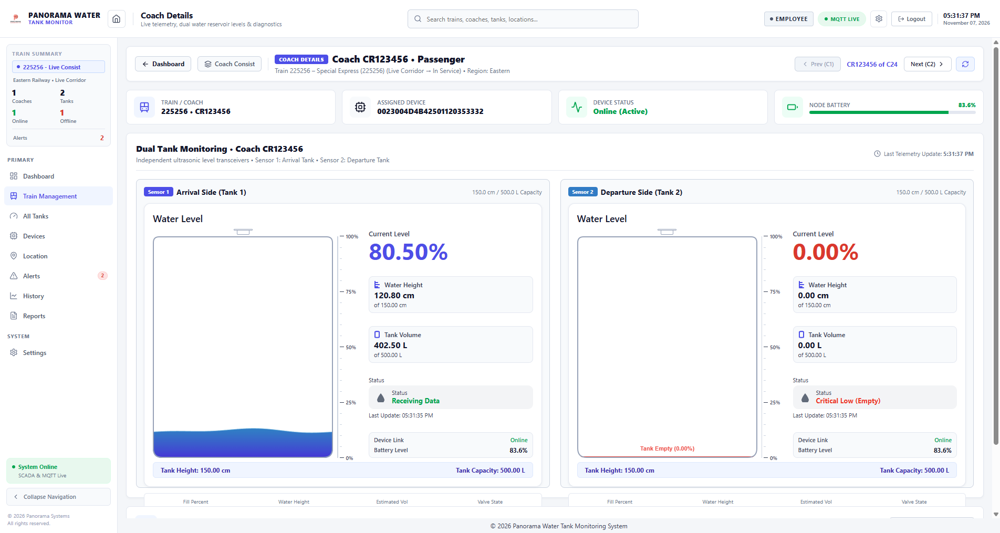](assets/screenshots/desktop/01_dashboard_1920x1080.png) | [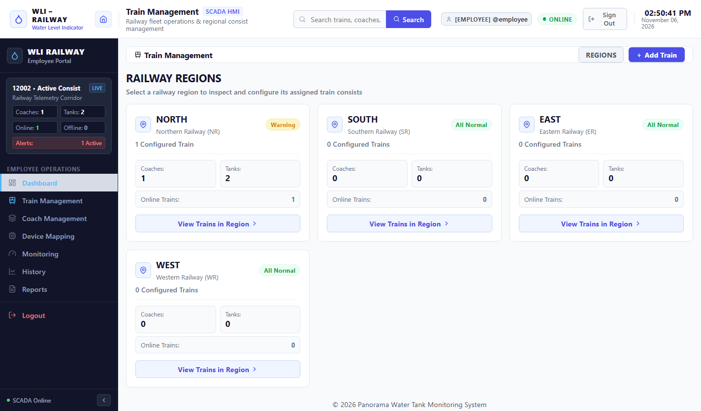](assets/screenshots/desktop/05_train_fleet_management.png) |
| *Fluid physics, 4-tier capacity ranks, active train summary & 5 KPI metrics* | *Northern, Southern, Eastern, and Western railway zone allocation* |

| Multi-Tank Fleet Monitoring Matrix | SCADA Hardware Mapping Matrix |
|:---:|:---:|
| [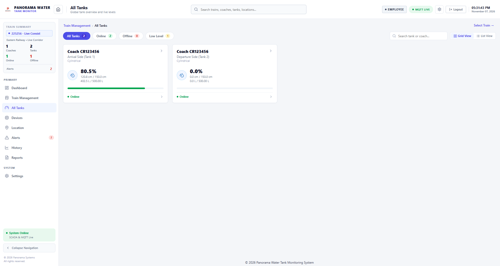](assets/screenshots/desktop/04_all_tanks_monitoring.png) | [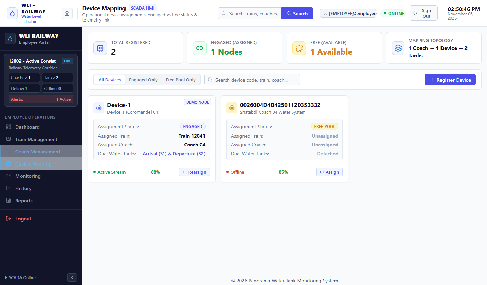](assets/screenshots/desktop/06_device_mapping_scada.png) |
| *Simultaneous fill-level tracking across all rake rakes and coach tanks* | *8-column SCADA device registry, auto-discovery & signal diagnostics* |

| Corridor GPS Tracking & Refill Facilities | LTTB Historical Trend Analytics |
|:---:|:---:|
| [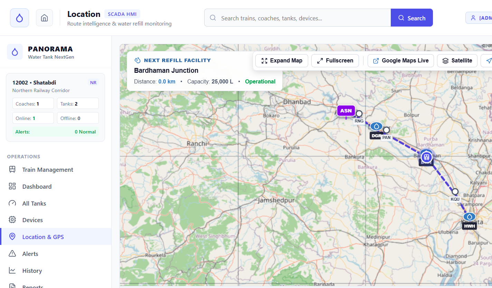](assets/screenshots/desktop/07_gps_corridor_location.png) | [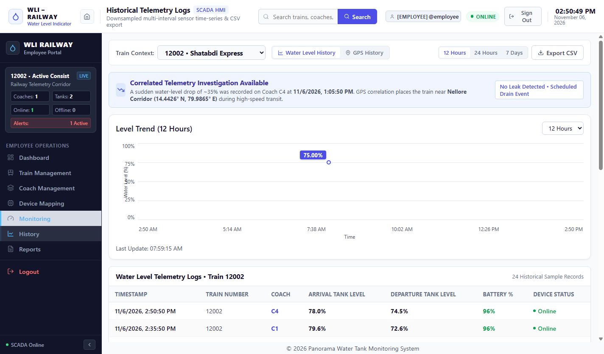](assets/screenshots/desktop/09_historical_telemetry.png) |
| *Howrah–Asansol railway transit corridor with en-route refill verification* | *12h, 24h, 7d downsampled curves preserving operational peaks & troughs* |

| SCADA Alarm Management Console | Operational Report Generation |
|:---:|:---:|
| [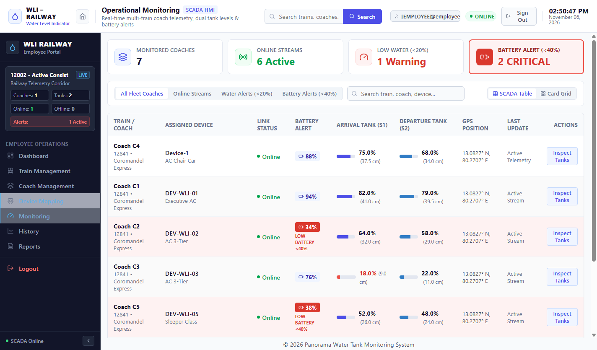](assets/screenshots/desktop/08_alerts_management.png) | [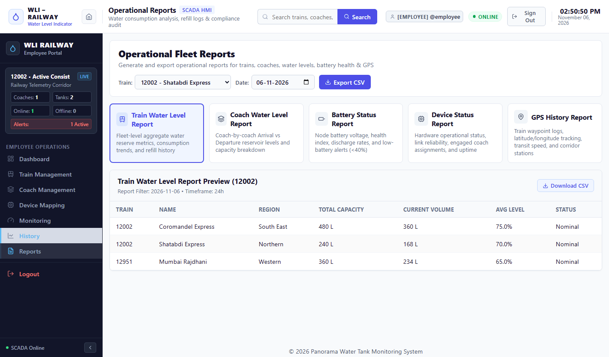](assets/screenshots/desktop/10_reports_analytics.png) |
| *Critical low water triggers, sensor fault isolation, operator acknowledgment* | *Multi-parameter filtering with RFC 4180 sanitized CSV export* |

</div>

### Mobile Handheld Maintenance Console (Responsive Breakpoints: 390 × 844 & 430 × 932)

<div align="center">

| Mobile Dashboard | Slide-in Navigation Drawer | Mobile Train Fleet |
|:---:|:---:|:---:|
| [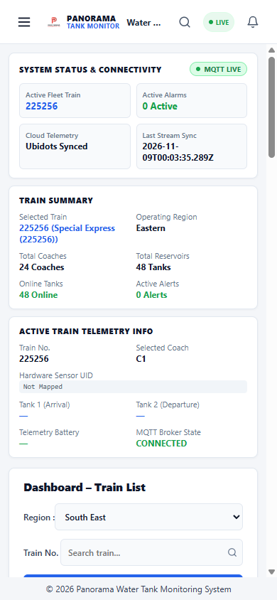](assets/screenshots/mobile/01_mobile_dashboard_390x844.png) | [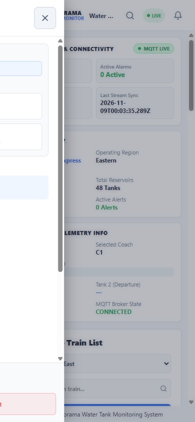](assets/screenshots/mobile/03_mobile_navigation_drawer.png) | [](assets/screenshots/mobile/04_mobile_train_management.png) |
| *Compact 2-column KPI summary, 44px tap targets* | *Blur backdrop, instant route switching* | *Touch-optimized fleet selector cards* |

| Mobile Tank Monitoring | Mobile SCADA Alerts | Mobile Corridor Location |
|:---:|:---:|:---:|
| [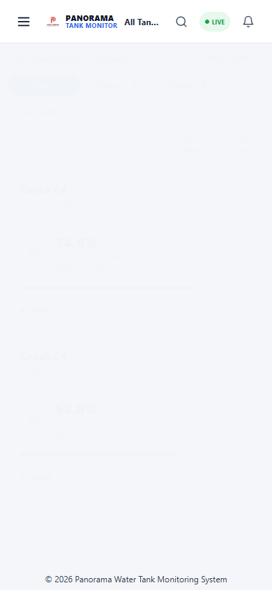](assets/screenshots/mobile/06_mobile_all_tanks.png) | [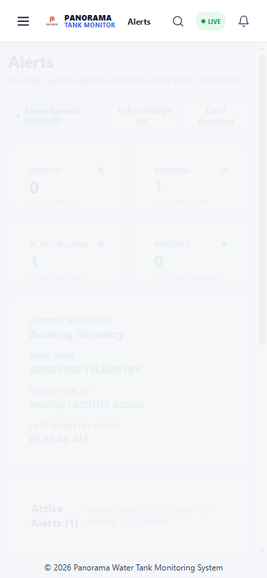](assets/screenshots/mobile/08_mobile_alerts.png) | [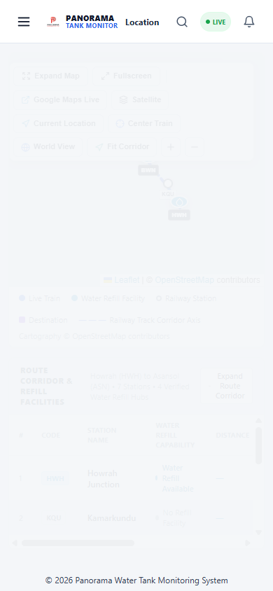](assets/screenshots/mobile/11_mobile_location.png) |
| *Fluid auto-fit cards, zero horizontal scroll* | *2×2 metric grid, operator acknowledgment* | *GPS waypoint coordinates & refill status* |

</div>

> Detailed documentation and full-resolution uncompressed previews are available in the [Screenshot Catalog](assets/screenshots/README.md).

---

## 2. Project Overview

### 2.1 Operational Context
Passenger rail networks operate rakes traversing thousands of kilometres across diverse climatic regions. Ensuring uninterrupted water supply in passenger coaches (restrooms, wash basins, and catering cars) is critical for passenger hygiene, operational reliability, and turnaround punctuality. 

Manual stick or sight-glass inspection during brief station halts is error-prone, hazardous, and incapable of detecting mid-transit leaks or consumption anomalies. The **Panorama Water Tank Monitor (WLI)** automates rolling stock water management by continuously sampling hydrostatic pressure transducers mounted in coach water reservoirs, computing real-time water volume, detecting rate-of-consumption anomalies, and broadcasting telemetry to divisional control centers over LTE and MQTT.

### 2.2 Hierarchical Data Relationship Model
The system organizes rolling stock assets according to operational railway hierarchies:

```
[Railway Zone] (e.g. Eastern Railway)
      │
      └── [Train Fleet / Rake] (e.g. Train 225256 - Express Fleet)
            │
            └── [Passenger Coach] (e.g. Coach B4 - AC 3-Tier)
                  │
                  ├── [Hardware Device] (e.g. UID: 0023004D4B42501120353332)
                  │     ├── Transducer 1: Hydrostatic Current Loop (4–20 mA)
                  │     ├── Environmental: BME280 Temperature/Humidity/Pressure
                  │     └── Modem: Quectel EC200U LTE Cat-1 + GNSS
                  │
                  ├── [Tank 1 - Arrival End] (50.0 cm Height, 20.0 L Capacity)
                  └── [Tank 2 - Departure End] (50.0 cm Height, 20.0 L Capacity)
```

---

## 3. Key Features

- **Real-Time SCADA Dashboard:** Dynamic fluid SVG visualization with dual sine-wave slosh physics rendered at 60 FPS.
- **Genuine Online/Offline Tracking:** Strict 4-point verification engine (`tankStatusService`) confirming device mapping, telemetry receipt, $\le 120$s timeout freshness, and active carrier links. Invariant $\text{Total Tanks} = \text{Online} + \text{Offline}$ verified.
- **Fleet & Consist Management:** Multi-train hierarchy covering Northern, Southern, Eastern, and Western railway divisions with full coach and dual-tank drilling.
- **Hardware Auto-Discovery & Mapping:** 8-column SCADA mapping console tracking edge hardware UIDs, firmware versions, battery voltages, and MAC addresses.
- **Multi-Condition SCADA Alarms:** Threshold detection for Critical Low ($\le 10\%$), Warning Low ($\le 20\%$), Overflow ($\ge 100\%$), and Transducer Circuit Faults (< 0.25V / out-of-range).
- **LTTB Time-Series Downsampling:** Largest-Triangle-Three-Buckets algorithm compresses 1,000 dense telemetry points to ~100 points in < 4.5ms without peak/valley distortion.
- **RFC 4180 CSV Data Export:** Historical telemetry export with automated formula injection neutralization (`=`, `+`, `-`, `@` escaping).
- **Corridor GPS Tracking:** Real-time train tracking along the Howrah–Asansol mainline corridor with verified station refill facilities.
- **Enterprise RBAC & Session Revocation:** Four-tier access hierarchy (`ADMIN`, `EMPLOYEE`, `OPERATOR`, `VIEWER`) with database-backed `token_version` invalidation on logout.
- **Dual Runtime Support:** Standard web browser SPA delivery and native desktop execution via supervised Electron 30 with process tree management.

---

## 4. Technology Stack

| Architectural Layer | Technology | Version | Purpose |
|---|---|:---:|---|
| **Frontend Framework** | React (React Native Web) | `18.3.1` | Cross-platform UI components with native-like ergonomics |
| **Language (Frontend)** | TypeScript | `5.4.5` | Type safety and strict data model contracts |
| **Styling & Theme** | CSS3 Custom Properties | Modern | Dynamic rem scaling (`--app-scale`) and SCADA tokens |
| **Frontend Bundler** | esbuild | `0.21.5` | Standalone sub-second production asset compilation |
| **Desktop Shell** | Electron | `30.0.0` | Native desktop wrapper with context isolation & sandbox |
| **Backend Framework** | FastAPI (Python) | `0.110.0+` | Asynchronous REST endpoints, lifespans, and WebSockets |
| **Language (Backend)** | Python | `3.11 / 3.12` | Core daemon runtime and scientific calculations |
| **ORM & Persistence** | SQLAlchemy | `2.0.28+` | Type-safe asynchronous database access layer |
| **Database Engines** | PostgreSQL / SQLite | `16 / 3.x` | Relational storage (`asyncpg` for prod, `aiosqlite` for dev) |
| **Schema Migrations** | Alembic | `1.13.1+` | Version-controlled declarative database schema migrations |
| **Message Broker** | Eclipse Mosquitto / HiveMQ | `2.0+ / 4.x` | Industrial MQTT telemetry pub/sub over TCP & WSS |
| **MQTT Client** | Paho MQTT (JS & Python) | `2.2.0` | Bidirectional edge-to-cloud messaging with QoS 1 |
| **Downsampling Engine** | LTTB Algorithm | Custom | High-fidelity time-series decimation for charts |
| **Automated Testing** | Pytest & AsyncIO | `9.2.0` | Comprehensive 58-test backend verification suite |

---

## 5. Architectural Topology

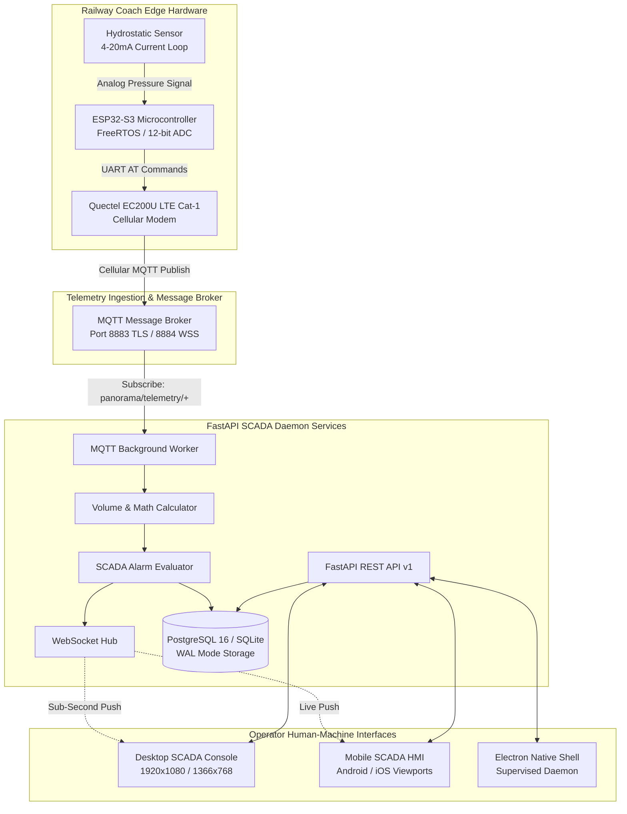

---

## 6. Repository Structure

```text
PanoramaWaterTank_NextGen/
├── .github/
│   └── workflows/
│       ├── ci.yml                     # Continuous Integration & multi-environment test suite
│       └── backend-ci.yml             # GitHub Pages automated deployment pipeline
├── apps/
│   └── mobile/                        # React 18 / React Native Web HMI Application
│       ├── electron/                  # Electron 30 desktop shell & process supervisor
│       │   ├── main.cjs               # Native window lifecycle & daemon supervision
│       │   └── preload.cjs            # Context-isolated secure preload bridge
│       ├── scripts/                   # Build, dev, preview, and test automation scripts
│       └── src/
│           ├── api/client.ts          # REST API client with JWT & demo interceptors
│           ├── components/            # UI components (Header, Sidebar, Modals, Tank SVG)
│           ├── screens/               # SCADA operational views (Dashboard, Tanks, Trains)
│           ├── services/              # tankStatusService, mqttService, deviceRegistry
│           ├── state/AppContext.tsx   # Centralized global telemetry and consist state
│           └── theme/ScadaTheme.ts    # Industrial styling tokens and color hierarchy
├── assets/
│   ├── branding/                      # Vector & high-res project icons and logos
│   └── screenshots/                   # Authentic desktop & mobile application captures
│       ├── desktop/                   # 1920x1080 and 1366x768 supervisory captures
│       ├── mobile/                    # 390x844 and 430x932 handheld responsive captures
│       └── README.md                  # Comprehensive screenshot index and descriptions
├── backend/
│   ├── app/
│   │   ├── api/v1/                    # REST route controllers (auth, tanks, trains, alarms)
│   │   ├── core/                      # Config, async database engine, bcrypt security
│   │   ├── models/                    # SQLAlchemy 2.0 ORM entity declarations
│   │   ├── mqtt/                      # Paho MQTT ingestion worker and telemetry parser
│   │   ├── repositories/              # Parameterized database access operations
│   │   ├── schemas/                   # Pydantic v2 validation contracts
│   │   ├── services/                  # VolumeCalculator, AlarmService, LTTBDownsampler
│   │   └── websocket/                 # Live WebSocket connection manager
│   ├── migrations/                    # Alembic schema versioning scripts
│   ├── requirements.txt               # Locked Python runtime dependencies
│   └── tests/                         # Automated test suite (58 tests, 100% passing)
├── config/
│   ├── .env.example                   # Environment variable template with documentation
│   └── mosquitto.conf                 # Local Mosquitto broker configuration
├── docs/                              # Technical specifications and architectural audits
│   ├── architecture/                  # System topology, data flows, database, MQTT specs
│   ├── development/                   # Workstation setup, frontend, backend, and DB guides
│   ├── api/                           # REST & WebSocket endpoint documentation
│   ├── hardware/                      # Microcontroller BOM & FreeRTOS firmware guide
│   └── security/                      # Vulnerability disclosure policy & production checklist
├── PROJECT_SECURITY_AUDIT/            # 20 Master Enterprise Security Audit Reports
├── .editorconfig                      # Universal IDE indentation & whitespace rules
├── .gitattributes                     # Line-ending normalization (LF for code, CRLF for bats)
├── .gitignore                         # Strict exclusion of secrets, DBs, and build artifacts
├── CHANGELOG.md                       # Version history adhering to Keep a Changelog
├── CONTRIBUTING.md                    # Developer guidelines, branching, and PR standards
├── LICENSE                            # Apache License 2.0
├── package.json                       # Monorepo scripts and esbuild dependencies
└── README.md                          # Master developer documentation
```

---

## 7. Developer Quickstart & Installation

This project is a modular industrial engineering platform requiring configured runtime environments. It is not distributed as a preconfigured one-click binary.

### 7.1 Prerequisites
- **Node.js:** `>= 20.0.0`
- **npm:** `>= 10.0.0`
- **Python:** `>= 3.11.0` (with `venv` and `pip`)
- **Git:** `>= 2.40.0`

### 7.2 Installation Steps

```bash
# 1. Clone repository
git clone https://github.com/soumikbur/PanoramaWaterTank_NextGen.git
cd PanoramaWaterTank_NextGen

# 2. Install frontend workspace dependencies
npm ci

# 3. Configure environment variables (Placeholders only)
cp config/.env.example backend/.env

# 4. Set up backend Python virtual environment
cd backend
python -m venv .venv

# Activate virtual environment
# Windows (PowerShell):
.venv\Scripts\Activate.ps1
# Linux / macOS:
source .venv/bin/activate

# Install backend dependencies
pip install -r requirements.txt
cd ..
```

### 7.3 Running the Stack Locally

```bash
# Terminal 1: Launch FastAPI SCADA Daemon (Port 8000)
cd backend
python -m uvicorn app.main:app --host 127.0.0.1 --port 8000 --reload

# Terminal 2: Launch Frontend Development Server (Port 3000 / 3001)
npm run dev

# Or launch zero-cache static preview server:
npm run preview
```

### 7.4 Running Automated Verification

```bash
# Frontend production compilation check (< 250ms)
npm run build

# Backend verification test suite (58 unit & integration tests)
cd backend
pytest tests/ -v
```

---

## 8. Configuration Reference

All backend and edge parameters are managed via environment variables. Copy `config/.env.example` to `backend/.env` and configure accordingly:

```ini
# Runtime Configuration
ENV=development
DEBUG=true
APP_NAME="Panorama Water Tank Monitor"
APP_VERSION="2.0.0"

# Cryptographic Keys (Generate with: openssl rand -hex 32)
SECRET_KEY=CHANGE_ME_GENERATE_RANDOM_SECRET_KEY
ALGORITHM=HS256
ACCESS_TOKEN_EXPIRE_MINUTES=480

# Database Connection (SQLite WAL for dev, PostgreSQL for production)
DATABASE_URL=sqlite+aiosqlite:///./panorama_dev.db

# MQTT Message Broker
MQTT_BROKER_HOST=broker.hivemq.com
MQTT_BROKER_PORT=1883
MQTT_TLS_PORT=8883
MQTT_USE_TLS=false
MQTT_TELEMETRY_TOPIC_FILTER=panorama/telemetry/+
MQTT_COMMAND_TOPIC_PREFIX=panorama/commands/

# CORS Allowed Origins (JSON Array)
CORS_ORIGINS=["http://localhost:3000","http://localhost:8000","http://127.0.0.1:3001","https://soumikbur.github.io"]
```

---

## 9. Security & Enterprise Compliance Notice

This repository contains developer-oriented source code, engineering specifications, and demonstration interfaces. 

- **No Embedded Production Secrets:** Version control strictly excludes real operational passwords, private API keys, production certificates, and database dumps.
- **Audited Security Controls:** The codebase has undergone comprehensive static and dynamic security auditing covering OWASP Top 10, OWASP ASVS v4.0.3, and OWASP API Top 10. All verified defects (including path traversal, CORS wildcarding, and CSV formula injection) have been remediated in code (see [`PROJECT_SECURITY_AUDIT/`](PROJECT_SECURITY_AUDIT)).
- **Independent Acceptance Notice:** Deployment on live passenger rolling stock requires independent third-party safety assessment, physical network isolation via private cellular APN, dedicated private mTLS broker infrastructure, and formal written authorization from the railway corporation's accredited security authority.

---

## 10. License

This project is licensed under the **Apache License, Version 2.0**. See the [LICENSE](LICENSE) file for full terms and conditions.

```
Copyright 2026 Panorama Systems / Soumik Ghosh

Licensed under the Apache License, Version 2.0 (the "License");
you may not use this file except in compliance with the License.
You may obtain a copy of the License at

    http://www.apache.org/licenses/LICENSE-2.0
```
