<div align="center">


# PANORAMA WATER TANK MONITOR (NEXTGEN)
### Industrial Railway Rolling Stock Water Level Supervisory Control & Data Acquisition (SCADA/HMI)

[](https://github.com/soumikbur/PanoramaWaterTank_NextGen/actions/workflows/ci.yml)
[](https://soumikbur.github.io/PanoramaWaterTank_NextGen/)
[](https://www.python.org/)
[](https://fastapi.tiangolo.com/)
[](https://react.dev/)
[](https://www.typescriptlang.org/)
[](https://www.postgresql.org/)
[](https://capacitorjs.com/)
[](https://mqtt.org/)
[](LICENSE)

<p align="center">
  <strong>Next-Generation Industrial Telemetry Ingestion, Fleet Management, and SCADA Monitoring Platform for Passenger Rolling Stock</strong><br/>
  Submersible Hydrostatic Transducers • Sub-Second MQTT Telemetry • Real-Time Terminal (MQTT.fx Parity) • PostgreSQL 16 Persistence • Device-Adaptive Android HMI
</p>

[Live Web Demo](https://soumikbur.github.io/PanoramaWaterTank_NextGen/) • [System Architecture](docs/ARCHITECTURE.md) • [Backend Docs](docs/BACKEND.md) • [Database Schema](docs/DATABASE.md) • [MQTT Protocol](docs/MQTT_TELEMETRY.md) • [API Reference](docs/API_REFERENCE.md) • [Mobile App](docs/MOBILE_APP.md) • [Deployment](docs/DEPLOYMENT.md) • [Troubleshooting](docs/TROUBLESHOOTING.md)

</div>

---

## 1. Visual Showcase

The **Panorama Water Tank Monitor — NextGen** features an industrial-grade human-machine interface (HMI) with high visual contrast, animated fluid dynamics, and responsive execution across desktop supervisory workstations and handheld mobile maintenance devices.

### 1.1 Desktop Supervisory Workstations (1920 × 1080 / 1366 × 768)

<div align="center">

| Primary SCADA Operations Console | Regional Fleet Consist Management |
|:---:|:---:|
| [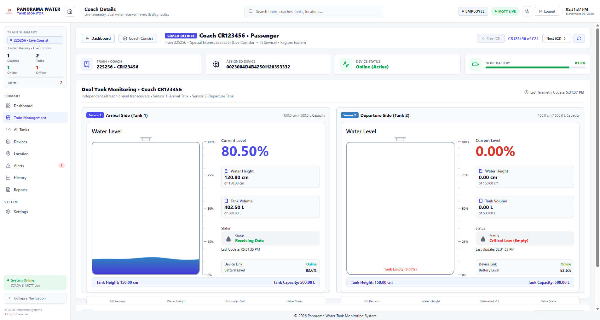](assets/screenshots/desktop/01_dashboard_1920x1080.png) | [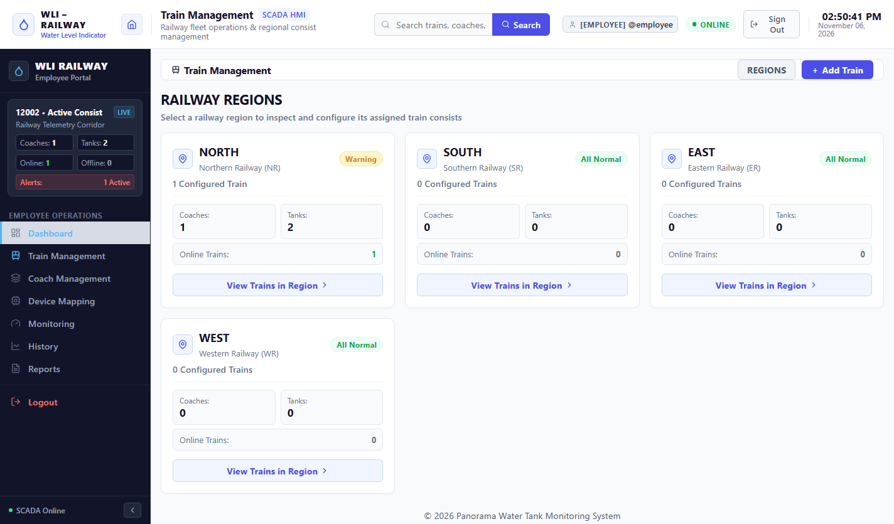](assets/screenshots/desktop/05_train_fleet_management.png) |
| *Fluid physics, 4-tier capacity ranks, active train summary & 5 KPI metrics* | *Consist builder, coach reordering, official composition auto-enrichment* |

| Multi-Tank Fleet Monitoring Matrix | SCADA Hardware Mapping Matrix |
|:---:|:---:|
| [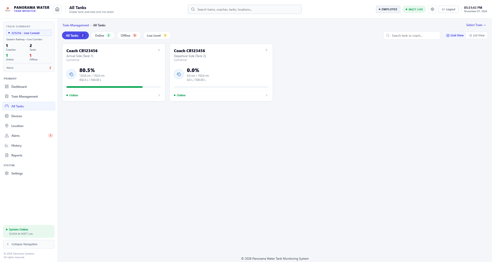](assets/screenshots/desktop/04_all_tanks_monitoring.png) | [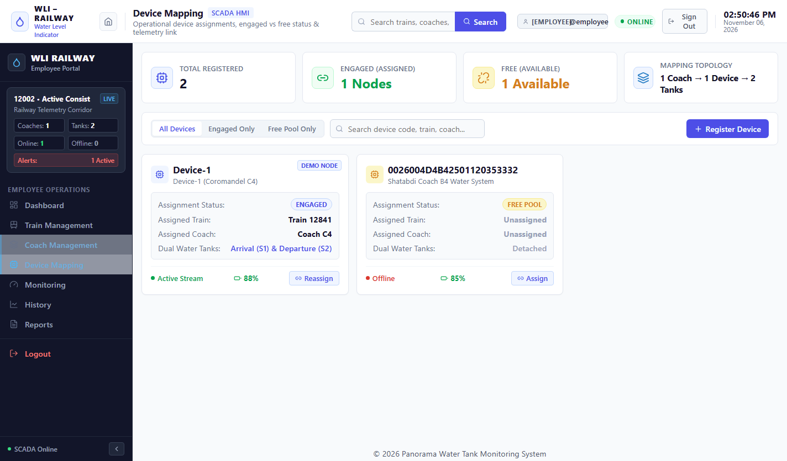](assets/screenshots/desktop/06_device_mapping_scada.png) |
| *Simultaneous fill-level tracking across all train consists and coach tanks* | *SCADA device registry, unmapped hardware auto-discovery & diagnostics* |

| Live MQTT Raw Data Monitor (MQTT.fx Parity) | Minimal Clean JSON Mode (Show Timestamps OFF) |
|:---:|:---:|
| [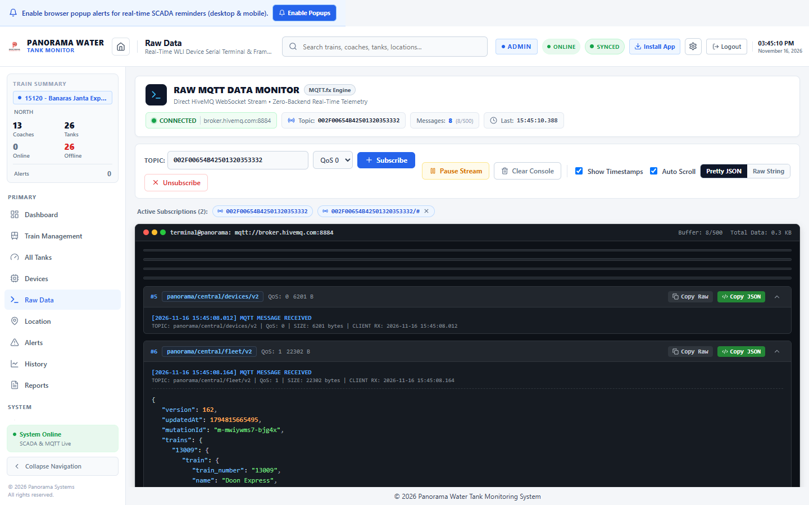](assets/screenshots/desktop/12_raw_mqtt_monitor.png) | [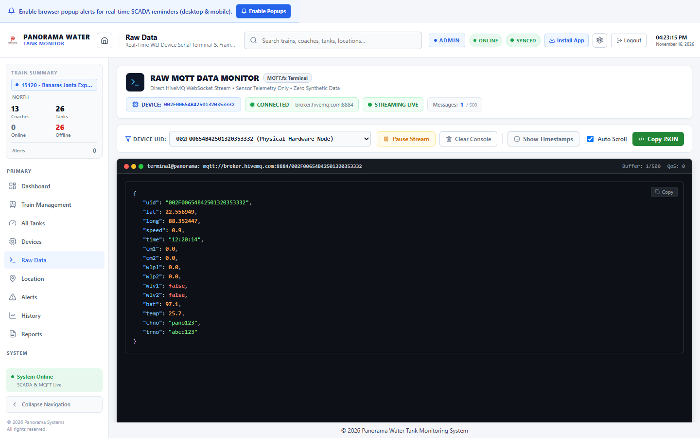](assets/screenshots/desktop/13_raw_mqtt_monitor_clean.png) |
| *Direct HiveMQ WSS stream, topic controls, 500-message buffer & timestamp headers* | *Clean JSON terminal identical to MQTT.fx for real-time edge packet inspection* |

| Corridor GPS Tracking & Refill Facilities | LTTB Historical Trend Analytics |
|:---:|:---:|
| [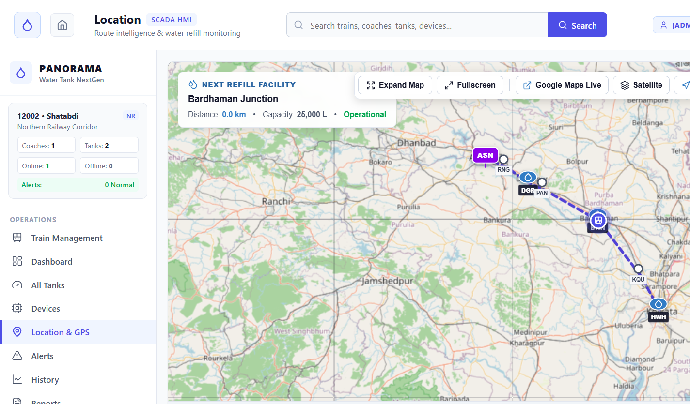](assets/screenshots/desktop/07_gps_corridor_location.png) | [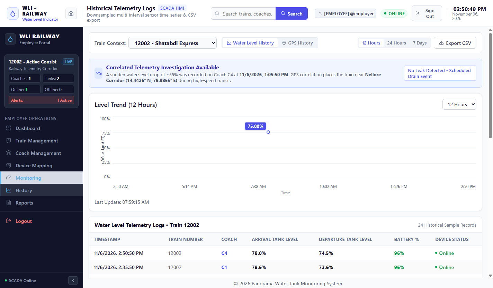](assets/screenshots/desktop/09_historical_telemetry.png) |
| *Howrah–Asansol railway transit corridor with en-route refill station verification* | *12h, 24h, 7d downsampled curves preserving operational peaks & troughs* |

| SCADA Alarm Management Console | Operational Report Generation |
|:---:|:---:|
| [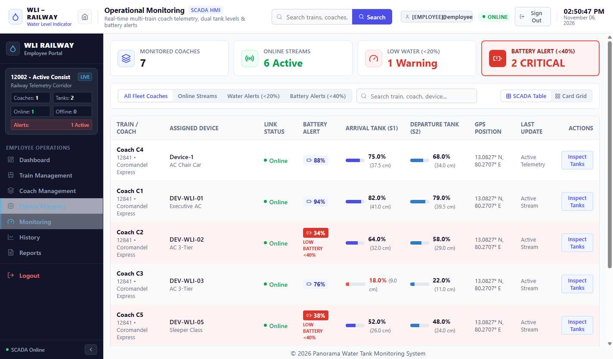](assets/screenshots/desktop/08_alerts_management.png) | [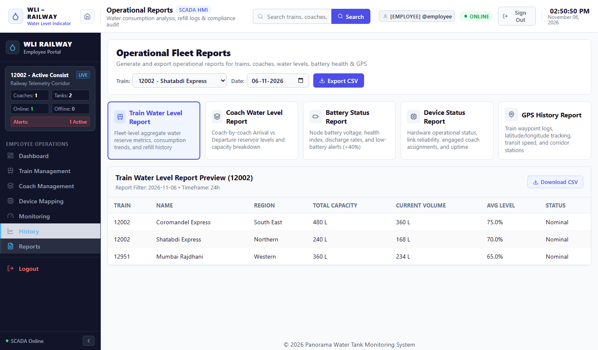](assets/screenshots/desktop/10_reports_analytics.png) |
| *Critical low water triggers, sensor fault isolation, operator acknowledgment* | *Multi-parameter filtering with RFC 4180 sanitized CSV export* |

</div>

### 1.2 Mobile Handheld Maintenance Console (Capacitor Android & Mobile Responsive)

<div align="center">

| Mobile Dashboard | Slide-in Navigation Drawer | Mobile Train Fleet |
|:---:|:---:|:---:|
| [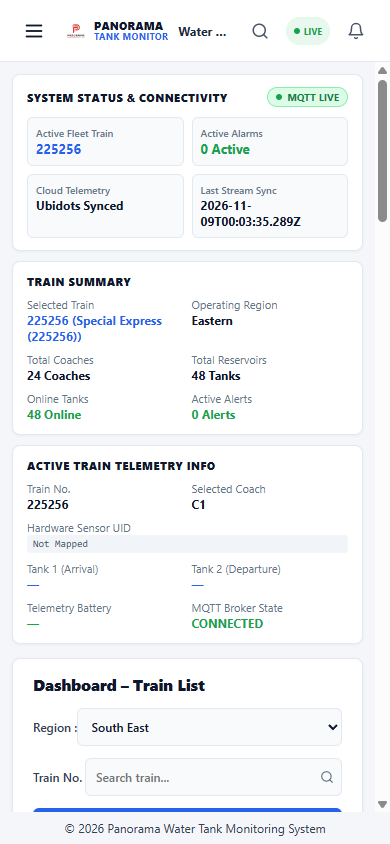](assets/screenshots/mobile/01_mobile_dashboard_390x844.png) | [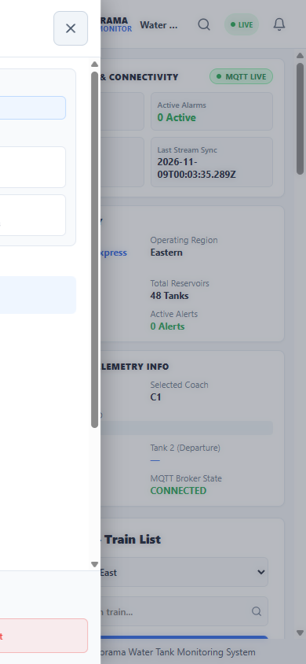](assets/screenshots/mobile/03_mobile_navigation_drawer.png) | [](assets/screenshots/mobile/04_mobile_train_management.png) |
| *Compact KPI summary, adaptive tokens, 44px tap targets* | *Instant route switching & consistent admin navigation* | *Touch-optimized fleet selector cards* |

| Mobile Raw Data Monitor | Mobile SCADA Alerts | Mobile Corridor Location |
|:---:|:---:|:---:|
| [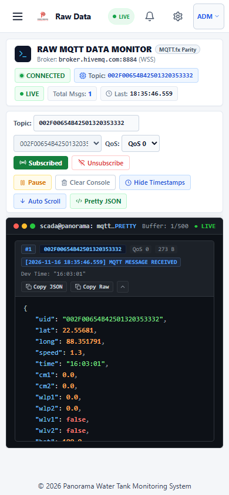](assets/screenshots/mobile/12_mobile_raw_data.png) | [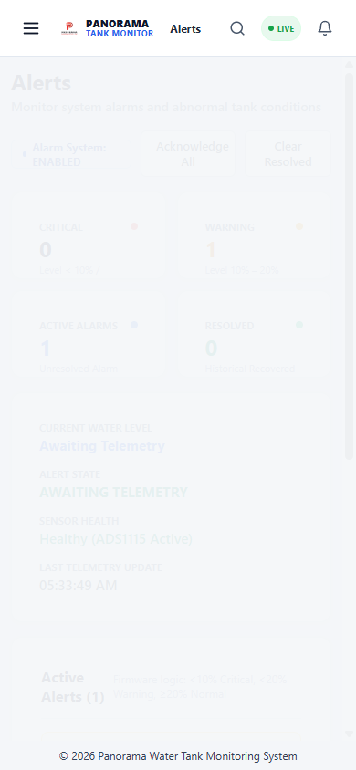](assets/screenshots/mobile/08_mobile_alerts.png) | [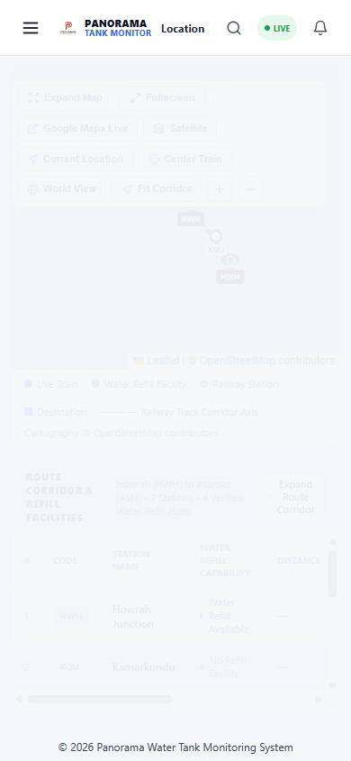](assets/screenshots/mobile/11_mobile_location.png) |
| *Full MQTT.fx terminal controls formatted for Android* | *Native Android notification shade integration* | *GPS waypoint coordinates & refill status* |

</div>

---

## 2. Project Overview

### 2.1 Operational Context
Passenger railway systems operate long-distance rakes that traverse thousands of kilometres across diverse geographical zones. Maintaining an uninterrupted water supply in passenger coaches (restrooms, washbasins, and pantry cars) is critical for passenger hygiene, railway operational standards, and turnaround punctuality.

Manual dipstick inspections during brief station halts are hazardous, labor-intensive, and incapable of detecting mid-transit leaks or anomalous consumption. The **Panorama Water Tank Monitor — NextGen** automates rolling stock water management by continuously sampling submersible hydrostatic pressure transducers mounted in coach reservoirs, computing real-time water volume, isolating sensor circuit faults, and broadcasting telemetry over cellular 4G LTE and MQTT.

### 2.2 Core System Objectives
- **Real-Time Water Level Monitoring**: Continuous volume and percentage calculations across dual cylindrical tanks per coach (Arrival End and Departure End).
- **Railway Train & Consist Management**: Hierarchy covering railway regions, zones, trains, and coach marshaling with drag-and-drop position reordering.
- **Hardware Device Registration & Auto-Discovery**: Automatic detection and mapping of edge IoT hardware nodes broadcasting default strings.
- **Direct MQTT Telemetry Ingestion**: High-throughput messaging over MQTT 3.1.1/5.0 with QoS guarantees.
- **Real-Time MQTT.fx Terminal (Raw Data)**: Direct broker streaming over Secure WebSockets with dual timestamp modes, buffer management, and payload syntax highlighting.
- **Mainline Corridor Tracking**: GNSS satellite positioning along established routes (e.g. Howrah–Asansol mainline) with en-route watering facility markers.
- **Supervisory Alert Engine**: Multi-tier threshold evaluation (Critical Low $\le 10\%$, Warning Low $\le 20\%$, Overflow $\ge 100\%$, Transducer Open Circuit), audio sirens, operator acknowledgment, and native Android system notification shade popups.
- **LTTB Historical Downsampling**: High-fidelity time-series compression reducing thousands of telemetry records into lightweight trend curves.
- **Authoritative PostgreSQL Persistence**: Enterprise relational storage with ACID transactions, cascade protections, and transactional outbox event logging.
- **Mobile Execution via Capacitor**: Dedicated Android runtime supporting device-adaptive UI scaling, hardware back buttons, and low-resource devices (1GB RAM).

---

## 3. Technology Stack

The platform is engineered with modern, verifiable technologies organized by system layer:

| Layer | Technology | Version | Purpose |
|:---|:---|:---:|:---|
| **Frontend UI** | React | `18.3.1` | Component-driven SCADA human-machine interface |
| **Language (Web)** | TypeScript | `5.4.5` | Strict static type safety and shared domain contracts |
| **Styling & Tokens** | CSS3 Custom Properties | Modern | Scoped adaptive tokens (`--android-scale`, `--android-vw`) |
| **Frontend Bundler** | esbuild | `0.21.5` | Sub-second production compilation (< 600ms) |
| **Mapping Engine** | Leaflet | `1.9.4` | OpenStreetMap rendering for railway corridor tracking |
| **Icons** | Lucide React | `0.378.0` | Industrial UI icon set |
| **Mobile Runtime** | Capacitor Core & Android | `6.2.0` | Native Android application container and runtime bridge |
| **Mobile Notifications**| Capacitor Local Notifications| `6.1.1` | Native Android notification shade alerts and custom channels |
| **Backend Framework** | FastAPI | `0.110.0+` | Asynchronous REST controllers, dependency injection, OpenAPI 3.1 |
| **Language (Backend)**| Python | `3.11 / 3.12` | Core daemon runtime and mathematical calculations |
| **ASGI Server** | Uvicorn | `0.28.0+` | Asynchronous HTTP/1.1 and WebSocket server |
| **ORM & Database** | SQLAlchemy (Async) | `2.0.28+` | Asynchronous object-relational mapping |
| **PostgreSQL Driver** | asyncpg | `0.29.0+` | High-performance asynchronous PostgreSQL client |
| **Local Dev Driver** | aiosqlite | `0.20.0+` | Zero-dependency SQLite driver in Write-Ahead Logging mode |
| **Schema Migrations** | Alembic | `1.13.1+` | Version-controlled declarative database migrations |
| **Validation** | Pydantic | `2.6.0+` | Telemetry validation and settings configuration |
| **Message Broker** | Eclipse Mosquitto / HiveMQ | `2.0+ / 4.x` | Industrial MQTT pub/sub over TCP, TLS, and WebSockets |
| **MQTT Client (Web)** | Paho MQTT (JavaScript) | `1.1.0` | Browser/Capacitor WebSocket client (`wss://broker.hivemq.com:8884`) |
| **MQTT Client (Py)** | paho-mqtt (Python) | `2.1.0` | Background daemon ingestion worker with reconnect loop |
| **Desktop Shell** | Electron | `30.0.0` | Supervised native desktop wrapper with sandbox isolation |
| **Automated Testing** | Pytest & Pytest-Asyncio | `9.2.0` | Automated backend verification suite (**86 / 86 tests passed**) |
| **E2E Testing** | Playwright | `1.65.1` | Headless browser verification and responsive testing |

---

## 4. System Architecture

### 4.1 End-to-End Conceptual & Physical Topology

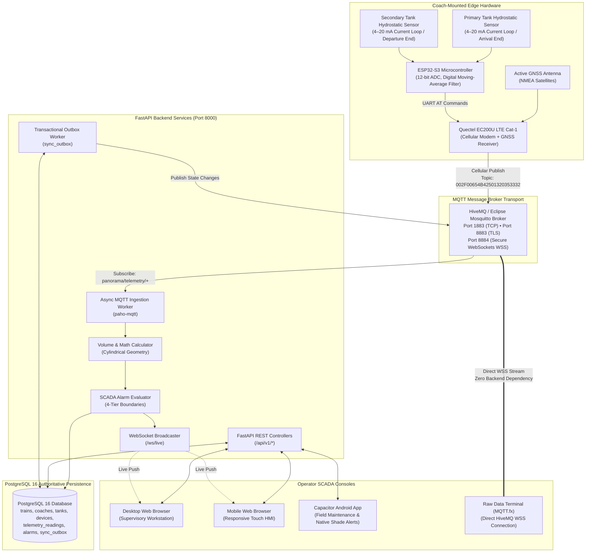

### 4.2 Telemetry Ingestion & Synchronization Flow

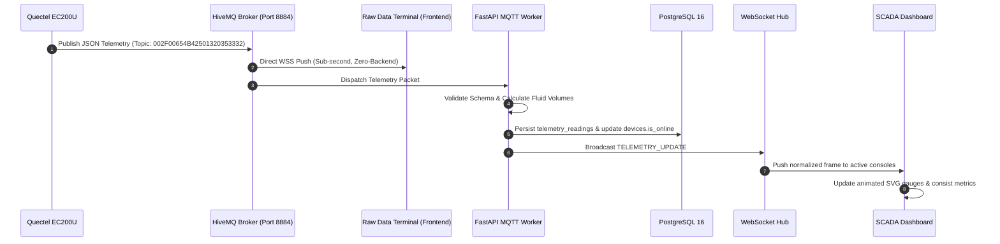

---

## 5. Dashboard Features (All 10 Modules)

The supervisory HMI provides 10 specialized operational modules accessible via the primary SCADA navigation:

| # | Module | Route | Purpose | Key Capabilities |
|:---:|:---|:---:|:---|:---|
| **1** | **Dashboard** | `#/dashboard` | Operational Overview | 60 FPS fluid SVG tank slosh physics, dual-tank fill meters, 5 KPI summaries, 4-tier capacity status ranks, consist train summary. |
| **2** | **Train Management** | `#/trains` | Consist & Fleet Marshaling | Create trains, add/edit/delete coaches, drag-and-drop position reordering, auto-enrichment via Indian Railway database, cascade delete safety. |
| **3** | **All Tanks** | `#/watertank` | Fleet Tank Matrix | High-density grid monitoring dual tanks across all active consists, valve actuation indicators, volume percentages, and offline dead-man badges. |
| **4** | **Devices** | `#/devices` | SCADA Node Registry | 8-column hardware registry tracking UIDs, firmware versions, battery voltages, carrier signal quality, and unmapped node auto-discovery. |
| **5** | **Raw Data** | `#/raw-data` | **Real-Time MQTT.fx Terminal** | Direct HiveMQ WebSocket streaming (`wss://broker.hivemq.com:8884/mqtt`), topic pre-fill `002F00654B42501320353332`, dynamic subscribe/unsubscribe, stream pause/resume, console clearing, dual timestamp modes, 500-message FIFO buffer, payload syntax highlighting, and copy JSON/raw. |
| **6** | **Location** | `#/location` | Corridor GPS Tracking | Leaflet map tracking Howrah–Asansol mainline corridor, active GNSS waypoints, speed (km/h), altitude, and verified station water refill points. |
| **7** | **Alerts** | `#/alerts` | Alarm Management | 4-tier threshold engine (Critical $\le 10\%$, Warning $\le 20\%$, Overflow $\ge 100\%$, Sensor Fault), audible siren, operator acknowledgment notes, and native Android shade notifications. |
| **8** | **History** | `#/history` | Time-Series Analytics | Largest-Triangle-Three-Buckets (LTTB) downsampled telemetry charting over 1h, 24h, 7d, and 30d intervals preserving operational spikes. |
| **9** | **Reports** | `#/reports` | Audit & Export | Multi-parameter filtering by train, coach, and severity; RFC 4180 compliant CSV export with automatic spreadsheet formula injection protection. |
| **10**| **Settings** | `#/settings` | System & Calibration | User profile management, UI scale presets (80%–130%), notification threshold tuning, telemetry timeouts, and regional preferences. |

### Spotlight: The Raw Data Monitor
The **Raw Data Monitor** (`#/raw-data`) operates as an independent terminal emulator inside the administration section:
- **Zero Backend Coupling**: Connects directly to HiveMQ over WebSocket TLS. If the backend API or PostgreSQL database is offline, the Raw Data Monitor continues streaming uninterrupted.
- **Timestamp Modes**:
  - *Mode 1 (Enabled)*: Displays detailed frame header: `[YYYY-MM-DD HH:mm:ss.SSS] MQTT MESSAGE RECEIVED` with topic, QoS, size, and client RX time.
  - *Mode 2 (Disabled)*: Displays only the clean JSON payload, matching the exact interface of **MQTT.fx**.
- **Buffer Safety**: Strictly caps incoming frames at 500 messages (FIFO) to eliminate browser memory exhaustion.
- **Fault-Tolerant Parsing**: Safely catches and displays non-JSON or malformed strings with a dedicated badge without crashing.

---

## 6. MQTT Architecture & Hardware Telemetry

### 6.1 Broker Connection Configuration
- **Host**: `broker.hivemq.com`
- **TCP Port**: `1883`
- **TLS Port**: `8883`
- **Secure WebSocket Port**: `8884` (Path: `/mqtt`)
- **Target Test Device Topic**: `002F00654B42501320353332`

### 6.2 Verified Hardware JSON Payload Specification
The following payload represents real telemetry broadcast by the physical Quectel EC200U LTE Cat-1 hardware module and processed by the system:

```json
{
  "uid": "002F00654B42501320353332",
  "lat": 22.556949,
  "long": 88.352447,
  "speed": 0.9,
  "time": "12:20:14",
  "cm1": 0.0,
  "cm2": 0.0,
  "wlp1": 0.0,
  "wlp2": 0.0,
  "wlv1": false,
  "wlv2": false,
  "bat": 97.1,
  "temp": 25.7,
  "chno": "pano123",
  "trno": "abcd123"
}
```

### 6.3 Payload Field Definitions

| Field | Type | Unit | Description |
|:---|:---:|:---:|:---|
| `uid` | `string` | — | 24-character hexadecimal factory hardware serial number. |
| `lat` | `float` | Deg | WGS 84 latitude from integrated Quectel GNSS receiver. |
| `long` | `float` | Deg | WGS 84 longitude from integrated Quectel GNSS receiver. |
| `speed` | `float` | km/h | Calculated ground speed over track. |
| `time` | `string` | UTC | Time of telemetry acquisition (`HH:mm:ss`). |
| `cm1` | `float` | cm | Hydrostatic water column height in Primary Tank (Arrival End). |
| `cm2` | `float` | cm | Hydrostatic water column height in Secondary Tank (Departure End). |
| `wlp1` | `float` | % | Volume percentage in Primary Tank ($0.0 - 100.0\%$). |
| `wlp2` | `float` | % | Volume percentage in Secondary Tank ($0.0 - 100.0\%$). |
| `wlv1` | `boolean` | — | Valve actuation status for Tank 1 (`true` = Open, `false` = Closed). |
| `wlv2` | `boolean` | — | Valve actuation status for Tank 2 (`true` = Open, `false` = Closed). |
| `bat` | `float` | % / V | Edge battery charge level ($97.1 = 97.1\%$). Normalized as `battery_v1`. |
| `temp` | `float` | °C | Ambient electronics enclosure temperature. |
| `chno` | `string` | — | Configured coach identifier on edge node. |
| `trno` | `string` | — | Configured train identifier on edge node. |

---

## 7. PostgreSQL Database Documentation

### 7.1 Entity-Relationship (ER) Diagram

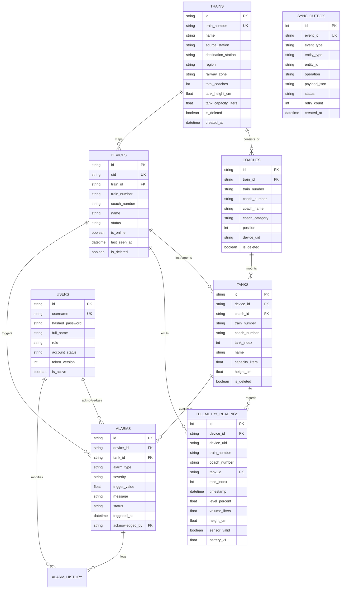

### 7.2 Database Migrations (Alembic)
The database schema is managed via declarative Alembic migrations in `backend/migrations/versions`:
- `001_initial_schema.py`: Initial core tables (devices, tanks, telemetry, alarms).
- `002_add_trains_table.py`: Trains and regional consist mapping.
- `003_permanent_database_architecture.py`: Permanent relational schema: railway regions, zones, coaches, transactional `sync_outbox`, and `deletion_audit_records`.

Apply migrations:
```bash
cd backend
alembic upgrade head
```

---

## 8. Backend API Documentation

All endpoints are versioned under `/api/v1` and document OpenAPI 3.1 schemas at `/docs`.

| Method | Endpoint | Description | Auth Scope |
|:---|:---|:---|:---:|
| `GET` | `/health` | Root health probe alias | Public |
| `GET` | `/api/v1/health` | Comprehensive system health check | Public |
| `GET` | `/api/v1/health/database` | PostgreSQL connection pool execution & latency probe | Public |
| `GET` | `/api/v1/health/mqtt` | MQTT broker connection status & subscription count | Public |
| `GET` | `/api/v1/health/system` | Compute, memory & active worker thread metrics | Public |
| `POST` | `/api/v1/auth/login` | Authenticate user & return signed JWT token | Public |
| `GET` | `/api/v1/auth/me` | Fetch active authenticated user profile | Bearer JWT |
| `POST` | `/api/v1/auth/logout` | Revoke session & increment `token_version` | Bearer JWT |
| `POST` | `/api/v1/auth/register` | Submit new user account registration for admin approval | Public |
| `GET` | `/api/v1/trains` | List all configured trains with consist summaries | Bearer JWT |
| `POST` | `/api/v1/trains` | Create a new train consist | Admin |
| `GET` | `/api/v1/trains/lookup/{train_number}` | Query railway database (DataMeet / RailRadar) | Bearer JWT |
| `GET` | `/api/v1/trains/{train_number}/consist` | Get detailed coach marshaling & tank mappings | Bearer JWT |
| `PUT` | `/api/v1/trains/{train_number}` | Update train metadata or regional assignment | Admin |
| `DELETE` | `/api/v1/trains/{train_number}` | Cascade delete train consist (0 orphans guaranteed) | Admin |
| `POST` | `/api/v1/trains/{train_number}/coaches` | Append coach to train consist | Admin |
| `PUT` | `/api/v1/trains/{train_number}/coaches/reorder` | Update coach sequence positions (1..N) | Admin |
| `GET` | `/api/v1/devices` | List registered and auto-discovered edge hardware nodes | Bearer JWT |
| `POST` | `/api/v1/devices` | Register a new hardware node UID | Admin |
| `PUT` | `/api/v1/devices/{device_id}` | Map device to train coach and dual-tank positions | Admin |
| `DELETE` | `/api/v1/devices/{device_id}` | Unmap or delete device record | Admin |
| `GET` | `/api/v1/tanks` | List all coach tanks with physical dimensions & levels | Bearer JWT |
| `GET` | `/api/v1/tanks/live` | Real-time snapshot of all water volumes and percentages | Bearer JWT |
| `GET` | `/api/v1/telemetry/history` | Query time-series telemetry with LTTB downsampling | Bearer JWT |
| `GET` | `/api/v1/alarms` | Query active and historical SCADA alarms | Bearer JWT |
| `POST` | `/api/v1/alarms/{alarm_id}/acknowledge`| Acknowledge alarm with operator comment | Bearer JWT |
| `GET` | `/api/v1/location` | Fetch current GPS locations of all fleet trains | Bearer JWT |
| `GET` | `/api/v1/location/corridor` | Get Howrah–Asansol corridor path & refill stations | Bearer JWT |
| `GET` | `/api/v1/export/csv` | Download RFC 4180 CSV report with formula escaping | Bearer JWT |
| `GET` | `/api/v1/users` | List all registered users (Admin only) | Admin |
| `POST` | `/api/v1/users/registrations/{id}/approve` | Approve pending user registration | Admin |

---

## 9. Mobile Application — Capacitor Android

The mobile application is packaged using **Capacitor 6** inside `PanoramaWaterTank_Capacitor/`:

### 9.1 Native Android System Notifications
Critical water-level alerts bypass standard in-app banners and generate native Android notifications in the system notification shade:
- Configures Android notification channel `critical-water-alerts` (High Importance, audible alert, vibration).
- Actionable deep-linking opens the app directly to `#/alerts?train=...&coach=...`.
- Operator acknowledgment in the app automatically cancels the active notification in the shade.

### 9.2 Device-Adaptive UI Scaling Engine
The app incorporates [adaptiveUiService.ts](apps/mobile/src/services/adaptiveUiService.ts) and scoped CSS tokens (`capacitor-android-adaptive.css`):
- Dynamically calculates viewport categories: `compact` ($< 360\text{px}$), `standard` ($360 - 389\text{px}$), `large` ($390 - 429\text{px}$), `xlarge` ($430 - 599\text{px}$), and `tablet` ($\ge 600\text{px}$).
- Injects CSS custom properties: `--android-vw`, `--android-vh`, and `--android-scale`.
- Desktop web and mobile browser styles remain 100% unaffected.

### 9.3 Low-Resource Testing Harness
Validated against an ultra-low-resource hardware profile:
- **AVD**: `Panorama_ULTRA_LOW_RESOURCE`
- **Specs**: Android 11 (API 30), 1024 MB RAM, 2 CPU cores, 128 MB VM heap, $720 \times 1280$ resolution.

---

## 10. Installation & Development Setup

### 10.1 Prerequisites
- **Node.js**: `>= 20.0.0 <= 24.x`
- **npm**: `>= 10.0.0`
- **Python**: `>= 3.11.0` (with `venv` and `pip`)
- **PostgreSQL**: `16` (or Docker)
- **Git**: `>= 2.40.0`

### 10.2 Installation Steps

```bash
# 1. Clone the repository
git clone https://github.com/soumikbur/PanoramaWaterTank_NextGen.git
cd PanoramaWaterTank_NextGen

# 2. Install monorepo frontend dependencies
npm ci

# 3. Configure backend environment variables
cp config/.env.example backend/.env

# 4. Set up Python virtual environment
cd backend
python -m venv venv

# Activate virtual environment
# Windows (PowerShell):
.\venv\Scripts\Activate.ps1
# Linux / macOS:
source venv/bin/activate

# Install Python backend requirements
pip install -r requirements.txt
cd ..
```

### 10.3 Running the Application Locally

```bash
# Terminal 1: Launch FastAPI SCADA Daemon (Port 8000)
cd backend
python -m uvicorn app.main:app --host 127.0.0.1 --port 8000 --reload

# Terminal 2: Launch Frontend Development Server (Port 3000 / 3001)
npm run dev

# Or compile and launch zero-cache static preview:
npm run build
npm run preview
```

### 10.4 Running Automated Verification

```bash
# Compile and sync production frontend bundle (< 600ms)
npm run build

# Execute full Pytest test suite (86 tests, 100% passing)
cd backend
pytest tests/ -v

# Run Playwright E2E verification
cd ..
node scripts/verify_raw_data_monitor.cjs
```

---

## 11. Environment Variables & Security

All configuration parameters are managed through environment variables. Copy `config/.env.example` to `backend/.env`:

| Variable | Default Value | Description |
|:---|:---|:---|
| `ENV` | `development` | Application environment (`development`, `production`). |
| `DEBUG` | `true` | Enables verbose debug logging and auto-reload. |
| `SECRET_KEY` | *(Generate 32-byte key)* | Cryptographic HMAC secret for signing JWT tokens. |
| `DATABASE_URL` | `postgresql+asyncpg://...` | Asynchronous SQLAlchemy database connection string. |
| `MQTT_BROKER_HOST` | `broker.hivemq.com` | MQTT broker hostname. |
| `MQTT_BROKER_PORT` | `1883` | MQTT standard TCP port. |
| `MQTT_TLS_PORT` | `8883` | MQTT secure TLS port. |
| `DEFAULT_DEVICE_UID` | `002F00654B42501320353332` | Default physical hardware node UID. |
| `CORS_ORIGINS` | `["http://localhost:3000", ...]`| JSON array of authorized origins (no wildcards). |

> [!CAUTION]
> Real production passwords, API tokens, and private certificates must never be committed to version control. The repository is audited to ensure zero embedded secrets.

---

## 12. Deployment Architecture

- **Frontend Hosting (GitHub Pages)**:
  - The static React 18 SPA is automatically compiled and deployed to **GitHub Pages** via `.github/workflows/backend-ci.yml` upon pushes to `main`.
  - Accessible at: `https://soumikbur.github.io/PanoramaWaterTank_NextGen/`
  - *Note*: GitHub Pages is a static CDN; it connects to external backend APIs and connects directly to the HiveMQ broker over Secure WebSockets (`wss://broker.hivemq.com:8884/mqtt`).
- **Backend Hosting (Render / Container VM)**:
  - Containerized FastAPI ASGI daemon executing under Uvicorn bound to `0.0.0.0:8000`.
  - Connects to managed PostgreSQL 16 database with persistent volume storage.

---

## 13. Troubleshooting & Diagnostics

| Issue | Likely Cause | Resolution Steps |
|:---|:---|:---|
| **Remote Backend Unreachable** | Stale local loopback in `localStorage`, backend offline, or mixed-content on HTTPS. | 1. The client now automatically invalidates stale `http://localhost:8000` overrides when running over HTTPS or Capacitor.<br>2. On local dev, verify `curl.exe http://127.0.0.1:8000/api/v1/health`.<br>3. In production, requests default safely to Render (`https://panorama-water-tank-backend.onrender.com/api/v1`). |
| **PostgreSQL Connection Refused** | PostgreSQL container is stopped or invalid credentials. | 1. Check `docker ps` or `pg_isready -p 5432`.<br>2. Verify `DATABASE_URL` credentials in `backend/.env`. |
| **MQTT Broker Disconnected** | Port 8884 / 1883 blocked by firewall. | 1. Verify `curl -I https://broker.hivemq.com:8884/mqtt`.<br>2. Ensure WebSocket TLS protocol is allowed. |
| **Device Telemetry Not Arriving** | Topic mismatch or hardware modem disconnected. | 1. Confirm topic `002F00654B42501320353332` in Raw Data Monitor.<br>2. Check cellular LED on Quectel EC200U modem. |
| **Device Shows Offline Status** | No telemetry received within 120-second dead-man window. | Device will automatically return to Online when new telemetry packet arrives. Check `last_seen_at`. |
| **GPS Location Unavailable** | GNSS receiver searching for satellites indoors. | Move external GNSS antenna near window or railway coach exterior. |
| **Mobile Notifications Missing** | Android 13+ notification permissions not granted. | Open Android Settings -> Apps -> Panorama -> Notifications -> Enable all permissions. |
| **GitHub Pages 404 on Refresh** | Static CDN path rewrite limitation. | The app includes `dist/404.html` to convert subpaths into client-side hash routes (`#/screen`). |

For full diagnosis steps, refer to [docs/TROUBLESHOOTING.md](docs/TROUBLESHOOTING.md).

---

## 14. Repository Structure

```text
PanoramaWaterTank_NextGen/
├── .github/workflows/                 # GitHub Actions CI & Pages deployment pipelines
├── apps/mobile/                       # React 18 / React Native Web HMI Application
│   ├── electron/                      # Electron 30 desktop wrapper & process supervisor
│   ├── src/
│   │   ├── api/client.ts              # REST API client with JWT interceptors
│   │   ├── components/                # UI components (Header, Sidebar, Gauges, Modals)
│   │   ├── screens/                   # 10 SCADA views (Dashboard, Raw Data, Alerts, etc.)
│   │   ├── services/                  # mqttService, tankStatusService, adaptiveUiService
│   │   └── state/AppContext.tsx       # Centralized global SCADA state store
│   └── package.json                   # Frontend dependencies and build scripts
├── assets/
│   ├── branding/                      # Logos, icons, and vector brand assets
│   └── screenshots/                   # Authentic desktop & mobile application captures
├── backend/
│   ├── app/                           # FastAPI application package
│   │   ├── api/v1/                    # Versioned REST controllers & WebSocket route
│   │   ├── core/                      # Config, async database engine, bcrypt security
│   │   ├── models/                    # SQLAlchemy 2.0 ORM declarations
│   │   ├── mqtt/                      # Paho MQTT ingestion worker & telemetry parser
│   │   └── services/                  # VolumeCalculator, AlarmService, LTTBDownsampler
│   ├── migrations/                    # Alembic schema versioning scripts
│   ├── requirements.txt               # Locked Python dependencies
│   └── tests/                         # 86 automated Pytest tests (100% passing)
├── config/
│   ├── .env.example                   # Environment variable template with documentation
│   └── mosquitto.conf                 # Local Mosquitto broker configuration
├── docs/                              # Technical documentation suite
│   ├── ARCHITECTURE.md                # Full system architecture specification
│   ├── BACKEND.md                     # Backend architecture & diagnostics
│   ├── DATABASE.md                    # PostgreSQL schema & ER diagram
│   ├── MQTT_TELEMETRY.md              # Hardware MQTT protocol & payload spec
│   ├── API_REFERENCE.md               # Complete REST API & WebSocket reference
│   ├── MOBILE_APP.md                  # Capacitor Android configuration & adaptive scaling
│   ├── DEPLOYMENT.md                  # Production deployment & Docker runbook
│   ├── DEVELOPMENT.md                 # Local development & testing guidelines
│   └── TROUBLESHOOTING.md             # Exhaustive diagnostic & remediation matrix
├── PanoramaWaterTank_Capacitor/       # Capacitor 6 Android mobile project
│   ├── android/                       # Native Android Studio Gradle project
│   └── capacitor.config.ts            # Capacitor mobile configuration
├── scripts/                           # Build, sync, and automated verification scripts
├── package.json                       # Monorepo workspaces and root scripts
└── README.md                          # Primary project documentation
```

---

## 15. License

This project is licensed under the **Apache License, Version 2.0**. See the [LICENSE](LICENSE) file for complete details.

```text
Copyright 2026 Panorama Systems / Soumik Ghosh

Licensed under the Apache License, Version 2.0 (the "License");
you may not use this file except in compliance with the License.
You may obtain a copy of the License at

    http://www.apache.org/licenses/LICENSE-2.0
```
