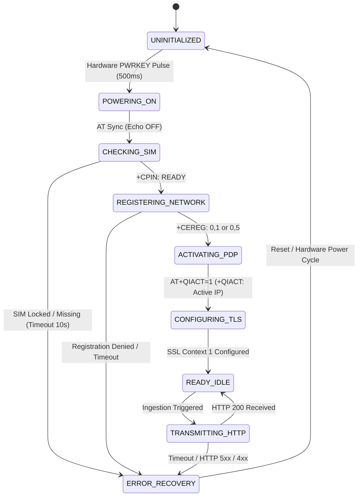
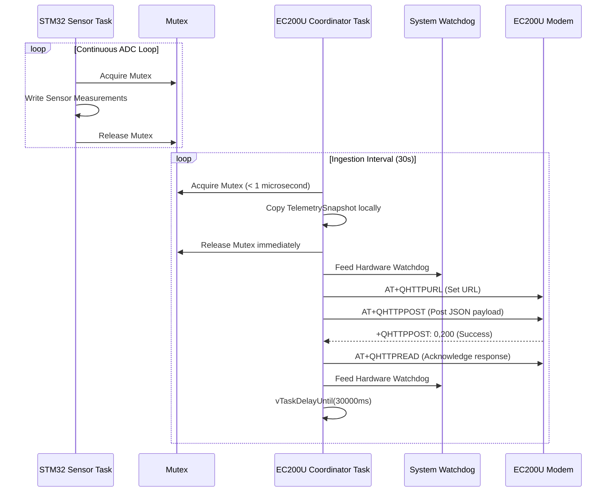

# Quectel EC200U LTE Modem HTTPS Integration Guide

**Project:** Panorama Water Tank Monitor (WLI) — NextGen  
**Target Hardware:** STM32F4 Core MCU + Quectel EC200U-CN LTE Cat-1 Modem  
**Firmware Version Reference:** `EC200UCNAAR03A03M08`  
**Target Receiver:** Isolated FastAPI HTTPS Receiver (`HTTPS_Server`)  

---

## 1. System Overview & Architecture

The Panorama Water Tank Monitor HTTPS Communication System uses the Quectel EC200U-CN LTE Cat-1 cellular modem as the primary wide-area network gateway. The modem offloads all TCP/IP, DNS, TLS 1.2/1.3 encryption, and HTTP protocol processing from the main STM32 microcontroller.

```mermaid
flowchart TD
    subgraph STM32_Subsystem ["STM32 Microcontroller Subsystem"]
        ADC["Hydrostatic Sensor (4-20mA ADC)<br/>Pressure Sensor (0.5-4.5V ADC)"] --> SensorTask["Sensor Processing Task<br/>(Calculates cm, %, Alarms)"]
        SensorTask --> Mutex["Telemetry Mutex<br/>(Lock duration < 1 us)"]
        Mutex --> Snapshot["TelemetrySnapshot Store"]
        Snapshot --> CoordinatorTask["EC200U Coordinator Task<br/>(FreeRTOS Priority: Normal)"]
    end

    subgraph EC200U_Module ["Quectel EC200U-CN Subsystem"]
        CoordinatorTask -->|UART AT Commands (115200 8-N-1)| RingBuffer["2048-Byte Circular Ring Buffer"]
        RingBuffer --> ATParser["AT Command & URC Engine"]
        ATParser --> RadioStack["LTE Cat-1 Radio Stack<br/>(Airtel India: airtelgprs.com)"]
        RadioStack --> SSLContext["Hardware SSL Engine (Context 1)<br/>Trust Anchor: ISRG Root X1"]
        SSLContext --> HTTPClient["Embedded HTTP/HTTPS Client"]
    end

    subgraph Cloud_Infrastructure ["Public Cloud Gateway"]
        HTTPClient -->|HTTPS POST (Port 443)| EdgeProxy["Cloudflare / Reverse Proxy Edge"]
        EdgeProxy --> FastAPI["FastAPI Ingestion Endpoint<br/>/api/telemetry"]
        FastAPI --> Storage["In-Memory Ring & Persistence Store"]
        Storage --> Dashboard["HTTPS Laboratory Dashboard"]
    end
```

### Key Architectural Constraints
1. **STM32 Microcontroller:** Dedicated to real-time ADC sampling, water level height/percentage calculations, high/low alarm evaluation, and local fail-safe switching.
2. **EC200U Cellular Modem:** Exclusively handles SIM interaction, LTE registration, PDP context activation, DNS resolution, and secure TLS POST transmission.
3. **ESP32 Subsystem:** Reserved exclusively for local Bluetooth Low Energy (BLE) operator diagnostics. Never connects to Wi-Fi, MQTT, or external cloud networks.
4. **BME280 Sensor:** Deprecated and completely omitted from the active hardware architecture.

---

## 2. Hardware Interface & Electrical Specifications

### 2.1 Pin Assignment & Signal Interconnect

The physical interconnect between the STM32F4 and the EC200U-CN module utilizes an asynchronous 3.3V TTL serial interface and four discrete GPIO control lines:

| EC200U Pin Name | STM32 Pin Assignment | Signal Direction | Description | Electrical Level |
|---|---|:---:|---|---|
| **TXD** (Modem TX) | `PA3` (USART2_RX) | EC200U $\rightarrow$ STM32 | Serial data received from modem | 3.3V CMOS |
| **RXD** (Modem RX) | `PA2` (USART2_TX) | STM32 $\rightarrow$ EC200U | Serial data sent to modem | 3.3V CMOS |
| **PWRKEY** | `PB0` (GPIO_Output) | STM32 $\rightarrow$ EC200U | Power On/Off pulse control (Active LOW, open-drain) | 3.3V Tolerant |
| **RESET** | `PB1` (GPIO_Output) | STM32 $\rightarrow$ EC200U | Emergency hardware reset (Active LOW, >150ms) | 3.3V Tolerant |
| **STATUS** | `PB2` (GPIO_Input) | EC200U $\rightarrow$ STM32 | Module operating status indicator (HIGH = active) | 3.3V CMOS |
| **NET_STATUS** | `PB10` (GPIO_Input) | EC200U $\rightarrow$ STM32 | Network registration LED output / monitoring | 3.3V CMOS |
| **VBAT** | Dedicated Power Rail | External PSU $\rightarrow$ EC200U | Main supply input (3.8V nominal, 3.4V min, 4.3V max) | 2.0A Surge Capable |
| **GND** | System Ground | Interconnect | Common reference ground plane | 0V |

> [!CAUTION]
> The EC200U-CN RF power amplifier draws brief peak transmission bursts up to 2.0A on LTE Cat-1. The `VBAT` supply must feature a low-ESR ceramic capacitor array (minimum $100\mu\text{F} + 100\text{nF} + 33\text{pF}$) immediately adjacent to the module power pins to prevent supply droop below 3.4V, which would trigger emergency under-voltage brownout shutdown.

---

## 3. Embedded Firmware Architecture (`EC200U/`)

The firmware driver is structured into clean, modular C++ components with strict separation between hardware abstraction and communication state machines:

```
EC200U/
├── ec200u_config.h     # Compile-time constants, APN, timeouts, URIs, tokens
├── ec200u_types.h      # Data structs, state enums, diagnostic records
├── ec200u_uart.h       # Circular ring buffer and non-blocking UART HAL
├── ec200u_uart.cpp     # Ring buffer implementation, line parsing, timeout handling
├── ec200u.h           # Core Modem Manager interface (network, SIM, signal)
├── ec200u.cpp         # AT command sequences, PDP context, automatic recovery
├── ec200u_tls.h       # TLS/SSL engine configuration interface
├── ec200u_tls.cpp     # SSL context parameters, ISRG Root X1 trust store provisioning
├── ec200u_http.h      # Embedded HTTP/HTTPS client interface
├── ec200u_http.cpp    # JSON formatting, custom header injection, POST execution
├── ec200u_freertos.h  # RTOS coordinator task and thread-safe snapshot wrapper
└── ec200u_freertos.cpp# Periodic telemetry timer, mutex locking, watchdog feeding
```

### 3.1 Non-Blocking Ring Buffer (`ec200u_uart.cpp`)
The incoming serial stream is processed via a 2048-byte circular ring buffer. When the STM32 USART RX interrupt fires, incoming bytes are pushed into the buffer via `push_byte_isr()` without blocking or allocating dynamic heap memory.

- `read_line()` scans for `\r\n` delimiters without blocking other FreeRTOS threads.
- `send_and_wait()` transmits commands in single uninterrupted frames and monitors the incoming ring buffer until expected terminators (`OK`, `ERROR`, `CONNECT`, or timeout) arrive.

### 3.2 Core Modem Manager (`ec200u.cpp`)
Coordinates the modem lifecycle through a structured state machine:



---

## 4. TLS & Certificate Provisioning

The Quectel EC200U features an onboard hardware SSL engine. For secure communication with modern HTTPS servers, SSL Context ID 1 is configured to validate the server's X.509 certificate against the Let's Encrypt `ISRG Root X1` trust anchor.

### 4.1 Onboard Certificate Storage
1. The root certificate is uploaded to the modem's internal user file storage (UFS) as `cacert.pem` via `AT+QFUPL="cacert.pem",<size>`.
2. The driver checks for existence via `AT+QFLST="*"`. If missing, it writes the certificate bytes directly.

### 4.2 Required AT SSL Configuration Sequence
```text
AT+QSSLCFG="sslversion",1,4        --> Enforce TLS 1.2 and TLS 1.3 only
AT+QSSLCFG="ciphersuite",1,0xFFFF  --> Enable all robust modern cipher suites
AT+QSSLCFG="seclevel",1,1          --> Enforce server certificate verification
AT+QSSLCFG="cacert",1,"cacert.pem" --> Bind root trust anchor file
AT+QSSLCFG="sni",1,1               --> Enable Server Name Indication (SNI)
AT+QSSLCFG="checkcert",1,1         --> Validate server domain name against SAN
AT+QSSLCFG="ignorelocaltime",1,1   --> Prevent TLS failure prior to NITZ cellular clock sync
```

> [!IMPORTANT]
> The `ignorelocaltime=1` flag is mandatory for embedded cellular deployments. If cellular base stations fail to broadcast local NITZ time strings or during the initial seconds before time synchronization, standard TLS handshakes would fail due to an apparent certificate expiration error. Setting `ignorelocaltime=1` instructs the modem's crypto engine to bypass the local clock verification window while retaining full cryptographic signature and public-key authenticity verification.

---

## 5. Telemetry Ingestion & JSON Schema Mapping

The driver formats raw analog and digital sensor readings into the Phase 04 standard JSON schema without invoking bloated third-party serialization libraries:

### 5.1 Field Mapping Matrix
| Raw STM32 Source | Target JSON Key | Data Type | Engineering Units / Encoding |
|---|---|:---:|---|
| System MAC / Serial | `device_id` | String | Fixed device identifier (e.g., `COACH-PROD-WLI-01`) |
| FreeRTOS Tick Count | `sequence_id` | Integer | Monotonically incrementing 32-bit counter |
| 4-20mA Hydrostatic Sensor | `water_level_cm` | Float | Hydrostatic liquid height (0.0 to 300.0 cm) |
| Water Level Percentage | `water_level_percent`| Float | Calculated percentage (0.0% to 100.0%) |
| 0.5-4.5V Pressure Transducer| `water_pressure_bar` | Float | Gauge pressure in bar (0.00 to 5.00 bar) |
| Onboard Supply Divider | `battery_voltage_v` | Float | DC bus voltage (0.00 to 24.00 V) |
| Battery SoC Calculation | `battery_percentage` | Float | State of charge (0.0% to 100.0%) |
| Modem AT+CSQ Command | `rssi_dbm` | Integer | Signal strength in dBm (-113 to -51 dBm) |
| Active Alarm Flags | `alarm_active` | Boolean | True if any alarm threshold is exceeded |
| Leak Detection Sensor | `leak_detected` | Boolean | Digital optical leak sensor status |
| Pump Contactor State | `pump_running` | Boolean | Auxiliary relay contact state feedback |
| GNSS NMEA Parser | `gps_latitude` | Float | Degrees North (WGS84) |
| GNSS NMEA Parser | `gps_longitude` | Float | Degrees East (WGS84) |
| GNSS NMEA Parser | `gps_altitude_m` | Float | Elevation above mean sea level (meters) |
| Error Bitfield | `diagnostic_code` | Integer | 0 = Normal, 1 = Low Sensor, 2 = Overload, etc. |

### 5.2 Formatted Payload Example
```json
{
  "device_id": "COACH-PROD-WLI-01",
  "sequence_id": 1420,
  "water_level_cm": 182.5,
  "water_level_percent": 91.25,
  "water_pressure_bar": 1.25,
  "battery_voltage_v": 12.65,
  "battery_percentage": 89.0,
  "rssi_dbm": -57,
  "alarm_active": false,
  "leak_detected": false,
  "pump_running": true,
  "gps_latitude": 22.572645,
  "gps_longitude": 88.363892,
  "gps_altitude_m": 9.2,
  "diagnostic_code": 0
}
```

---

## 6. FreeRTOS Integration & Concurrency Design

The coordinator runs as an independent FreeRTOS task with an upload period defined in `ec200u_config.h` (default: 30 seconds).



### Mutex Isolation Rule
To ensure that cellular network latency (which can reach several seconds under poor radio conditions) never blocks the real-time sensor ADC sampling, alarm trips, or pump protection routines, the coordinator task:
1. Acquires the telemetry mutex only long enough to perform a memory copy (`memcpy`) of the 64-byte `TelemetrySnapshot` structure (sub-microsecond hold time).
2. Immediately releases the mutex.
3. Conducts all serial UART transmissions, network waiting, and HTTP response parsing using its local private copy.
4. Feeds the system watchdog before and after every network transaction.

---

## 7. Fault Recovery & Watchdog Safeguards

When cellular connectivity fails (e.g., poor coverage, cell handover, SIM de-registration), the driver invokes a multi-tiered escalation strategy:

```
Tier 1: Minor Network Loss (PDP context deactivation)
└── Action: Re-issue AT+QIACT=1 up to 3 times (5s backoff).

Tier 2: Major Network Loss (Radio de-registration / SIM timeout)
└── Action: Soft-reset radio with AT+CFUN=0 followed by AT+CFUN=1.

Tier 3: Unresponsive Modem (UART timeout on basic AT command)
└── Action: Assert hardware RESET pin low for 250ms, then reinitialize.

Tier 4: Catastrophic Lockup (Internal baseband freeze)
└── Action: Trigger external hardware power cycle via PMIC load switch.
```

---

## 8. Verification & Tooling

To verify the integration without needing an active field installation:
1. **Firmware Unit Tests:** Compile and execute `tests/test_ec200u_firmware.cpp` via `g++ -std=c++17`.
2. **Automated Integration Runner:** Execute `tools/test_ec200u_live.py --auto-start` in `PanoramaWaterTank_NextGen/` to test modem AT flows against the FastAPI test instance.
