# Existing Architecture & Data Flow Analysis

**Audited Project**: `PanoramaWaterTank-Milestone2/PanoramaWaterTank`  
**Framework**: Qt 6.9 / 6.12 (C++20, QML, QtQuick, QtMqtt, QtSql)  
**Date**: October 30, 2026  

---

## 1. Architectural Layers & Component Interactions

```mermaid
flowchart TD
    subgraph ExternalSources["External Hardware & Telemetry Sources"]
        ESP32["ESP32-S3 Edge Node<br/>(Dual Pressure Sensors)"]
        EC200U["Quectel EC200U<br/>(LTE Cat 1 Modem)"]
        BROKER["MQTT Broker<br/>(Mosquitto/HiveMQ)"]
        UBIDOTS["Legacy Ubidots Cloud<br/>(Deprecated)"]
    end

    subgraph IngestionLayer["Ingestion & Network Layer"]
        MqttService["MqttService<br/>(QtMqtt TLS Client)"]
        ApiClient["ApiClient<br/>(QNetworkAccessManager)"]
        ConnectionManager["ConnectionManager<br/>(Poll Timers & Health Checks)"]
    end

    subgraph DomainStateLayer["Domain Models & State Singletons"]
        TankRepository["TankRepository<br/>(Telemetry Ingestion Bridge)"]
        TankModel["TankModel<br/>(Central God Object)"]
        TrainManager["TrainManager<br/>(24-Coach Consist Hierarchy)"]
        LocationManager["LocationManager<br/>(GNSS & Refill Decision)"]
        RailwayManager["RailwayManager<br/>(Station Timetables)"]
        SettingsManager["SettingsManager<br/>(QSettings Storage)"]
        AuthManager["AuthManager<br/>(RBAC Security)"]
        AppStateManager["ApplicationStateManager<br/>(Session Cache)"]
    end

    subgraph PersistenceLayer["Persistence Layer"]
        DatabaseManager["DatabaseManager<br/>(SQLite3 Database)"]
    end

    subgraph PresentationLayer["QML UI Layer (Qt Quick / Controls)"]
        AppShell["App.qml (Root Shell & Navigation)"]
        Dashboard["DashboardPage.qml (Visualizer, Sensors, Trend)"]
        AllTanks["AllTanksPage.qml (Fleet Tank Grid)"]
        TrainView["TrainViewPage.qml (24 Consist Coaches)"]
        Alerts["AlertsPage.qml (Alarm History & Acknowledgment)"]
        History["HistoryPage.qml (12h/24h/7d Trends, CSV Export)"]
        Settings["SettingsPage.qml (REST/MQTT/Tank Config, Users)"]
        Map["MapPage.qml (Route & Endurance View)"]
    end

    EC200U --> BROKER
    BROKER --> MqttService
    ESP32 --> ApiClient
    UBIDOTS -.-> ApiClient
    ConnectionManager --> ApiClient

    MqttService --> TankRepository
    MqttService --> TrainManager
    MqttService --> LocationManager
    ApiClient --> TankRepository
    TankRepository --> TankModel
    TankRepository --> DatabaseManager

    TrainManager --> DatabaseManager
    TrainManager --> TankModel
    LocationManager --> SettingsManager
    LocationManager --> TrainManager
    RailwayManager --> DatabaseManager
    AuthManager --> DatabaseManager

    AppShell --> TankModel
    AppShell --> TrainManager
    AppShell --> LocationManager
    AppShell --> SettingsManager
    AppShell --> AuthManager

    Dashboard --> TankModel
    AllTanks --> TrainManager
    TrainView --> TrainManager
    Alerts --> TankModel
    History --> TankModel
    Settings --> SettingsManager
    Map --> LocationManager
```

---

## 2. Telemetry Ingestion Data Flow

1. **Cellular MQTT Telemetry**:
   - The Quectel EC200U modem packages sensor data into a 12-field JSON payload containing:
     `{ "uid": "...", "coach": "panoroma", "wlp1": 26.6, "wlp2": 0.0, "wlv1": true, "wlv2": false, "lat": 22.55, "lon": 88.35, "alt": 40.7, "date": "2026-09-29", "time": "16:49:03" }`
   - `MqttService` subscribes to `panorama/telemetry/#` over TLS 1.2+. Upon reception, it validates the JSON schema.
   - Sensor validity flags (`wlv1`, `wlv2`) are evaluated. If sensor 1 is valid, its value is used; if sensor 1 fails and sensor 2 is valid, automatic sensor failover occurs. If both fail, `measurement_state` transitions to `SENSOR_FAULT`.
   - Payload is forwarded via Qt signals to `TankRepository`, `TrainManager`, and `LocationManager`.

2. **Direct ESP32 REST Ingestion**:
   - `ConnectionManager` issues a periodic HTTP `GET /api/status` request to the ESP32 host via `ApiClient`.
   - Before accepting readings, it checks `/api/health`. If healthy, the raw water height in cm is received.
   - **Transient Spike Rejection**: If the reading exceeds tank physical height (e.g. 161 cm on a 50 cm tank), it is rejected as sensor noise, preserving the last known valid reading.
   - **Disconnect Retention**: If the ESP32 drops offline, `TankModel` preserves the previous physical height and volume readings rather than resetting to 0, preventing spurious Low Critical alarms.

3. **Domain Volume & Alarm Calculation**:
   - `VolumeCalculator` converts water height into volume in liters:
     - **Cylindrical Tank**: $V = \pi \times r^2 \times h / 1000$
     - **Rectangular Tank**: $V = (l \times w \times h) / 1000$
   - `TankModel` derives the alarm tier:
     - Level $\ge 100\%$: `OVERFLOW`
     - Level $< 10\%$: `CRITICAL`
     - Level $< 20\%$: `WARNING`
     - Otherwise: `NORMAL`
   - Deadband hysteresis ($\pm 1.0\%$) prevents alarm fluttering at boundary thresholds.

4. **UI Notification**:
   - Properties are exposed to QML via `Q_PROPERTY` with `NOTIFY` signals (`waterLevelChanged`, `fillPercentageChanged`, `alarmLevelChanged`, `connectionStateChanged`).
   - The QML scene graph redraws `TankVisualization` with fluid physics wave animations, `SensorsCard` metrics, and `LevelTrendCard` polyline curves.

