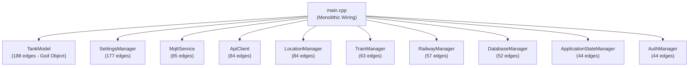

# Comprehensive Existing Project Audit

**Audited Project**: `C:\Users\User\Documents\Antigravity_soumik\PanoramaWaterTank-Milestone2\PanoramaWaterTank`  
**Tooling Used**: Graphify AST Extraction Engine (1585 nodes, 2889 edges), CMake 4.4.4, GCC 16.2.0, Qt 6.12.0 MinGW  
**Audit Date**: October 30, 2026  

---

## 1. Executive Summary

The existing **Panorama Water Tank Monitor** is a desktop industrial supervisory control and data acquisition (SCADA/HMI) application developed in C++20 and Qt 6.9/6.12 (QML/QtQuick). It provides real-time water level monitoring, telemetry ingestion, historical analytics, geometric tank capacity calculation, 4-tier alarm management, multi-train 24-coach consist management, GPS location tracking, and role-based access control.

While the application possesses rich domain logic and passing unit tests for core protocols, its architectural foundation suffers from high coupling, god objects, monolithic initialization, and fragile teardown sequences.

---

## 2. Technology Stack & Environment

- **Language Standard**: C++20 (`set(CMAKE_CXX_STANDARD 20)`)
- **UI Technology**: Qt Quick 2 / QML with Qt Quick Controls 2 (Basic style) and Qt Quick Shapes
- **Qt Version**: Qt 6.9 required in CMake; built and verified against installed Qt 6.12.0 MinGW 64-bit
- **Database**: SQLite 3 via `Qt6::Sql`
- **Network / Transport**:
  - `Qt6::Network` (`QNetworkAccessManager` for REST APIs)
  - `Qt6::Mqtt` (official Qt MQTT module with TLS 1.2+ support)
- **Primary Hardware Targets**:
  - Railway Coach Edge Node (ESP32-S3 + ADS1115 16-bit ADC + Dual Submersible Pressure Sensors)
  - Cellular Uplink: Quectel EC200U LTE Cat 1 Modem

---

## 3. Functionality Status Matrix

| Component / Subsystem | Status | Evidence / Verification |
| :--- | :--- | :--- |
| **MQTT Telemetry Ingestion** | **VERIFIED WORKING** | Passes all 10 unit tests in `test_mqtt_service.exe`. Parses 12-field telemetry JSON (device UID, coach, wlp1, wlp2, wlv1, wlv2, lat, lon, alt, date, time). |
| **ESP32 Direct REST API** | **VERIFIED WORKING** | Passes all 6 integration tests in `test_esp32_rest.exe`. Validated `/api/health`, `/api/status`, `/api/history`, `/api/config`. Transient spike rejection (161 cm rejected) and non-zero retention confirmed. |
| **Historical Data & CSV Export** | **VERIFIED WORKING** | Passes all 5 unit tests in `test_csv_export.exe`. 12h/24h/7d downsampling to ~100 points, LTTB preservation, strict chronological sorting. |
| **RBAC Authentication & Security** | **VERIFIED WORKING** | Passes all role tests in `test_role_railway_architecture.exe`. Salted SHA-256 hashing, Admin immutable credentials, 10-operator limit strictly enforced, session tokens. |
| **24-Coach Consist Hierarchy** | **VERIFIED WORKING** | 24 coach positions, two-digit formatting (`01`-`24`), device-to-coach assignment, dynamic capacity aggregation. |
| **SQLite Persistence** | **VERIFIED WORKING** | `DatabaseManager` handles schema creation, user tables, train tables, tank configurations, and historical logs. |
| **Location & Station Tracking** | **PARTIALLY VERIFIED** | Haversine distance, water endurance estimation, and refill recommendations work. Minor bug found in Test 7 where offline tank switch failed to zero out `waterHeightCm()`. |
| **Legacy Ubidots Cloud API** | **BROKEN / OBSOLETE** | `UbidotsClient.cpp` is an empty 0-byte stub. Endpoint queries return 0 points; cloud lock-in is superseded by direct ESP32 REST and local/broker MQTT. |

---

## 4. Architectural Analysis & God Nodes (Graphify Insights)

Graphify analysis mapped 1585 nodes and 2889 edges across the codebase, identifying the following structural hotspots:

### Hotspot 1: `TankModel` (188 edges)
`TankModel` violates the Single Responsibility Principle by combining:
1. Physical geometric calculations (cylinder vs rectangle volume, diameter, height, area).
2. Live sensor telemetry cache (water level %, height cm, volume L).
3. 4-tier alarm state machine (Normal, Warning, Critical, Overflow, Sensor Fault, Offline).
4. Historical trend array downsampling and caching.
5. QML UI property notification bindings (dozens of `NOTIFY` signals).
6. Sensor disconnect retention and surge filtering logic.

### Hotspot 2: Monolithic `main.cpp` (550+ lines)
- All services and managers are instantiated on the stack in `main.cpp`.
- Manual dependency injection is performed through a web of Qt signal-slot lambdas.
- Singletons registered in QML are dynamically resolved back into C++ via `engine.singletonInstance<T*>()`.
- Severe teardown race condition: `QQmlApplicationEngine` tears down QML-registered singletons before stack-allocated services (`ConnectionManager`, `MqttService`) are destroyed.

---

## 5. Security & Safety Evaluation

1. **Password Storage**: Uses salted SHA-256 with user-specific salts (`AuthManager`).
2. **Access Control**: Role-based permissions (`PermissionManager`) cleanly separate Admin configuration rights from Operator monitoring rights.
3. **Firmware Communication**:
   - MQTT supports TLS 1.2+ mutual authentication.
   - Credentials (broker password, API token) are stored locally in `QSettings` (needs secure encryption or credential store for high-security deployments).
4. **Transient Surge Protection**: The telemetry pipeline explicitly rejects sensor spikes exceeding physical tank boundaries and retains last known valid readings during transient communication dropouts.

