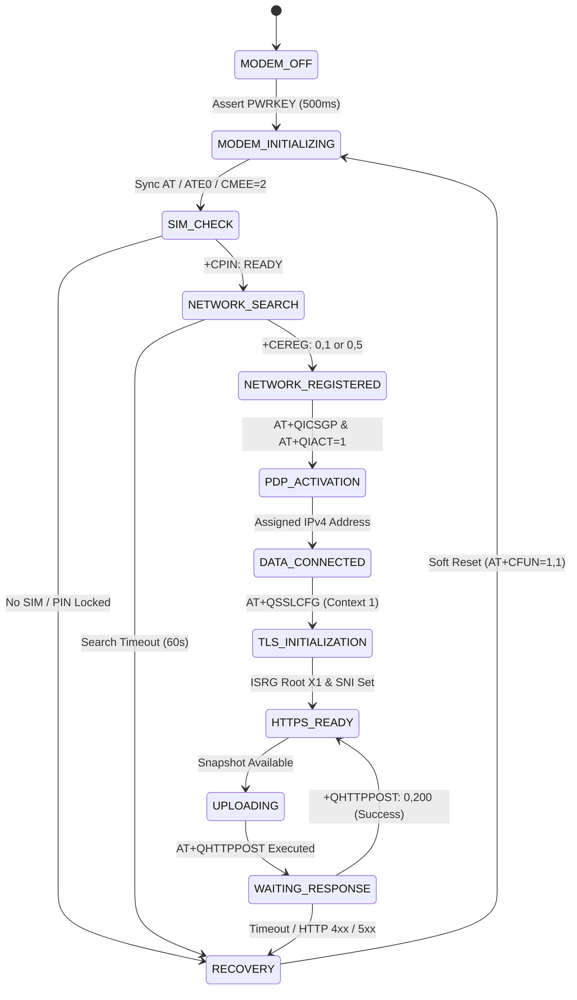

# Final Firmware Architecture & Implementation Guide

**Project:** Panorama Water Tank Monitor (WLI) — NextGen  
**Firmware Subsystem:** `PanoramaWaterTank_NextGen/EC200U/` & Core MCU  
**Language Standard:** ISO C++17 with FreeRTOS V10+  
**Target:** STMicroelectronics STM32F401RE  
**Date:** 2026-11-17  

---

## 1. Firmware Boot & Initialization Sequence

The STM32 firmware starts deterministically from reset through the following initialization stages:

```
[Power-On Reset]
       │
       ▼
1. System Clock Setup: Configure PLL to 84 MHz (HSE 8 MHz Crystal)
       │
       ▼
2. GPIO & Pin Muxing: Configure USART1, USART2, USART6, ADC1, and Control Pins
       │
       ▼
3. Ring Buffer & UART Driver: Initialize static 2048-byte RX ring buffer in SRAM
       │
       ▼
4. FreeRTOS Mutex & Queues: Create telemetry snapshot mutex and offline queue
       │
       ▼
5. Task Creation: Allocate FreeRTOS tasks with strict priority ordering
       │
       ▼
6. Kernel Start: vTaskStartScheduler() starts real-time execution
```

---

## 2. Sensor Acquisition & Calibration Engine

### A. Linear Calibration Formula
The hydrostatic pressure sensor produces a linear 4–20mA current proportional to liquid depth:

```cpp
// Static calibration constants (standard coach overhead water tank)
constexpr float TANK_MAX_HEIGHT_CM = 150.0f;
constexpr float SENSOR_V_EMPTY = 0.500f; // 4.00 mA
constexpr float SENSOR_V_FULL  = 4.500f; // 20.00 mA
constexpr float SENSOR_V_SPAN  = SENSOR_V_FULL - SENSOR_V_EMPTY; // 4.000V
constexpr float V_DISCONNECT_THRESHOLD = 0.200f;
constexpr float V_SHORT_THRESHOLD      = 4.850f;

SensorReadingResult process_sensor_adc_voltage(float voltage_v) {
    SensorReadingResult res;
    // 1. Fault Bounds Checking
    if (voltage_v < V_DISCONNECT_THRESHOLD) {
        res.is_fault = true;
        res.sensor_status = "DISCONNECTED";
        res.alarm_state = "SENSOR_FAULT";
        return res;
    }
    if (voltage_v > V_SHORT_THRESHOLD) {
        res.is_fault = true;
        res.sensor_status = "SHORT_CIRCUIT";
        res.alarm_state = "SENSOR_FAULT";
        return res;
    }

    // 2. Linear Height & Percentage Math
    float clamped_v = (voltage_v < SENSOR_V_EMPTY) ? SENSOR_V_EMPTY : voltage_v;
    res.height_cm = ((clamped_v - SENSOR_V_EMPTY) / SENSOR_V_SPAN) * TANK_MAX_HEIGHT_CM;
    res.percentage = (res.height_cm / TANK_MAX_HEIGHT_CM) * 100.0f;

    // 3. Alarm State Evaluation
    if (res.percentage <= 10.0f) {
        res.alarm_state = "CRITICAL_LOW";
    } else if (res.percentage <= 20.0f) {
        res.alarm_state = "LOW_WARNING";
    } else if (res.percentage > 102.0f) {
        res.alarm_state = "OVERFLOW";
    } else {
        res.alarm_state = "NONE";
    }
    return res;
}
```

---

## 3. FreeRTOS Task Scheduling & Mutex Concurrency

```
Task Priority Hierarchy:
[Priority 4: SensorAcquisitionTask] ─── Samples ADC every 100ms, updates telemetry mutex (<1us)
[Priority 3: ModbusSlaveTask]        ─── Serves RS485 queries from in-coach passenger display
[Priority 2: EC200UCoordinatorTask]  ─── Takes private snapshot copy, manages AT state machine
[Priority 1: BleInterfaceTask]       ─── Serves local BLE GATT diagnostics
[Priority 0: IdleTask / Watchdog]    ─── Feeds Independent Watchdog (IWDG)
```

### Mutex Isolation Pattern (`EC200U/ec200u_freertos.cpp`)
```cpp
void FreeRtosCoordinator::update_sensor_telemetry(const TelemetrySnapshot &data) {
    // Acquire mutex with 50ms timeout
    if (m_telemetry_mutex.take(50)) {
        m_latest_snapshot = data; // Sub-microsecond memory copy
        m_has_new_telemetry = true;
        m_telemetry_mutex.give(); // Release immediately
    }
}
```
The coordinator task never holds `m_telemetry_mutex` during UART transmissions, network waits, or HTTP POST operations. Cellular network delays cannot cause sensor ADC jitter or delayed alarm tripping.

---

## 4. EC200U State Machine & Cellular Transmission



---

## 5. Fault Recovery & Watchdog Integration

### A. Four-Tiered Recovery Escalation
1. **Tier 1 (Data Session Drop):** Re-activate PDP context via `AT+QIACT=1` up to 3 times (5s exponential backoff).
2. **Tier 2 (Cellular Radio Detach):** Reset RF stack via `AT+CFUN=0` followed by `AT+CFUN=1`.
3. **Tier 3 (Unresponsive Serial UART):** Assert hardware `RESET_N` pin LOW for $250\,\text{ms}$, re-initiating full modem boot.
4. **Tier 4 (Baseband Lockup):** Power cycle module power supply rail via external PMIC load switch.

### B. Watchdog Integration
The STM32 hardware Independent Watchdog (IWDG) has a calibrated timeout of $8000\,\text{ms}$. To ensure that long cellular network operations do not cause an unintended MCU watchdog reset:
- `FreeRtosCoordinator` feeds the watchdog via a registered callback `m_watchdog_feeder()` immediately prior to entering every network wait state, and immediately after receiving responses.

---

## 6. RS485 Modbus RTU Register Map

| Register Address | Register Name | Data Type | Engineering Units | Scale / Interpretation |
|:---:|---|:---:|:---:|---|
| `30001` | Water Level Height | uint16 | Centimeters ($\text{cm}$) | Scale: $\times 10$ ($120.8\,\text{cm} = 1208$) |
| `30002` | Water Fill Percentage | uint16 | Percent ($\%$) | Scale: $\times 10$ ($80.5\% = 805$) |
| `30003` | Transducer Voltage | uint16 | Millivolts ($\text{mV}$) | $3721\,\text{mV} = 3.721\,\text{V}$ |
| `30004` | Power Rail Voltage | uint16 | Millivolts ($\text{mV}$) | $12650\,\text{mV} = 12.65\,\text{V}$ |
| `30005` | Active Alarm Bitfield | uint16 | Bitfield | Bit 0: Low, Bit 1: Critical, Bit 2: Overflow, Bit 3: Fault |
| `30006` | Cellular Signal (CSQ) | uint16 | Index | $0–31$, $99 = \text{Unknown}$ |
| `30007` | Sequence Number (High) | uint16 | None | Upper 16 bits of rolling sequence ID |
| `30008` | Sequence Number (Low) | uint16 | None | Lower 16 bits of rolling sequence ID |
