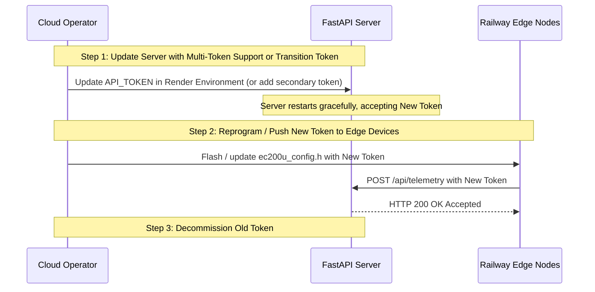

# System Operations & Maintenance Guide

**Project:** Panorama Water Tank Monitor (WLI) — NextGen  
**Document:** Field Operations, Troubleshooting & Maintenance Manual  
**Target Audience:** Field Engineers, Embedded Developers & DevOps Personnel  
**Date:** 2026-11-17  

---

## 1. STM32 Firmware Flashing & Update Procedures

### A. Initial Bench Flashing via ST-LINK (SWD)
1. **Physical Connection:** Connect ST-LINK V2/V3 to the STM32 4-pin SWD header:
   - `SWCLK` $\rightarrow$ Pin 49 (`PA14`)
   - `SWDIO` $\rightarrow$ Pin 46 (`PA13`)
   - `GND`   $\rightarrow$ System Ground
   - `3V3`   $\rightarrow$ Target VDD Reference
2. **Flash Command (using OpenOCD or STM32CubeProgrammer):**
   ```bash
   # Using STM32CubeProgrammer CLI
   STM32_Programmer_CLI -c port=SWD mode=UR -w firmware_wli_v2.2.0.hex 0x08000000 -v -rst
   ```

### B. Firmware Over-The-Air (FOTA) Considerations
The Quectel EC200U-CN supports HTTP file downloading to modem user file storage (UFS) via `AT+QHTTPGET`. For field OTA upgrades, the STM32 bootloader can read the downloaded binary via UART and write to internal flash bank 2.

---

## 2. Cloud Backend Deployment & Rollback (Render)

### A. Deploying Updates
1. Push committed changes to the GitHub repository branch `main`:
   ```bash
   git push origin main
   ```
2. Render detects the push to `HTTPS_Server` (configured via `rootDir: HTTPS_Server` in `render.yaml`) and triggers an automated build:
   - Environment: Python 3.11+
   - Build: `pip install -r requirements.txt`
   - Zero-Downtime Swap: Render boots the new container and verifies `GET /api/health` before redirecting public edge traffic.

### B. Rollback Procedure
If a defect is observed post-deployment:
1. Open the **Render Dashboard** $\rightarrow$ Navigate to `panorama-wli-https-receiver`.
2. Select **Events** $\rightarrow$ Locate the previous known good deployment.
3. Click **Rollback to this deploy**. The previous immutable container image is restored in $<30$ seconds.

---

## 3. Zero-Downtime API Token Rotation Procedure

To rotate the secret ingestion token without dropping active telemetry:



---

## 4. CA Certificate Maintenance & Renewal

The Quectel EC200U hardware SSL engine uses the Let's Encrypt `ISRG Root X1` certificate:
- **Expiration Date:** September 30, 2035 (valid for over 8 years).
- **Server Certificate Renewals:** Render renews its edge server certificates every 90 days. Because the root trust anchor (`ISRG Root X1`) remains unchanged, **zero maintenance or modem updates are required** during standard 90-day cloud certificate renewals.

### Updating `cacert.pem` in Modem Storage (if Trust Anchor Changes)
```text
1. Delete old cert:      AT+QFDEL="cacert.pem"
2. Upload new cert:      AT+QFUPL="cacert.pem",<file_size_in_bytes>,100
   (Stream raw PEM bytes immediately following the 'CONNECT' prompt)
3. Verify existence:     AT+QFLST="*"  (Expect: +QFLST: "cacert.pem",<size>)
4. Rebind to SSL:        AT+QSSLCFG="cacert",1,"cacert.pem"
```

---

## 5. Diagnostic & Troubleshooting Procedures

### A. Cellular Modem Troubleshooting
| Symptom | Probable Cause | Corrective Action |
|---|---|---|
| `+CPIN: NOT INSERTED` | Micro-SIM loose or dirty contacts | Reseat SIM card; inspect SIM tray spring contacts; verify 1.8V/3.0V SIM VDD. |
| `+CEREG: 0,2` (Searching) | Antenna disconnected or out of coverage | Inspect SMA connector; attach high-gain external whip antenna; test outdoors. |
| `+CEREG: 0,3` (Denied) | SIM expired or unpaid cellular plan | Contact Airtel India carrier support; verify data balance on account. |
| `+QIACT: ERROR` | Incorrect APN string | Verify `AT+QICSGP=1,1,"airtelgprs.com"`; check network roaming status. |
| `+QHTTPPOST: 714` | DNS resolution failure | Verify carrier IP assignment via `AT+QIACT?`; ping carrier DNS (e.g. `8.8.8.8`). |
| `+QHTTPPOST: 716` | SSL/TLS handshake failed | Verify `AT+QSSLCFG="seclevel",1,1`, check SNI enabled, verify `ignorelocaltime=1`. |

### B. Hydrostatic Level Sensor Diagnostics
| Measured Voltage | Diagnosis | Corrective Action |
|---|---|---|
| $V < 0.200\,\text{V}$ | **Open Circuit / Wire Cut** | Check 2-wire current loop cable; check 24V loop power supply; inspect terminal blocks. |
| $V > 4.850\,\text{V}$ | **Short Circuit / Overvoltage** | Check for water ingress in junction box; check op-amp supply rails; verify $250\,\Omega$ shunt. |
| $0.500\,\text{V}$ when tank has water | **Clogged Sensor Vent Pipe** | Submersible sensors use a vented cable to compensate for atmospheric pressure. Ensure vent tube is dry and unobstructed. |
| Drift / Non-linear readings | **Biological Fouling / Sludge** | Withdraw sensor from bottom of tank; gently clean sensing diaphragm with soft brush (do not poke diaphragm with sharp tools). |
