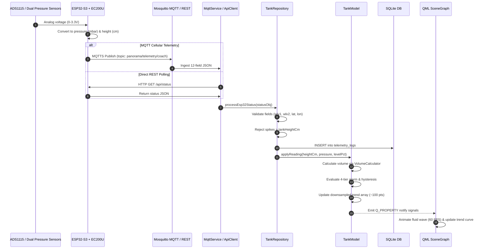

# Comprehensive Telemetry & UI Data Flow

**Scope**: End-to-End Data Pipeline from Edge Sensor to Presentation  
**Project**: Panorama Water Tank NextGen Rebuild  
**Date**: October 30, 2026  

---

## 1. Primary Ingestion Pipelines

---

## 2. Invariant Data Guarantees

1. **Deterministic Downsampling**:
   The historical time series preserves boundary min/max points while enforcing chronological ordering across 12-hour, 24-hour, and 7-day ranges, capped at ~100 points for smooth QML Canvas rendering.
2. **Authoritative REST vs Live Stream Alignment**:
   When direct REST returns authoritative measurements from the edge device, they override cached polling readings, keeping the live model and historical chart latest value aligned.
3. **No False Alarms on Disconnect**:
   When network communication drops, the model transitions to `Offline` and retains last known physical values rather than zeroing out to 0 cm, preventing false Critical Low alarms.

