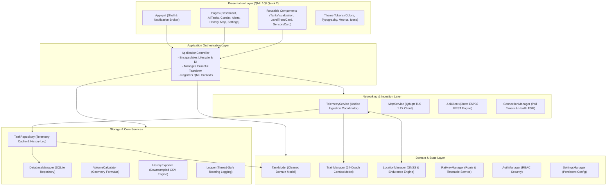

# NextGen Target Architecture Specification

**Project**: Panorama Water Tank NextGen Rebuild  
**Destination**: `C:\Users\User\Documents\Antigravity_soumik\PanoramaWaterTank_NextGen`  
**Framework**: Modern Modular C++20 / Qt 6.12 (QML, QtQuick, QtMqtt, QtSql)  
**Date**: October 30, 2026  

---

## 1. Architectural Philosophy & Design Principles

The NextGen rebuild eliminates the monolithic structure of the legacy application and establishes a clean, decoupled, tiered architecture:



---

## 2. Directory Structure

```text
PanoramaWaterTank_NextGen/
│
├── CMakeLists.txt                 # Primary build configuration (C++20, Qt 6.12, Ninja)
├── CMakePresets.json              # Standardized build presets
├── README.md                      # Project documentation and build instructions
│
├── app/
│   ├── main.cpp                   # Minimal entry point (< 60 lines)
│   ├── ApplicationController.h    # Central orchestrator & lifecycle manager
│   └── ApplicationController.cpp  # Dependency injection & signal orchestration
│
├── src/
│   ├── core/                      # Mathematical engines, utilities, logging
│   │   ├── VolumeCalculator.h / .cpp
│   │   ├── HistoryExporter.h / .cpp
│   │   ├── Logger.h / .cpp
│   │   ├── TimeManager.h / .cpp
│   │   └── DisplayPerformanceManager.h / .cpp
│   │
│   ├── networking/                # HTTP REST client and polling engine
│   │   ├── ApiClient.h / .cpp
│   │   └── ConnectionManager.h / .cpp
│   │
│   ├── telemetry/                 # MQTT client and telemetry models
│   │   ├── MqttConfig.h / .cpp
│   │   ├── MqttService.h / .cpp
│   │   └── TelemetryService.h / .cpp
│   │
│   ├── domain/                    # Authoritative business models
│   │   ├── TankModel.h / .cpp
│   │   ├── TrainManager.h / .cpp
│   │   ├── TrainConfigProvider.h / .cpp
│   │   ├── RailwayManager.h / .cpp
│   │   └── LocationTypes.h
│   │
│   ├── services/                  # Business services
│   │   ├── LocationManager.h / .cpp
│   │   ├── SearchManager.h / .cpp
│   │   └── ApplicationStateManager.h / .cpp
│   │
│   ├── repository/                # SQLite storage and repositories
│   │   ├── DatabaseManager.h / .cpp
│   │   └── TankRepository.h / .cpp
│   │
│   ├── security/                  # RBAC authentication & authorization
│   │   ├── AuthManager.h / .cpp
│   │   ├── PermissionManager.h / .cpp
│   │   └── Types.h
│   │
│   └── configuration/             # Persistent configuration
│       └── SettingsManager.h / .cpp
│
├── qml/                           # Recreated visual QML hierarchy
│   ├── App.qml
│   ├── components/
│   ├── pages/
│   ├── auth/
│   ├── search/
│   └── theme/
│
├── assets/                        # Icons, logos, and hero graphics
│   └── images/
│
├── tests/                         # Full automated test suite
│   ├── test_csv_export.cpp
│   ├── test_mqtt_service.cpp
│   ├── test_esp32_rest.cpp
│   ├── test_location_and_tanks.cpp
│   ├── test_role_railway_architecture.cpp
│   └── test_e2e_integration.cpp
│
└── WLI_DOCS/                      # Complete verification and architecture reports
```

---

## 3. Key Architectural Improvements

1. **Decoupled Application Lifecycle**:
   `ApplicationController` encapsulates the instantiation of all services, dependency injection, and signal wiring. When the application receives `aboutToQuit`, `ApplicationController::shutdown()` systematically stops network polling, disconnects MQTT, flushes database transactions, and saves state *before* the QML engine is destroyed, eliminating dangling pointer crashes.

2. **Clean Separation of Telemetry and Domain State**:
   - `TelemetryService` serves as the single entry point for all sensor readings (MQTT and REST).
   - `TankModel` focuses purely on authoritative tank geometry, live volume/percentage derivation, and alarm evaluation with deadband hysteresis.
   - Sensor transient spikes exceeding physical limits are intercepted and rejected prior to model updates.

3. **Isolated Persistence**:
   - `DatabaseManager` encapsulates all SQLite operations with transactions and prepared queries.
   - Schema creation and seed migrations run synchronously during initialization.

4. **Visual Parity Guarantee**:
   All visual tokens (`Colors.qml`, `Typography.qml`, `Metrics.qml`, `Icons.qml`) and component behaviors (`TankVisualization.qml` fluid wave, `LevelTrendCard.qml` LTTB downsampled charts, `ConsistGrid.qml` 24 coaches) are strictly preserved from the original application.

