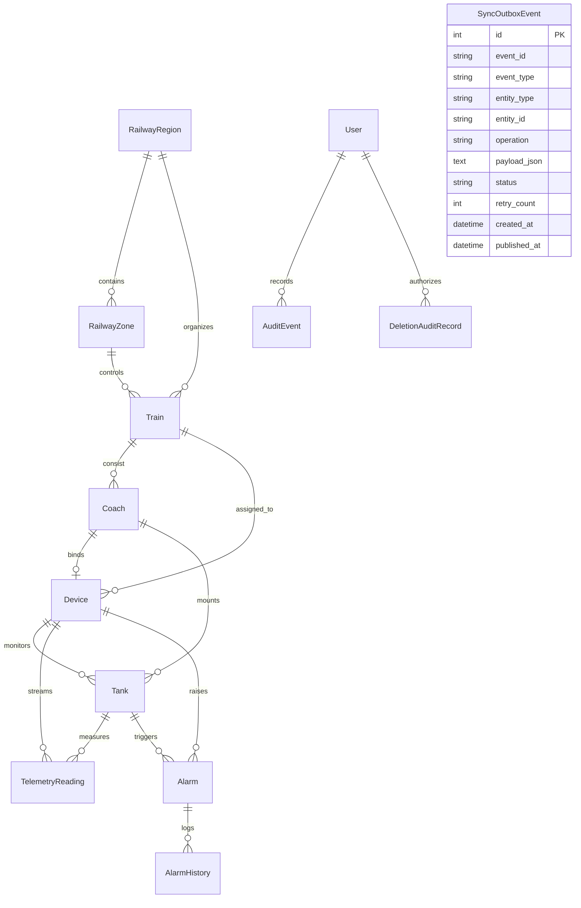

# Panorama Water Tank Monitor – Database Architecture

## 1. Executive Architecture Overview

The **Panorama Water Tank Monitor (NextGen)** SCADA system utilizes a robust, permanent, production-grade relational database architecture designed for zero data loss, high concurrency, and non-destructive operations.

- **Primary Production Engine:** PostgreSQL 16 (Hosted via managed Render database `panorama-postgres` configured in `render.yaml`).
- **Development & Offline Engine:** SQLite 3 with Write-Ahead Logging (WAL) and `aiosqlite` asynchronous driver.
- **ORM & Data Layer:** SQLAlchemy 2.0 with async engine, typed models, connection pooling, and `AsyncSessionLocal`.
- **Database Migrations:** Alembic versioned migrations (`migrations/versions/001_initial_schema.py`, `002_add_trains_table.py`, `003_permanent_database_architecture.py`).
- **Distributed Event Outbox:** Transactional outbox pattern (`sync_outbox`) guaranteeing zero lost mutations across MQTT and WebSocket clients.

---

## 2. Entity-Relationship Model (ER Diagram)



---

## 3. Database Schema Specification

### 3.1 Railway Hierarchy (`railway_regions` & `railway_zones`)
- **`railway_regions`**: Natural key `code` (e.g. `NORTH`, `EAST`, `SOUTH`, `WEST`, `CENTRAL`), `name`, `headquarters`, `description`, `created_at`.
- **`railway_zones`**: Natural key `code` (e.g. `NR`, `NCR`, `ER`, `SER`, `SR`, `WR`, `CR`), `name`, `region_code` (FK to `railway_regions.code`), `headquarters`, `created_at`.

### 3.2 Fleet Entities (`trains` & `coaches`)
- **`trains`**:
  - `id`: UUID (String 36, PK).
  - `train_number`: Unique 5-digit railway identifier (String 16, Indexed).
  - `name`: Train commercial title (String 160).
  - `source_station`, `source_code`, `destination_station`, `destination_code`.
  - `region`: Canonical region code (String 32).
  - `railway_zone`: Zonal division code (String 16).
  - `train_type`: e.g. "Rajdhani", "Shatabdi", "Express".
  - `tank_height_cm`: Standard train default tank height (Float, default 50.0 cm).
  - `tank_capacity_liters`: Standard default capacity (Float, default 20.0 L).
  - `coach_configuration_json`: Synchronized JSON manifest of train consist.
  - `is_deleted`: Soft-delete status flag (Boolean, default False).
  - `created_at`, `updated_at`: UTC timestamps.
- **`coaches`**:
  - `id`: UUID (String 36, PK).
  - `train_id`: Foreign key to `trains.id` with `ON DELETE CASCADE`.
  - `train_number`: Railway train number (String 16, Indexed).
  - `coach_number`: Coach identifier (e.g. `B4`, `A1`, `PC`) (String 16, Indexed).
  - `coach_name`: Descriptive display name (String 64).
  - `coach_category`: `PASSENGER`, `LOCOMOTIVE`, `BRAKE_LUGGAGE`, `PANTRY` (String 64).
  - `coach_type`: `AC_CHAIR_CAR`, `AC_3_TIER`, `AC_2_TIER`, `SLEEPER` (String 32).
  - `position`: Sequential order within consist (Integer, 1..N).
  - `device_uid`: Bound edge telemetry hardware UID (String 64, Indexed).
  - `is_deleted`: Soft-delete status flag (Boolean, default False).
  - Unique Constraint: `(train_number, coach_number, is_deleted)`.

### 3.3 Hardware & Telemetry Entities (`devices`, `tanks`, `telemetry_readings`)
- **`devices`**:
  - `id`: UUID (String 36, PK).
  - `uid`: Unique hardware identifier (e.g. `WLI-NODE-001`, `Quectel EC200U IMEI`).
  - `train_number`, `coach_number`: Active consist assignment.
  - `hardware_version`, `firmware_version`, `device_type`, `protocol`.
  - `status`: `AVAILABLE`, `ENGAGED`, `MAINTENANCE`.
  - `is_online`: Real-time connectivity flag.
  - `last_seen_at`: UTC timestamp of most recent heartbeat or frame.
  - `is_deleted`: Soft-delete status flag.
- **`tanks`**:
  - `id`: UUID (String 36, PK).
  - `device_id`: Foreign key to `devices.id` with `ON DELETE CASCADE`.
  - `coach_id`: Foreign key to `coaches.id` with `ON DELETE CASCADE`.
  - `tank_index`: 1 (Primary / Arrival) or 2 (Auxiliary / Departure).
  - `capacity_liters`: Water volume capacity (Float, default 20.0 L).
  - `height_cm`: Total tank height (Float, default 50.0 cm).
  - `area_m2`: Cross-sectional surface area (Float, default 0.04 m²).
  - `tank_type`: `CYLINDRICAL` or `RECTANGULAR`.
  - `warning_threshold_percent`, `critical_threshold_percent`, `overflow_threshold_percent`.
  - Unique Constraint: `(device_id, tank_index)`.
- **`telemetry_readings`**:
  - `id`: BigInt Autoincrement PK.
  - `device_id`: FK to `devices.id`.
  - `device_uid`: Indexed hardware UID.
  - `train_number`, `coach_number`: Contextual assignment at time of capture.
  - `tank_index`: 1 or 2.
  - `timestamp`: UTC sampling timestamp.
  - `level_percent`: Water fill percentage (0.0 to 100.0%).
  - `volume_liters`: Absolute calculated liquid volume.
  - `height_cm`: Measured water column height.
  - `sensor_valid`: Integrity check flag.
  - GPS coordinates (`latitude`, `longitude`, `speed_kmh`, `satellites`).
  - Battery metrics (`battery_v1`, `auxiliary_v2`).

### 3.4 Governance & Audit (`audit_events`, `deletion_audit_records`, `sync_outbox`)
- **`audit_events`**: Immutable ledger of all user actions (logins, updates, registrations).
- **`deletion_audit_records`**: Permanent historical record created whenever an administrator explicitly deletes a train, coach, or device. Contains `admin_username`, `entity_type`, `entity_identifier`, complete `snapshot_json` prior to deletion, `reason`, `ip_address`, and `created_at`.
- **`sync_outbox`**: Transactional event outbox ensuring guaranteed delivery of synchronization events to MQTT and WebSocket subscribers even across server crashes or network partitioning.

---

## 4. Connection Pooling and Reliability

Configured in `backend/app/core/database.py`:

```python
# Concurrency configuration:
if is_sqlite:
    engine_kwargs["connect_args"] = {"check_same_thread": False, "timeout": 30.0}
    engine_kwargs["poolclass"] = NullPool
else:
    # High-throughput PostgreSQL Connection Pool
    engine_kwargs["pool_size"] = 10
    engine_kwargs["max_overflow"] = 20
    engine_kwargs["pool_pre_ping"] = True      # Validates dead connections before checkout
    engine_kwargs["pool_recycle"] = 3600       # Recycles connections every hour
```

For SQLite, SQLite WAL mode is configured on every connection:
- `PRAGMA journal_mode=WAL`
- `PRAGMA synchronous=NORMAL`
- `PRAGMA busy_timeout=10000`
