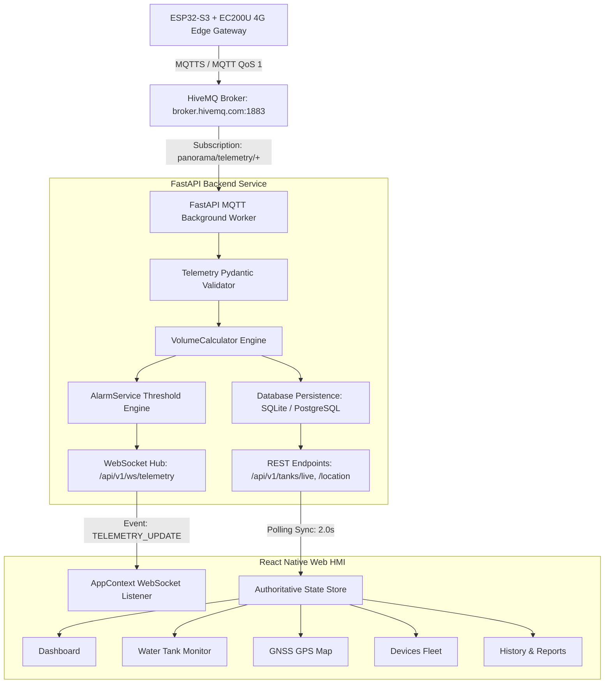

# Authoritative MQTT Telemetry Data Flow Specification

**Project:** Panorama Water Tank NextGen (Railway SCADA/HMI)  
**Workspace:** `C:\Users\User\Documents\Antigravity_soumik\PanoramaWaterTank_NextGen`  
**Document Version:** 2.0.0  
**Date:** October 31, 2026

---

## 1. Architectural Architecture Overview

The Panorama Water Tank NextGen application enforces a single authoritative data pipeline. Operational sensor data, device health, water levels, and GPS positions enter the system exclusively through MQTT subscriptions managed by the backend service. No browser or frontend component connects directly to the MQTT broker, preserving broker security, authentication credentials, and centralized business logic.



---

## 2. MQTT Broker & Topic Configuration

* **Broker Host:** `broker.hivemq.com`
* **Default TCP Port:** `1883` (Standard) / `8883` (TLS)
* **Client ID Pattern:** `panorama-backend-{uuid[:8]}`
* **Telemetry Wildcard Topic:** `panorama/telemetry/+`
* **Device Telemetry Topic Format:** `panorama/telemetry/{device_uid}`
* **Device Command Topic Prefix:** `panorama/commands/{device_uid}`
* **Status Topic Pattern:** `panorama/status/{device_uid}`

> [!NOTE]
> All credentials and connection configurations are stored in server-side environment variables (`.env`) or database settings and are never exposed to browser clients.

---

## 3. Edge Telemetry Message Schema

The hardware gateway (ESP32-S3 running FreeRTOS with Quectel EC200U 4G LTE) transmits JSON payloads matching the following authoritative schema:

### 3.1 JSON Payload Definition

```json
{
  "uid": "0026004D4B42501120353332",
  "trno": "12002",
  "chno": "B4",
  "wlp1": 74.5,
  "wlp2": 72.0,
  "wlvl": true,
  "wlv2": true,
  "lat": 27.1751,
  "long": 78.0421,
  "alt": 169.0,
  "speed": 65.5,
  "sats": 10,
  "v1": 12.8,
  "v2": 12.7,
  "dt": "2026-10-31",
  "time": "16:55:00"
}
```

### 3.2 Field Specifications

| Key | Type | Description | Nullable / Required | Validation Rules |
|---|---|---|---|---|
| `uid` | string | 24-character hexadecimal device unique identifier | **Required** | Must match regex `^[0-9A-Fa-f]{24}$` |
| `trno` | string | Indian Railways 5-digit train number | Optional | Coerced to string (e.g. `"12002"`) |
| `chno` | string | Coach designation (e.g. `"B4"`, `"C1"`) | Optional | String |
| `wlp1` | float | Primary tank water level percentage | Optional | Bounded: `0.0 <= wlp1 <= 200.0` |
| `wlp2` | float | Secondary auxiliary tank water level percentage | Optional | Bounded: `0.0 <= wlp2 <= 200.0` |
| `wlvl` | bool | Primary pressure sensor validity bit | Optional | Boolean |
| `wlv2` | bool | Secondary sensor validity bit | Optional | Boolean |
| `lat` | float | GNSS Latitude in decimal degrees (WGS84) | Optional | Bounded: `-90.0 <= lat <= 90.0` |
| `long` / `lon` | float | GNSS Longitude in decimal degrees (WGS84) | Optional | Bounded: `-180.0 <= lon <= 180.0` |
| `alt` | float | GNSS Altitude in meters above mean sea level | Optional | Float |
| `speed` | float | Ground speed in km/h | Optional | Float |
| `sats` | integer | Number of tracked GNSS satellites | Optional | Integer `>= 0` |
| `v1` | float | Primary battery voltage in Volts | Optional | Float |
| `v2` | float | Auxiliary battery/bus voltage in Volts | Optional | Float |
| `dt` | string | Telemetry date or full ISO8601 timestamp | Optional | ISO string format |
| `time` | string | Telemetry time string (e.g. `HH:MM:SS`) | Optional | Combined with `dt` if `dt` is date-only |

---

## 4. Telemetry Validation & Rejection Pipeline

When a message is received on `panorama/telemetry/+`:

1. **Topic Verification:** The topic suffix is extracted and compared against `payload.uid`. If mismatched, an anomaly is logged.
2. **Schema & Range Validation:** The payload is parsed using `TelemetryPayload` (Pydantic v2).
   - If JSON is malformed or unparseable, it is dropped and logged as a parser error.
   - If numeric fields exceed physical limits (e.g., `lat > 90.0`, `wlp1 < 0.0`), Pydantic raises a `ValidationError`. The message is rejected without overwriting existing valid state.
3. **Device Association:** The backend resolves the `Device` record using `uid`. If the device is not registered, it is automatically provisioned with default cylindrical tank geometry.
4. **Volume & Geometry Calculation:**
   $$\text{Volume (L)} = \left(\frac{\text{wlp1}}{100.0}\right) \times \text{Capacity (L)}$$
   $$\text{Water Height (cm)} = \left(\frac{\text{wlp1}}{100.0}\right) \times \text{Max Height (cm)}$$
5. **Persistence:** The reading is committed to the `telemetry_readings` table.
6. **Alarm Evaluation:** `AlarmService` checks `level_percent` against configured thresholds:
   - Level `< 10.0%`: `CRITICAL` low water alarm.
   - Level `< 20.0%`: `WARNING` low water alarm.
   - Level `> 100.0%`: `OVERFLOW` warning alarm.
7. **Real-time Broadcast:** A `TELEMETRY_UPDATE` WebSocket packet is emitted to all active frontend clients with the computed metrics.

---

## 5. Data Freshness & Stale Transition Rules

* **Freshness Threshold:** `30.0 seconds`
* **Rule:** If the elapsed duration between the current time and the last telemetry timestamp exceeds 30.0 seconds:
  $$\Delta t = t_{\text{now}} - t_{\text{last}} > 30\,\text{s}$$
* **System Actions upon Stale State:**
  - `liveTank.isStale` transitions to `True`.
  - `liveTank.alarmStatus` switches to `"STALE_DATA"`.
  - The UI presents an amber `Stale Data` badge.
  - Existing numerical readings remain displayed for diagnostic inspection but are visually distinguished from live data.
  - GNSS speed transitions to stale indication; dead-reckoning or fake train movement is strictly forbidden.

---

## 6. Historical Data Integrity & Limitations

* **No Synthetic Backfilling:** Historical charts (`LevelTrendCard`, `HistoryScreen`) query only records actually saved in `telemetry_readings`.
* **Zero-Filling Prohibition:** When no records exist in the database for a selected interval (e.g. 1h, 24h, 7d), the system renders an explicit empty-state message:  
  `"No historical water level telemetry recorded yet. Awaiting live MQTT telemetry..."`  
  It does **not** draw flat 0% lines or sine waves.
* **Downsampling:** For intervals exceeding 24 hours, downsampling is computed using Largest Triangle Three Buckets (LTTB) or min/max/average aggregation on actual points, preserving physical peaks and troughs without interpolating unmeasured periods.

