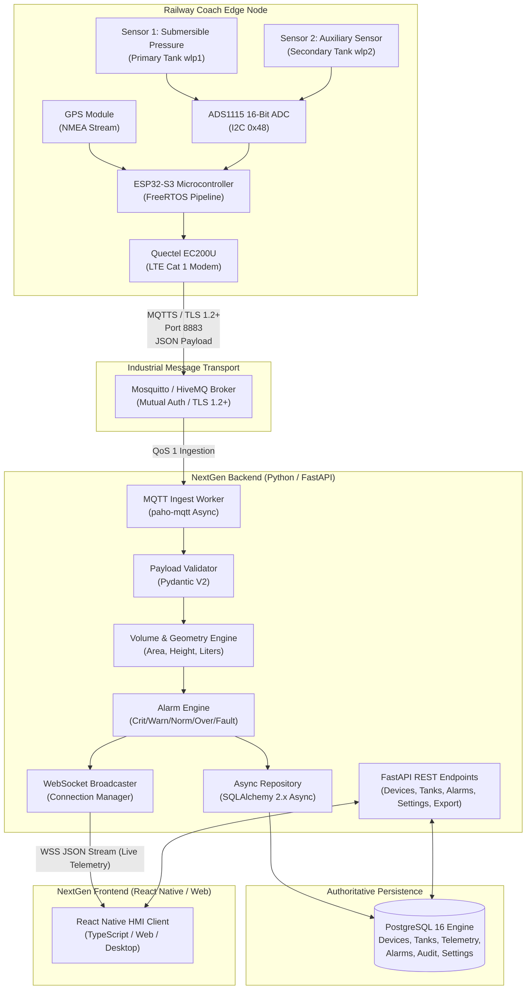
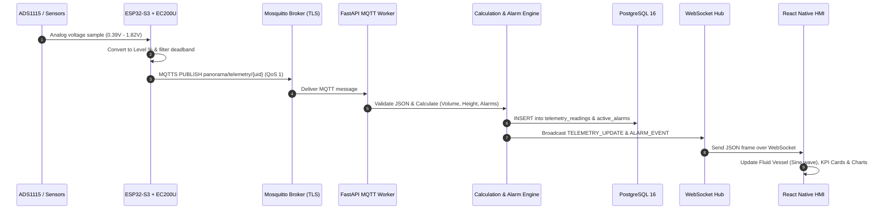
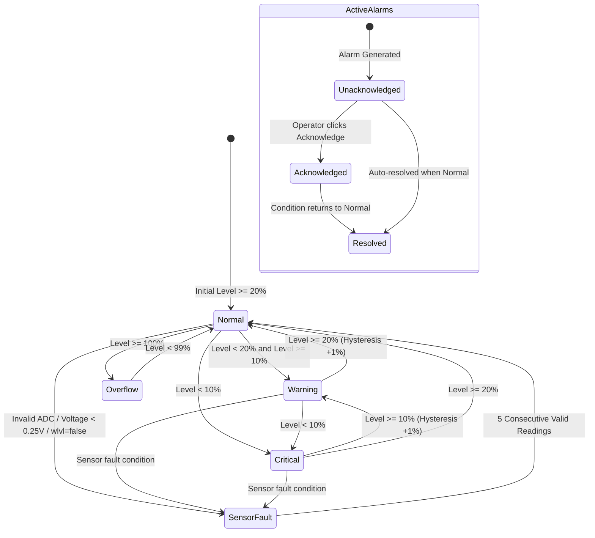

# Panorama Water Tank Monitor — System Architecture

## 1. Executive Architecture Summary

The **Panorama Water Tank Monitor — NextGen** architecture replaces the legacy monolithic C++/Qt desktop and Ubidots cloud application with a decoupled, containerized, industrial IoT supervisory control and data acquisition (SCADA/HMI) platform.

The system is designed around five core principles:
1. **Zero External Cloud Lock-in**: Full operational independence without proprietary cloud dependencies (100% free of Ubidots).
2. **Deterministic Mathematical Parity**: Strict adherence to the legacy fluid volume calculations, deadband hysteresis, and 4-tier alarm boundaries.
3. **Resilient Connectivity**: End-to-end TLS 1.2+ encrypted communication, exponential backoff with jitter, offline buffering, and dead-letter handling.
4. **Authoritative Persistence**: Enterprise PostgreSQL 16 database with ACID guarantees, time-series partitioning readiness, and Alembic migrations.
5. **Modern HMI / SCADA Experience**: React Native (TypeScript) cross-platform interface delivering 60 FPS animated fluid physics, responsive dashboards, and interactive historical charts.

---

## 2. High-Level System Topology

---

## 3. Component Details & Design Contracts

### 3.1 Edge Tier (Hardware & Firmware)
- **Microcontroller**: ESP32-S3 running FreeRTOS with dedicated tasks for sensor sampling, Kalman filtering, power management, and cellular AT command handling.
- **Cellular Modem**: Quectel EC200U Cat 1 module communicating via UART AT commands (`AT+QMTOPEN`, `AT+QMTCONN`, `AT+QMTPUB`).
- **Telemetry Payload**: Compact JSON stream conforming to `panorama/telemetry/{deviceId}` containing water levels, sensor validity flags, GPS, and bus voltages.

### 3.2 Transport Tier (MQTT Broker)
- **Protocol**: MQTT v3.1.1 / v5.0 over TLS 1.2+ (Port 8883).
- **Security**: TLS encryption with CA certificate validation, username/password authentication or client certificates.
- **Topic Hierarchy**:
  - Ingestion: `panorama/telemetry/{deviceId}`
  - Diagnostics: `panorama/diagnostics/{deviceId}`
  - Device Commands: `panorama/commands/{deviceId}`
  - System Broadcasts: `panorama/system/announcements`
- **Quality of Service**: QoS 1 (At least once delivery) with Last Will and Testament (LWT) configured to publish offline state on disconnect.

### 3.3 Backend Tier (Python / FastAPI)
- **Asynchronous Core**: FastAPI powered by Uvicorn and AsyncIO for high-throughput, non-blocking I/O.
- **Telemetry Ingestion Worker**: Background daemon managing resilient MQTT connection with auto-reconnection and exponential backoff jitter.
- **Calculation Service**: Exact implementation of the legacy C++ `VolumeCalculator`:
  $$\text{Area } A = \pi \cdot r^2 = 0.04 \text{ m}^2, \quad r \approx 0.112838 \text{ m}$$
  $$\text{Height } h = H_{\max} \cdot \left(\frac{\text{level}\%}{100}\right) = 0.50 \cdot \left(\frac{\text{level}\%}{100}\right)$$
  $$\text{Volume } V = A \cdot h \cdot 1000 \quad \text{[Liters]}$$
- **Alarm Engine**: Real-time evaluation of all incoming telemetry points against configured thresholds, managing state transitions (Active, Acknowledged, Resolved).
- **LTTB Downsampling Service**: Largest-Triangle-Three-Buckets algorithm implemented for time-series aggregation, reducing datasets to ~100 points for smooth charting.
- **WebSocket Gateway**: Real-time push notification of telemetry frames and alarm events to connected HMI clients.

### 3.4 Persistence Tier (PostgreSQL 16)
- **Schema**: Strongly typed relational schema with foreign key constraints, indexes on timestamp and device identifiers, and JSONB support for raw telemetry archives.
- **ORM**: Async SQLAlchemy 2.0 with session lifecycle management.
- **Migrations**: Alembic declarative migrations tracking schema evolution.

### 3.5 Client Tier (React Native + TypeScript)
- **Industrial HMI Layout**: 1536x1024 baseline responsive grid featuring collapsible sidebar navigation, top operational header, and bottom status bar.
- **Fluid Animation Engine**: Custom SVG/Canvas implementation of dual-sine wave fluid animation with real-time level scaling.
- **Data Synchronization**: Hybrid REST for initial bootstrap and historical queries + WebSocket for sub-second live telemetry updates.

---

## 4. End-to-End Telemetry Data Flow

---

## 5. Alarm Lifecycle State Machine

---

## 6. Failure Recovery & Resilience Strategy

### 6.1 Cellular & MQTT Disconnection
- If the cellular network drops or the MQTT broker is unreachable:
  1. The ESP32-S3 firmware buffers up to 256 telemetry frames in local SPIFFS / non-volatile storage.
  2. The EC200U modem attempts reconnection with exponential backoff: $T = \min(2^k \times 1000\text{ms} + \text{jitter}, 60000\text{ms})$.
  3. Upon reconnection, buffered records are published with their original edge timestamps.
  4. The broker detects sudden disconnection via the MQTT keepalive ping (30s) and triggers the Last Will and Testament (LWT) topic `panorama/status/{uid}` setting `online: false`.

### 6.2 Backend Ingestion Recovery
- The FastAPI MQTT consumer maintains an automatic reconnect loop.
- If the PostgreSQL database becomes momentarily unavailable:
  - Telemetry messages are retained in an in-memory ring buffer (up to 1,000 frames).
  - A circuit breaker trips, pausing MQTT message acknowledgement (`QoS 1`) to allow the broker to retain unacknowledged messages.
  - Once the database reconnects, buffered frames are flushed within an async transaction.

### 6.3 Frontend Connection Degradation
- The React Native client monitors WebSocket heartbeat pings every 5 seconds.
- If disconnected:
  - The UI immediately changes the header status badge from **CONNECTED** to **RECONNECTING** (Amber).
  - An exponential retry loop reconnects the WebSocket.
  - In the interim, the frontend falls back to periodic REST polling (`GET /api/v1/tanks/live`) every 5 seconds.
  - Once restored, the header transitions to **CONNECTED** (Green) and restores the live WebSocket stream.

