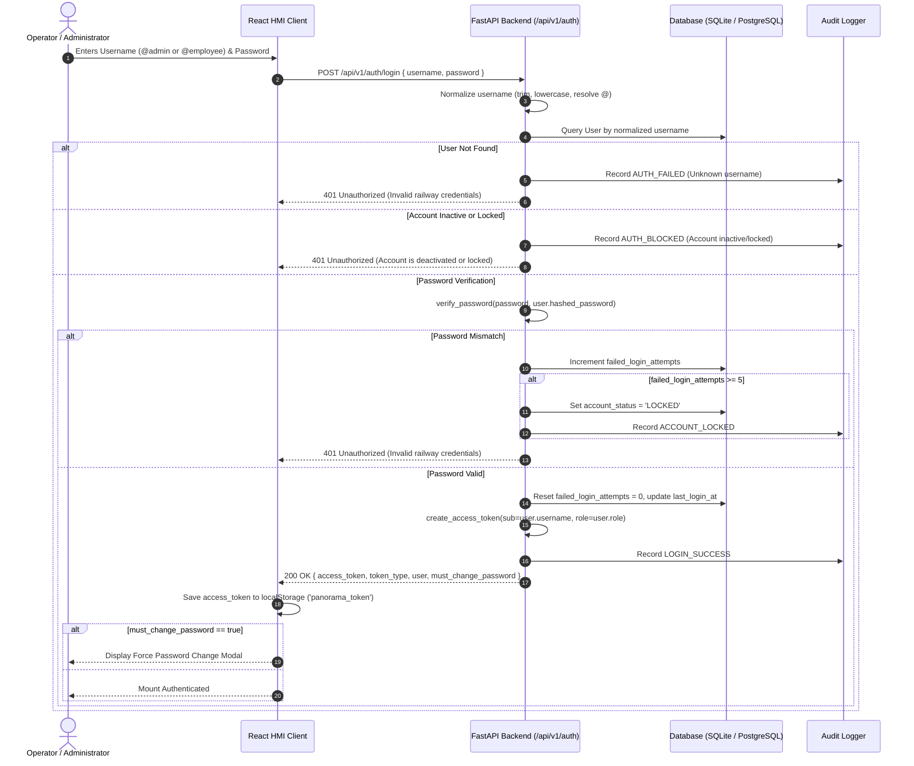

# Authentication & Credential Governance Flow

## 1. Overview

The Panorama Water Tank Monitor NextGen enforces a zero-trust, token-based authentication system backed by JSON Web Tokens (JWT) signed via HMAC-SHA256 (HS256) and salted bcrypt password hashing.

### Core Security Principles
- **Zero Plaintext Credentials**: Credentials are never stored in plaintext in the database or embedded within frontend source bundles.
- **Root Admin Immobility**: The `@admin` password cannot be changed, reset, or bypassed through any web application route; developer console recovery is required.
- **Admin-Managed Employee Credentials**: Employee credentials are created, reset, locked, and managed by administrators.
- **Mandatory First-Login Password Change**: Users flagged with `must_change_password: true` are intercepted by a mandatory password modal prior to console entry.
- **Brute Force Lockout**: Accounts exceeding 5 consecutive failed login attempts are automatically marked `account_status: LOCKED`.

---

## 2. Standard Login Sequence Flow



---

## 3. Account Roles & Initial State

| Role | Username | Initial Password | Permissions | Password Policy |
| :--- | :--- | :--- | :--- | :--- |
| `ADMIN` | `@admin` | `Admin@123` | Full access across all 11 system screens. Can manage employees and apply unified system settings. | In-app change forbidden (`POST /change-password` returns HTTP 403). Developer CLI only. |
| `EMPLOYEE` | `@employee` | `Employee@123` | Operational access (Dashboard, Tanks, Trains, Location, Alerts, History, Reports). | Reset by Admin. Mandatory change on next login supported. |

---

## 4. Forced Password Change Workflow

When an employee logs in with a temporary password (or when an administrator selects **Force password change on next login** during password reset):

1. The backend issues a valid JWT token, but the payload includes:
   ```json
   {
     "access_token": "eyJhbGciOi...",
     "token_type": "bearer",
     "must_change_password": true,
     "user": { ... }
   }
   ```
2. The React client intercepts this response in [LoginScreen.tsx](file:///c:/Users/User/Documents/Antigravity_soumik/PanoramaWaterTank_NextGen/apps/mobile/src/screens/LoginScreen.tsx) and displays a modal dialog:
   - Input: **New Password** (minimum 6 characters).
   - Input: **Confirm New Password**.
   - Action: **Update Password & Continue**.
3. Submission calls `POST /api/v1/auth/change-password` with `Authorization: Bearer <token>`.
4. The backend verifies the user is an `EMPLOYEE`, hashes the new password with bcrypt, updates the record, sets `must_change_password = False`, and logs a `PASSWORD_CHANGED` audit record.
5. The modal closes and navigation proceeds to the main dashboard.

---

## 5. Admin Password Immobility & Developer Recovery

To prevent accidental lockouts, session hijacking, or unauthorized administrative credential overrides from the web interface, the administrator password policy is enforced at the API controller layer:

```python
# backend/app/api/v1/auth.py
if current_user.role == "ADMIN" or current_user.username.lstrip("@").lower() == "admin":
    raise HTTPException(
        status_code=status.HTTP_403_FORBIDDEN,
        detail="Administrator passwords cannot be changed in-app. Use the secure developer recovery CLI tool."
    )
```

### Developer Recovery CLI Procedure
If the administrator password must be audited or reset:

1. Connect to the host terminal or container environment.
2. Run the secure recovery script:
   ```bash
   python backend/scripts/recover_admin.py --status
   ```
   *Output displays current account status, lock status, failed attempt counts, and last login timestamps.*
3. To reset the root administrator password:
   ```bash
   python backend/scripts/recover_admin.py --reset "NewSecureAdminPassword123!"
   ```
4. The CLI hashes the new password with bcrypt, clears any lockout flag, and resets `failed_login_attempts` to 0.

---

## 6. Role-Based Route Guards (RBAC)

RBAC is enforced on both backend API routes and the client interface:

```
                          ┌──────────────────────────┐
                          │   HTTP Request Headers   │
                          │ Authorization: Bearer JWT│
                          └─────────────┬────────────┘
                                        ▼
                          ┌──────────────────────────┐
                          │  get_current_user Guard  │
                          │ Validates JWT & Expiry   │
                          └─────────────┬────────────┘
                                        ▼
                          ┌──────────────────────────┐
                          │     Is Account Active?   │
                          └───────┬──────────┬───────┘
                                  │ No       │ Yes
                                  ▼          ▼
                             401 Blocked  ┌───────────────────────────┐
                                          │ get_current_admin_user    │
                                          │ Checks user.role == ADMIN │
                                          └───────┬───────────┬───────┘
                                                  │ No        │ Yes
                                                  ▼           ▼
                                             403 Forbidden   200 OK (Allowed)
```

### Protected Endpoints Matrix

| Route | HTTP Method | Required Role | Failure Response |
| :--- | :--- | :--- | :--- |
| `/api/v1/auth/login` | POST | Anonymous | 401 Unauthorized |
| `/api/v1/auth/me` | GET | `ADMIN` / `EMPLOYEE` | 401 Unauthorized |
| `/api/v1/auth/change-password` | POST | `EMPLOYEE` only | 403 Forbidden for `ADMIN` |
| `/api/v1/users` | GET, POST | `ADMIN` | 403 Forbidden |
| `/api/v1/users/{id}` | GET, PUT, DELETE | `ADMIN` | 403 Forbidden |
| `/api/v1/users/{id}/reset-password` | POST | `ADMIN` | 403 Forbidden |
| `/api/v1/users/{id}/status` | PATCH | `ADMIN` | 403 Forbidden |
| `/api/v1/settings/apply` | POST | `ADMIN` | 403 Forbidden |
| `/api/v1/settings/factory-reset` | POST | `ADMIN` | 403 Forbidden |
| `/api/v1/tanks/*`, `/trains/*` | GET | `ADMIN` / `EMPLOYEE` | 401 Unauthorized |
