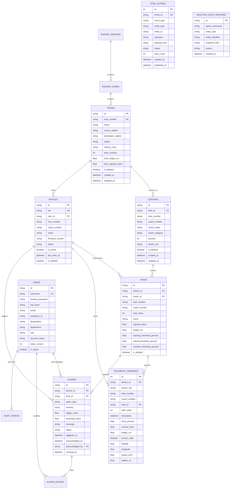

# PostgreSQL Database Architecture & Schema Specification

The **Panorama Water Tank Monitor — NextGen** uses **PostgreSQL 16** as its primary authoritative relational storage engine. It provides strict relational integrity, foreign key cascading constraints, transactional outbox logging, and versioned Alembic migrations.

---

## 1. Relational Entity-Relationship (ER) Diagram



---

## 2. Table Specifications

### 2.1 `trains`
Stores passenger rolling stock rakes.
- **Primary Key**: `id` (UUID string)
- **Unique Constraint**: `train_number`
- **Soft Deletion**: Supported via `is_deleted` (preserves historical telemetry while hiding train from active operations)
- **Cascade Rule**: Deleting a train cascades to soft-delete dependent coaches and disengage device assignments without leaving orphaned records.

### 2.2 `coaches`
Maintains individual coaches within a train consist.
- **Primary Key**: `id` (UUID string)
- **Foreign Key**: `train_id` references `trains.id` (`ON DELETE CASCADE`)
- **Position Tracking**: `position` (integer 1..N) determines train marshaling sequence.
- **Idempotency**: Re-adding an existing coach reuses prior configuration.

### 2.3 `devices`
Tracks physical edge IoT hardware modules (Quectel EC200U / ESP32-S3).
- **Primary Key**: `id` (UUID string)
- **Unique Constraint**: `uid` (Hardware UID e.g. `002F00654B42501320353332`)
- **Watchdog Status**: `is_online` evaluated dynamically against a 120-second stale telemetry window.

### 2.4 `tanks`
Cylindrical water vessels installed on passenger coaches.
- **Dual Configuration**: Typically 2 tanks per coach (`tank_index` 1 for Arrival End, `tank_index` 2 for Departure End).
- **Foreign Keys**: `coach_id` references `coaches.id`, `device_id` references `devices.id`.

### 2.5 `telemetry_readings`
Time-series log of all incoming water levels, battery voltages, and GNSS positions.
- **Indexes**: `(device_uid, timestamp)`, `(train_number, timestamp)`.

### 2.6 `sync_outbox`
Transactional queue implementing the Outbox Pattern to guarantee event publishing to MQTT subscribers across distributed clients.

---

## 3. Database Initialization & Alembic Migrations

### Applying Migrations
```bash
cd backend
# Run all pending migrations against the active database
alembic upgrade head
```

### Creating a New Migration
```bash
cd backend
alembic revision -m "add_custom_field"
```

### PostgreSQL Docker Quickstart
```bash
docker run --name panorama-postgres \
  -e POSTGRES_USER=panorama_app \
  -e POSTGRES_PASSWORD=panorama_secure_pass_2026 \
  -e POSTGRES_DB=panorama_db \
  -p 5432:5432 -d postgres:16-alpine
```
