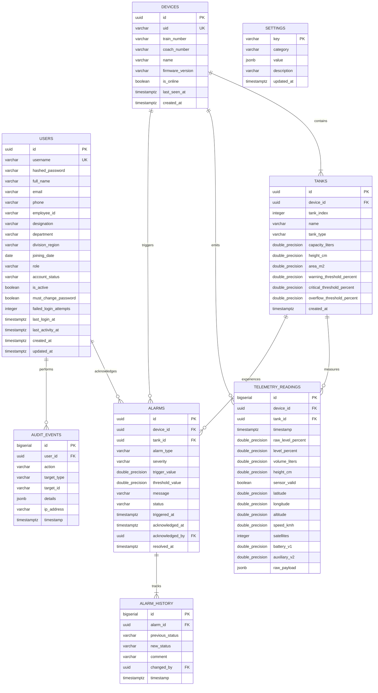

# Panorama Water Tank Monitor — Database Schema Specification

This document defines the complete PostgreSQL 16 relational data architecture for the NextGen Panorama Water Tank Monitor. The schema provides ACID-compliant storage for system configuration, fleet assets, high-frequency telemetry, alarm event state machines, and immutable audit logs.

---

## 1. Entity-Relationship Overview



---

## 2. Table Specifications & DDL

### 2.1 Table: `users`
Manages authorized railway personnel, administrators, and system accounts with full employee lifecycle governance.

```sql
CREATE TABLE users (
    id UUID PRIMARY KEY DEFAULT gen_random_uuid(),
    username VARCHAR(64) UNIQUE NOT NULL,
    hashed_password VARCHAR(255) NOT NULL,
    full_name VARCHAR(128) NOT NULL,
    email VARCHAR(255) UNIQUE,
    phone VARCHAR(32),
    employee_id VARCHAR(32),
    designation VARCHAR(64),
    department VARCHAR(64),
    division_region VARCHAR(64),
    joining_date DATE,
    role VARCHAR(32) NOT NULL DEFAULT 'EMPLOYEE' CHECK (role IN ('ADMIN', 'EMPLOYEE', 'OPERATOR', 'VIEWER')),
    account_status VARCHAR(32) NOT NULL DEFAULT 'ACTIVE' CHECK (account_status IN ('ACTIVE', 'INACTIVE', 'LOCKED')),
    is_active BOOLEAN NOT NULL DEFAULT true,
    must_change_password BOOLEAN NOT NULL DEFAULT false,
    failed_login_attempts INTEGER NOT NULL DEFAULT 0,
    last_login_at TIMESTAMPTZ,
    last_activity_at TIMESTAMPTZ,
    created_at TIMESTAMPTZ NOT NULL DEFAULT clock_timestamp(),
    updated_at TIMESTAMPTZ NOT NULL DEFAULT clock_timestamp()
);

CREATE INDEX idx_users_username ON users(username);
CREATE INDEX idx_users_role ON users(role);
CREATE INDEX idx_users_employee_id ON users(employee_id);
CREATE INDEX idx_users_department ON users(department);
CREATE INDEX idx_users_status ON users(account_status);
```

#### Defensive Migration & Seeding Note
The application implements an automated startup migration (`_sync_schema_migration` in `backend/app/core/database.py`) that checks the underlying engine (SQLite or PostgreSQL) and dynamically adds missing columns to existing databases without data loss.

Upon startup, `seed_initial_accounts` ensures the authoritative root administrator `@admin` (`Admin@123`) and initial employee `@employee` (`Employee@123`) accounts exist with secure bcrypt hashes and proper permissions.


### 2.2 Table: `devices`
Represents edge monitoring nodes installed on railway coaches.

```sql
CREATE TABLE devices (
    id UUID PRIMARY KEY DEFAULT gen_random_uuid(),
    uid VARCHAR(64) UNIQUE NOT NULL, -- e.g. 0026004D4B42501120353332
    train_number VARCHAR(32) NOT NULL DEFAULT '12002',
    coach_number VARCHAR(32) NOT NULL DEFAULT 'B4',
    name VARCHAR(128) NOT NULL DEFAULT 'Coach Water Monitor',
    hardware_version VARCHAR(32) DEFAULT 'ESP32S3-EC200U-V1',
    firmware_version VARCHAR(32) DEFAULT '2.0.0',
    is_online BOOLEAN NOT NULL DEFAULT false,
    last_seen_at TIMESTAMPTZ,
    created_at TIMESTAMPTZ NOT NULL DEFAULT clock_timestamp(),
    updated_at TIMESTAMPTZ NOT NULL DEFAULT clock_timestamp()
);

CREATE INDEX idx_devices_uid ON devices(uid);
CREATE INDEX idx_devices_train_coach ON devices(train_number, coach_number);
CREATE INDEX idx_devices_online ON devices(is_online);
```

### 2.3 Table: `tanks`
Stores individual physical water tank geometry and alert thresholds.

```sql
CREATE TABLE tanks (
    id UUID PRIMARY KEY DEFAULT gen_random_uuid(),
    device_id UUID NOT NULL REFERENCES devices(id) ON DELETE CASCADE,
    tank_index INTEGER NOT NULL DEFAULT 1 CHECK (tank_index IN (1, 2)),
    name VARCHAR(64) NOT NULL DEFAULT 'Primary Water Tank',
    tank_type VARCHAR(32) NOT NULL DEFAULT 'CYLINDRICAL' CHECK (tank_type IN ('CYLINDRICAL', 'RECTANGULAR')),
    capacity_liters DOUBLE PRECISION NOT NULL DEFAULT 20.0,
    height_cm DOUBLE PRECISION NOT NULL DEFAULT 50.0,
    area_m2 DOUBLE PRECISION NOT NULL DEFAULT 0.04,
    warning_threshold_percent DOUBLE PRECISION NOT NULL DEFAULT 20.0,
    critical_threshold_percent DOUBLE PRECISION NOT NULL DEFAULT 10.0,
    overflow_threshold_percent DOUBLE PRECISION NOT NULL DEFAULT 100.0,
    created_at TIMESTAMPTZ NOT NULL DEFAULT clock_timestamp(),
    updated_at TIMESTAMPTZ NOT NULL DEFAULT clock_timestamp(),
    CONSTRAINT uq_device_tank_index UNIQUE (device_id, tank_index)
);

CREATE INDEX idx_tanks_device ON tanks(device_id);
```

### 2.4 Table: `telemetry_readings`
Time-series table capturing live sensor frames. Designed for partitioning by month in large production deployments.

```sql
CREATE TABLE telemetry_readings (
    id BIGSERIAL PRIMARY KEY,
    device_id UUID NOT NULL REFERENCES devices(id) ON DELETE CASCADE,
    tank_id UUID REFERENCES tanks(id) ON DELETE SET NULL,
    timestamp TIMESTAMPTZ NOT NULL,
    raw_level_percent DOUBLE PRECISION NOT NULL,
    level_percent DOUBLE PRECISION NOT NULL, -- Clamped 0-100 for display
    volume_liters DOUBLE PRECISION NOT NULL,
    height_cm DOUBLE PRECISION NOT NULL,
    sensor_valid BOOLEAN NOT NULL DEFAULT true,
    latitude DOUBLE PRECISION,
    longitude DOUBLE PRECISION,
    altitude DOUBLE PRECISION,
    speed_kmh DOUBLE PRECISION,
    satellites INTEGER DEFAULT 0,
    battery_v1 DOUBLE PRECISION,
    auxiliary_v2 DOUBLE PRECISION,
    raw_payload JSONB,
    created_at TIMESTAMPTZ NOT NULL DEFAULT clock_timestamp()
);

CREATE INDEX idx_telemetry_device_time ON telemetry_readings(device_id, timestamp DESC);
CREATE INDEX idx_telemetry_tank_time ON telemetry_readings(tank_id, timestamp DESC);
CREATE INDEX idx_telemetry_timestamp ON telemetry_readings(timestamp DESC);
```

### 2.5 Table: `alarms`
Stateful alarms generated by the calculation and threshold engine.

```sql
CREATE TABLE alarms (
    id UUID PRIMARY KEY DEFAULT gen_random_uuid(),
    device_id UUID NOT NULL REFERENCES devices(id) ON DELETE CASCADE,
    tank_id UUID REFERENCES tanks(id) ON DELETE SET NULL,
    alarm_type VARCHAR(32) NOT NULL CHECK (alarm_type IN (
        'CRITICAL_LOW', 'WARNING_LOW', 'OVERFLOW', 'SENSOR_FAULT', 'VOLTAGE_FAULT'
    )),
    severity VARCHAR(16) NOT NULL CHECK (severity IN ('CRITICAL', 'WARNING', 'INFO')),
    trigger_value DOUBLE PRECISION NOT NULL,
    threshold_value DOUBLE PRECISION NOT NULL,
    message VARCHAR(255) NOT NULL,
    status VARCHAR(16) NOT NULL DEFAULT 'ACTIVE' CHECK (status IN ('ACTIVE', 'ACKNOWLEDGED', 'RESOLVED')),
    triggered_at TIMESTAMPTZ NOT NULL DEFAULT clock_timestamp(),
    acknowledged_at TIMESTAMPTZ,
    acknowledged_by UUID REFERENCES users(id) ON DELETE SET NULL,
    resolved_at TIMESTAMPTZ
);

CREATE INDEX idx_alarms_device ON alarms(device_id);
CREATE INDEX idx_alarms_status ON alarms(status);
CREATE INDEX idx_alarms_triggered_at ON alarms(triggered_at DESC);
```

### 2.6 Table: `alarm_history`
Maintains an immutable transition log for audit compliance.

```sql
CREATE TABLE alarm_history (
    id BIGSERIAL PRIMARY KEY,
    alarm_id UUID NOT NULL REFERENCES alarms(id) ON DELETE CASCADE,
    previous_status VARCHAR(16) NOT NULL,
    new_status VARCHAR(16) NOT NULL,
    comment TEXT,
    changed_by UUID REFERENCES users(id) ON DELETE SET NULL,
    timestamp TIMESTAMPTZ NOT NULL DEFAULT clock_timestamp()
);

CREATE INDEX idx_alarm_history_alarm ON alarm_history(alarm_id);
```

### 2.7 Table: `settings`
System-wide and operational runtime configurations.

```sql
CREATE TABLE settings (
    key VARCHAR(64) PRIMARY KEY,
    category VARCHAR(32) NOT NULL CHECK (category IN ('MQTT', 'TANK', 'ALARM', 'SYSTEM')),
    value JSONB NOT NULL,
    description TEXT,
    updated_at TIMESTAMPTZ NOT NULL DEFAULT clock_timestamp()
);

CREATE INDEX idx_settings_category ON settings(category);
```

### 2.8 Table: `audit_events`
Security and administrative action logging.

```sql
CREATE TABLE audit_events (
    id BIGSERIAL PRIMARY KEY,
    user_id UUID REFERENCES users(id) ON DELETE SET NULL,
    action VARCHAR(64) NOT NULL,
    target_type VARCHAR(64) NOT NULL,
    target_id VARCHAR(64),
    details JSONB,
    ip_address VARCHAR(45),
    timestamp TIMESTAMPTZ NOT NULL DEFAULT clock_timestamp()
);

CREATE INDEX idx_audit_user ON audit_events(user_id);
CREATE INDEX idx_audit_time ON audit_events(timestamp DESC);
```

---

## 3. Seed Data Specification

The database initializes with standard demo and operational records:
1. **Default Administrator**:
   - Username: `admin`
   - Role: `ADMIN`
2. **Standard Monitored Device**:
   - UID: `0026004D4B42501120353332`
   - Train Number: `12002` (Bhopal Shatabdi Express)
   - Coach Number: `B4`
   - Name: `Shatabdi Coach B4 Water System`
3. **Primary Tank**:
   - Name: `Coach B4 Primary Tank`
   - Capacity: `20.0 L`
   - Height: `50.0 cm`
   - Cross-Sectional Area: `0.04 m²`
   - Critical Threshold: `10.0%`
   - Warning Threshold: `20.0%`
   - Overflow Threshold: `100.0%`
4. **Secondary Tank**:
   - Name: `Coach B4 Auxiliary Tank`
   - Capacity: `20.0 L`
   - Height: `50.0 cm`
   - Area: `0.04 m²`

