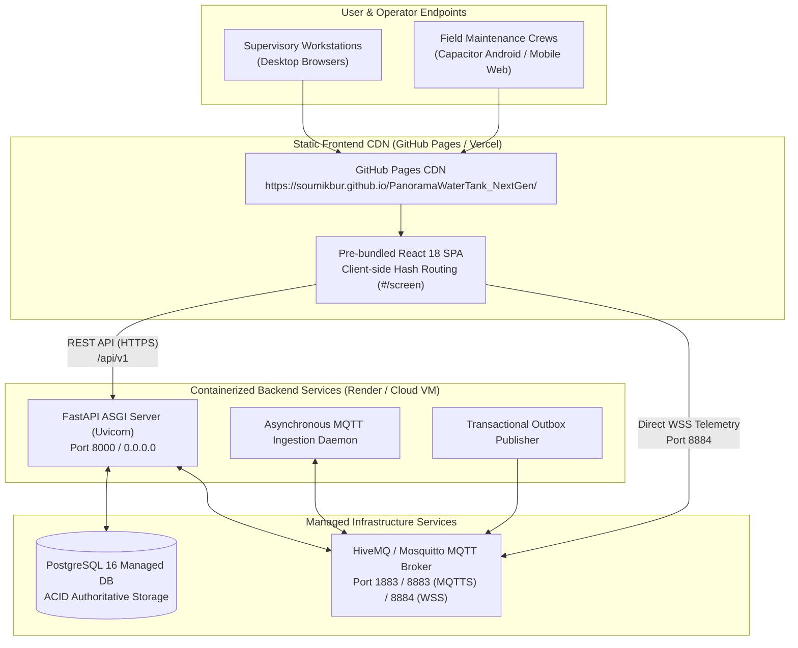

# Deployment Architecture & Production Runbook — Panorama NextGen

This document outlines the deployment architecture for the **Panorama Water Tank Monitor — NextGen** platform, distinguishing between static frontend hosting and backend daemon execution.

---

## 1. Hosting Architecture Overview



---

## 2. Frontend Deployment (GitHub Pages)

### 2.1 Continuous Deployment Pipeline (`.github/workflows/backend-ci.yml`)
- Triggered automatically on git pushes to the `main` branch.
- Compiles the production bundle via `npm run build`.
- Generates `dist/index.html`, `dist/404.html`, and bundled JS/CSS assets.
- Deploys static artifacts directly to **GitHub Pages**.
- **Live URL**: `https://soumikbur.github.io/PanoramaWaterTank_NextGen/`

> [!IMPORTANT]
> GitHub Pages is a static content distribution network (CDN). It cannot execute Python daemons or run an embedded PostgreSQL database. When users access the GitHub Pages demo, the frontend connects to the backend over HTTPS/WSS and connects directly to the HiveMQ broker over WebSocket TLS (`wss://broker.hivemq.com:8884/mqtt`).

---

## 3. Backend Deployment (Docker & Managed Cloud)

### 3.1 Docker Compose Deployment
To run the complete production backend stack with PostgreSQL:

```yaml
version: '3.8'

services:
  db:
    image: postgres:16-alpine
    container_name: panorama-db
    environment:
      POSTGRES_USER: panorama_app
      POSTGRES_PASSWORD: ${POSTGRES_PASSWORD}
      POSTGRES_DB: panorama_db
    volumes:
      - pgdata:/var/lib/postgresql/data
    restart: always

  backend:
    build:
      context: ./backend
      dockerfile: Dockerfile
    container_name: panorama-backend
    environment:
      ENV: production
      DATABASE_URL: postgresql+asyncpg://panorama_app:${POSTGRES_PASSWORD}@db:5432/panorama_db
      SECRET_KEY: ${SECRET_KEY}
      MQTT_BROKER_HOST: broker.hivemq.com
      MQTT_BROKER_PORT: 1883
    ports:
      - "8000:8000"
    depends_on:
      - db
    restart: always

volumes:
  pgdata:
```

### 3.2 Starting Backend Container Stack
```bash
docker-compose up -d --build
```
