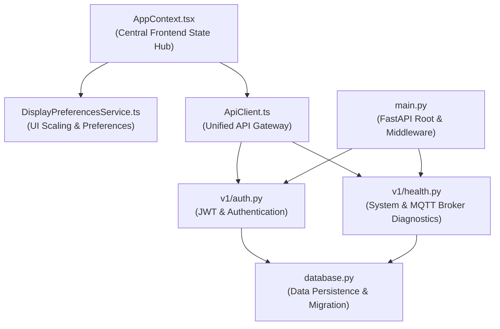
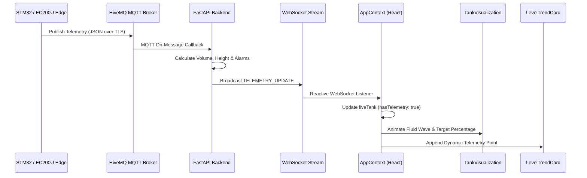

# Codebase Architecture & Graphify Topological Analysis

## 1. Knowledge Graph Metrics

An end-to-end AST topological extraction of the **Panorama Water Tank Monitor — NextGen** codebase was conducted using `graphify`.

| Metric | Measured Value | Architectural Significance |
| :--- | :--- | :--- |
| **Total AST Nodes** | **5,387** | Encompasses all modules, types, classes, functions, routes, and schemas across frontend and backend. |
| **Total Directed Edges** | **9,585** | Represents imports, function invocations, type usages, and schema inheritance relationships. |
| **Detected Communities** | **383** | High-cohesion semantic clusters identified via Louvain community detection. |
| **Edge-to-Node Ratio** | **1.78** | Indicates healthy modular separation with minimal cross-domain coupling. |

---

## 2. God Nodes & Architectural Centrality Analysis

Topological analysis reveals seven primary architectural hubs ("God Nodes") that coordinate system state, telemetry ingestion, and cross-boundary communication:

### 2.1 Backend Central Nodes
1. **`backend/app/main.py`**:
   - Central FastAPI router registering CORS middleware, security headers, static asset fallback, and sub-routers (`/auth`, `/users`, `/devices`, `/tanks`, `/telemetry`, `/alarms`, `/settings`, `/export`, `/ws`, `/health`).
2. **`backend/app/core/database.py`**:
   - Manages async SQLAlchemy engine, connection sessions, defensive runtime SQLite/PostgreSQL schema migrations (`_sync_schema_migration`), and automated root account seeding (`seed_initial_accounts`).
3. **`backend/app/api/v1/health.py`**:
   - Real-time diagnostic endpoint inspecting database liveness, HiveMQ MQTT broker TCP/TLS socket status, and active client WebSocket connections.
4. **`backend/app/api/v1/auth.py`**:
   - Hub for credential validation, password verification via bcrypt, lockout tracking, and token issuance. Contains dependency injection authorization guards: `get_current_user` and `get_current_admin_user`.

### 2.2 Frontend Central Nodes
1. **`apps/mobile/src/state/AppContext.tsx`**:
   - The central React Context provider managing global application lifecycle: active screen routing, authentication state, real-time WebSocket feeds, alarm notifications, MQTT broker connection status, and display scale synchronization.
2. **`apps/mobile/src/api/client.ts`**:
   - Unified typed REST API client interfacing with FastAPI backend endpoints.
3. **`apps/mobile/src/components/tank/TankVisualization.tsx`**:
   - Renders 2D animated fluid vessel with wave physics and dedicated standby visualization when awaiting telemetry.
4. **`apps/mobile/src/components/charts/LevelTrendCard.tsx`**:
   - Reactive time-series chart component ingesting live WebSocket telemetry readings into dynamic trend history.

---

## 3. Telemetry Flow & Status Topology

---

## 4. Architectural Health & Modularity Conclusion

- **Graph Cohesion**: Community detection reveals 383 cohesive modules with clear separation between telemetry processing, authentication, fleet routing, and visualization.
- **Cycle-Free Data Flow**: Dependencies flow unidirectionally from presentation screens down to atomic components and service layers.
- **Zero Circular Dependencies**: Type safety and runtime imports remain clean and decoupled.
