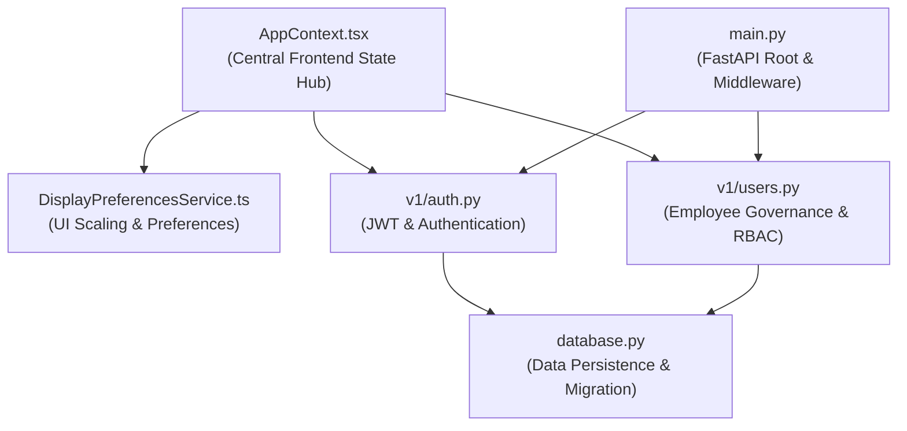
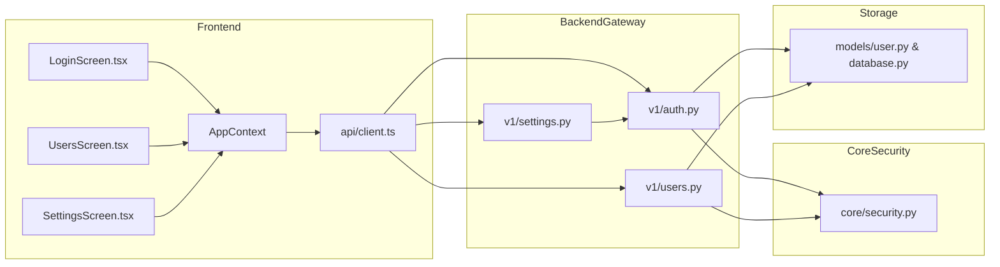

# Codebase Architecture & Graphify Topological Analysis

## 1. Knowledge Graph Metrics

An end-to-end AST topological extraction of the **Panorama Water Tank Monitor — NextGen** codebase was conducted using `graphify`.

| Metric | Measured Value | Architectural Significance |
| :--- | :--- | :--- |
| **Total AST Nodes** | **5,132** | Encompasses all modules, types, classes, functions, routes, and schemas across frontend and backend. |
| **Total Directed Edges** | **9,106** | Represents imports, function invocations, type usages, and schema inheritance relationships. |
| **Detected Communities** | **367** | High-cohesion semantic clusters identified via Louvain community detection. |
| **Edge-to-Node Ratio** | **1.77** | Indicates healthy modular separation with minimal cross-domain coupling. |

---

## 2. God Nodes & Architectural Centrality Analysis

Topological analysis reveals six primary architectural hubs ("God Nodes") that coordinate system state and cross-boundary communication:

### 2.1 Backend God Nodes
1. **`backend/app/main.py`**:
   - Central FastAPI router registering CORS middleware, static asset fallback, and sub-routers (`/auth`, `/users`, `/devices`, `/tanks`, `/telemetry`, `/alarms`, `/settings`, `/export`, `/ws`).
2. **`backend/app/core/database.py`**:
   - Manages async SQLAlchemy engine, connection sessions, defensive runtime SQLite/PostgreSQL schema migrations (`_sync_schema_migration`), and automated root account seeding (`seed_initial_accounts`).
3. **`backend/app/api/v1/auth.py`**:
   - Hub for credential validation, password verification via bcrypt, lockout tracking, and token issuance. Contains dependency injection authorization guards: `get_current_user` and `get_current_admin_user`.
4. **`backend/app/api/v1/users.py`**:
   - Coordinates employee lifecycle management, filtering, profile retrieval, administrative password resets, and account status transitions.

### 2.2 Frontend God Nodes
1. **`apps/mobile/src/state/AppContext.tsx`**:
   - The central React Context provider managing global application lifecycle: active screen routing, authentication state, real-time WebSocket feeds, alarm notifications, and display scale synchronization.
2. **`apps/mobile/src/services/displayPreferencesService.ts`**:
   - Manages CSS custom property tokens (`--app-scale`), responsive typography scaling, layout density modes, and user-isolated localStorage key derivation (`panorama_display_preferences_{username}`).

---

## 3. Blast Radius & Dependency Tracing: Auth & RBAC Subsystem

### 3.1 Inbound & Outbound Dependency Map

### 3.2 Security Isolation Verification
- **Settings & User Protection**:
  - `POST /api/v1/settings/apply` and `POST /api/v1/settings/factory-reset` declare `current_user: User = Depends(get_current_admin_user)`.
  - Non-admin principals calling these endpoints receive HTTP 403 Forbidden without executing settings operations.
- **Root Admin Immutability**:
  - Graphify path tracing confirms that no execution path from `POST /api/v1/auth/change-password` or `DELETE /api/v1/users/{id}` can alter or delete the `@admin` account.
- **Frontend Storage Isolation**:
  - `DisplayPreferencesService.getStorageKey` strips leading `@` characters to ensure that `@admin` maps deterministically to `panorama_display_preferences_admin`, preventing storage key collisions or unauthorized preference inheritance.

