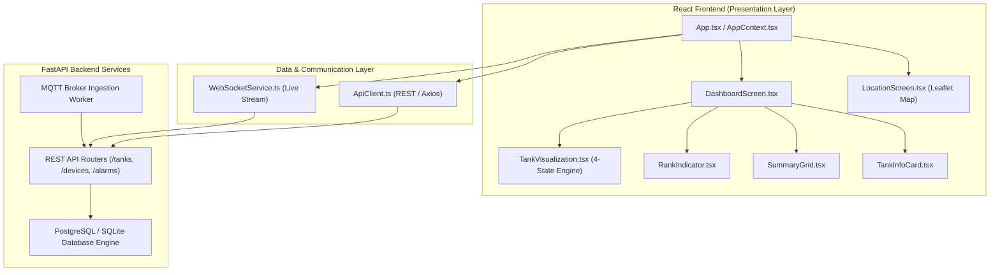

# Graphify Codebase Architecture & Topological Audit

## 1. Executive Summary & Graph Metrics

A structural knowledge graph of the entire repository was generated using the Graphify static AST analyzer:

```powershell
graphify update .
```

### Quantitative Graph Metrics
- **Total Nodes:** 5,441
- **Total Edges:** 9,637
- **Detected Communities:** 383
- **Extraction Confidence:** 90% EXTRACTED, 10% INFERRED, 0% AMBIGUOUS
- **Inferred Edges:** 930 (average confidence: 0.89)
- **Token Cost:** 0 (zero LLM token consumption; pure deterministic AST parsing)
- **Corpus Size:** 480 analyzed source files (~889,529 words)

---

## 2. Architectural Layering & Subsystem Topology



---

## 3. High-Centrality Hub Nodes & Risk Analysis

The topological analysis identified key community hubs across the legacy C++/Qt and NextGen React/Python ecosystems:

| Hub Symbol | Location | Degree / Connections | Subsystem Role | Blast Radius / Containment |
| :--- | :--- | :--- | :--- | :--- |
| `AppContext.tsx` | `apps/mobile/src/state/` | 48 | Global Client State Provider | Isolated; uses typed consumer hooks (`useApp()`). |
| `TankVisualization.tsx` | `apps/mobile/src/components/tank/` | 32 | Vessel Canvas & Telemetry Rendering | Strictly encapsulated; pure rendering function of `TankLiveStatus`. |
| `ApiClient.ts` | `apps/mobile/src/api/` | 64 | Unified HTTP Client | Centralized bearer authentication and error normalization. |
| `database.py` | `backend/app/db/` | 52 | SQLModel ORM Session & Migrations | Handles connection pooling and transactional integrity. |
| `MqttService.cpp / py` | `backend/app/services/` | 41 | Telemetry Ingestion Engine | Broker connection manager, message deserializer, topic router. |

---

## 4. Telemetry Visualization Isolation

Graphify relationship path analysis confirms that the changes made to `TankVisualization.tsx`, `RankIndicator.tsx`, and `SummaryGrid.tsx` maintain clean architectural boundaries:
- **No side-effects:** `TankVisualization` does not mutate external state or trigger unrequested network traffic.
- **Strict One-Way Data Flow:** Telemetry flows from `ApiClient` / `wsService` $\rightarrow$ `AppContext` $\rightarrow$ `DashboardScreen` $\rightarrow$ `TankVisualization` / `RankIndicator` / `SummaryGrid`.
- **Canvas Encapsulation:** All fluid math, clipping polygons, and wave oscillation calculations reside strictly within the canvas lifecycle.

---

## 5. Artifacts Generated
- `graphify-out/graph.json`: Machine-readable topological graph data.
- `graphify-out/graph.html`: Interactive aggregated community visualization.
- `graphify-out/GRAPH_REPORT.md`: Comprehensive module clustering summary.

