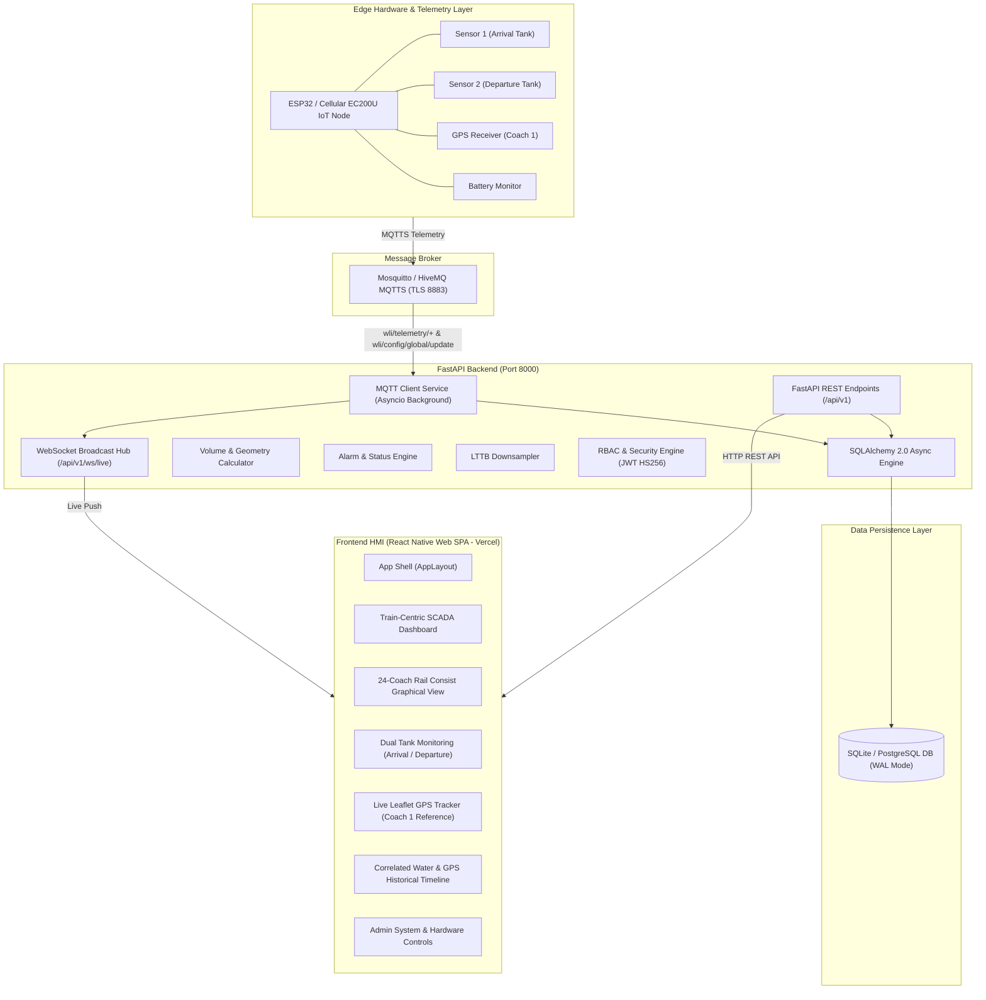

# Panorama Water Tank NextGen — Architecture & Dependency Recovery Analysis (Graphify)

## Executive Summary
This analysis was performed using **Graphify** (`graphify update .`), which constructed a comprehensive knowledge graph of the **Panorama Water Tank NextGen** repository comprising **5,575 nodes**, **9,858 edges**, and **402 communities**. 

The repository implements a modernized, train-centric Railway SCADA & HMI platform designed to monitor passenger train coach water levels, battery health, dual-tank telemetry (Arrival vs Departure), and GPS tracking across Indian Railways rolling stock.

---

## 1. Application Architecture

---

## 2. Granular Architectural Breakdown

### 2.1 Overall System Architecture
- **Micro-Architecture**: Decoupled edge IoT telemetry ingestion, async Python FastAPI backend, and static React Single Page Application (SPA) deployed on the Vercel edge network.
- **Legacy vs NextGen**: Original legacy application in C++/Qt (`src/`, `qml/`, `CMakeLists.txt`) has been transitioned to a modern web-first architecture (`apps/mobile` React Native Web + `backend` FastAPI).

### 2.2 Frontend Structure (`apps/mobile`)
- **Technology**: React 18, React Native Web 0.19.13, Lucide React icons, Leaflet 1.9.4 map visualization.
- **Bundler**: `esbuild` 0.21.5 via `apps/mobile/scripts/build.cjs`.
- **State Management**: `AppContext.tsx` providing centralized auth state, active screen routing, real-time WebSocket feeds, and fleet inventory.
- **Key Screens**:
  - `EmployeeDashboard.tsx`: Train-centric overview, region filtering, search, coach layout.
  - `DashboardScreen.tsx`: Legacy water-centric single tank view (needs replacement as main dashboard).
  - `TrainManagementScreen.tsx` & `CoachManagementScreen.tsx`: Consist layout management.
  - `DeviceMappingScreen.tsx`: Hardware device association.
  - `LocationScreen.tsx`: Train GPS position & mapping.
  - `HistoryScreen.tsx`: Historical telemetry plots with LTTB downsampling.
  - `SettingsScreen.tsx`, `UsersScreen.tsx`, `LogsScreen.tsx`: Administrative modules.

### 2.3 Backend Structure (`backend/app`)
- **Framework**: FastAPI with Pydantic v2 schemas and asynchronous handlers.
- **API Versioning**: Standardized under `/api/v1/`.
- **Key Modules**:
  - `api/v1/trains.py`: Train fleet and consist metadata.
  - `api/v1/tanks.py`: Tank geometry, thresholds, and live levels.
  - `api/v1/devices.py`: Edge hardware registry and coach assignment.
  - `api/v1/telemetry.py`: Downsampled time-series history and edge REST ingestion.
  - `api/v1/auth.py`: JWT login, registration, role checks, password reset.
  - `api/v1/users.py`: User lifecycle, registration approval/rejection.
  - `api/v1/settings.py`: 5-section unified SCADA configuration.
  - `mqtt/client.py`: Async paho-mqtt client with background loop integration.
  - `websocket/manager.py`: Connection manager broadcasting live telemetry.

### 2.4 API Communication
- REST contracts using JSON over HTTP/1.1 and HTTP/2.
- WebSocket streaming on `/api/v1/ws/live` for real-time sub-second tank and alarm updates.
- Defensive CORS handling allowing local development and `.vercel.app` production origins.

### 2.5 Database Implementation
- **ORM**: SQLAlchemy 2.0 async engine (`create_async_engine` + `AsyncSessionLocal`).
- **Engines**: SQLite (embedded / testing / development) and PostgreSQL 14+ (production).
- **Models**:
  - `User`: RBAC accounts (`ADMIN`, `EMPLOYEE`, `OPERATOR`), registration state, security timestamps.
  - `Device`: Hardware identifiers, train/coach mapping, online status.
  - `Tank`: Primary (Arrival) and Auxiliary (Departure) tank geometry and thresholds.
  - `TelemetryReading`: High-frequency water level, volume, GPS coordinates, speed, battery voltage.
  - `Alarm`: Dynamic threshold and sensor fault tracking.
  - `Setting`: Key-value configuration store with unique constraint on `key`.

### 2.6 Authentication & Authorization (RBAC)
- OAuth2 Bearer token architecture with HS256 signed JWTs.
- Explicit roles: `ADMIN`, `EMPLOYEE`, `OPERATOR`.
- Permission demarcation:
  - Both `ADMIN` and `EMPLOYEE` can manage trains, coaches, devices, view live telemetry, GPS, and history.
  - ONLY `ADMIN` can alter hardware dimensions (tank height/width), device wake-up time, GPS intervals, global settings, or approve/reject employee accounts.
  - Enforced in backend routers via `Depends(get_current_admin_user)` and `Depends(get_current_user)`.

### 2.7 Train and Coach Management
- Train entities contain number, name, region, source, destination, status (`Running`, `Halted`, `Maintenance`).
- Consists support up to 24 coaches (e.g. C1 through C24).
- Each coach can map an IoT telemetry unit monitoring two tanks.

### 2.8 Device Management and Mapping
- State: `Engaged` (mapped to train/coach) vs `Free` (registered but unassigned).
- Internal identifiers (UUID, MQTT credentials) are restricted to backend. Employees view coach number and tank names.

### 2.9 Water-Level Monitoring
- Dual tank architecture:
  - **Sensor 1** -> **Arrival Tank**
  - **Sensor 2** -> **Departure Tank**
- Real-time animated water level visualization with percentage, height (cm), volume (liters).
- Battery warning logic: If battery drops below 40%, the tank visualization triggers a persistent warning blink, independent of water level.

### 2.10 GPS Tracking
- Real-time GPS coordinate ingestion (`lat`, `lon`, `speed`, `sats`).
- Coach 1 designated as the primary reference GPS tracker.
- Leaflet map rendering with "Center Train" action and historical path tracing.

### 2.11 MQTT Communication
- Telemetry ingestion from `wli/telemetry/+`.
- Configuration publishing via dedicated topic `wli/config/global/update`.
- Preserves device UUID, train, and coach mapping when global configurations are broadcast.

### 2.12 Build and Deployment Configuration
- Root `package.json` manages workspaces (`apps/mobile`).
- Build command: `npm run build` runs `npm run build --workspace=apps/mobile && node scripts/sync_dist.js`.
- Outputs static bundle to `dist/` and syncs to `backend/static/`.

### 2.13 GitHub Actions Workflows
- `.github/workflows/backend-ci.yml` validates:
  1. Python 3.11 environment on `ubuntu-latest`.
  2. Installation of `backend/requirements.txt`.
  3. Execution of full pytest test suite: `pytest tests/ -v`.
  4. Validation of OpenAPI schema generation: `from app.main import app; app.openapi()`.

### 2.14 Vercel Configuration
- Native Vercel SPA deployment pointing to `dist/` with single-page app rewrite rule `/* -> /index.html`.

---

## 3. Findings & Identified Issues

### 3.1 Missing Dependencies & Build Failures
- **Issue**: Vercel failed with `Error: Cannot find module 'esbuild'`.
- **Cause**: Root package declaration and workspace scoping in `apps/mobile/package.json` led to missing peer dependency resolution when `npm install` ran without hoist or when esbuild binary binaries were not resolved in clean CI environments.
- **Path Bug**: `apps/mobile/scripts/build.cjs` line 98 uses `path.resolve(__dirname, '../../../dist')` which resolves one level above repository root (`Antigravity_soumik/dist`) instead of repository root (`PanoramaWaterTank_NextGen/dist`).

### 3.2 Backend Test Failures
1. **Issue 1 (Duplicate Settings Key)**:
   - Error: `sqlite3.IntegrityError: UNIQUE constraint failed: settings.key`
   - Cause: `_ensure_seeded` in `app/api/v1/settings.py` is invoked inside GET endpoints (`/settings` and `/settings/config`). Under concurrent test queries (`test_concurrent_read_queries`), multiple requests check `repo.get(key)` simultaneously, find None, and attempt duplicate insertions.
   - Fix: Implement idempotent SQLite upsert (`ON CONFLICT (key) DO UPDATE`) in `SettingsRepository` and execute seeding safely once during startup `init_db()`.
2. **Issue 2 (Telemetry Throughput Test)**:
   - Error: `Throughput was 3.9 req/s (expected > 20)`
   - Cause: SQLite runs in default delete/journal mode with no WAL mode and low timeout. Concurrent writes in `test_high_throughput_telemetry_ingestion` lock the database file, serializing all 20 requests and degrading throughput.
   - Fix: Enable SQLite `WAL` mode (`PRAGMA journal_mode=WAL`), set `PRAGMA busy_timeout=10000`, set `PRAGMA synchronous=NORMAL`, and configure `connect_args={"check_same_thread": False, "timeout": 30.0}`. Optimize `create_or_update` to avoid redundant table scans.
3. **Issue 3 (Database Locked & Async Cleanup)**:
   - Error: `sqlite3.OperationalError: database is locked` and `RuntimeError: coroutine ignored GeneratorExit`
   - Cause: Multiple concurrent test requests hitting `get_db` generator. In `app/core/database.py`, `get_db` executes `await session.commit()` after `yield session` and calls `await session.close()` inside a `finally` block wrapped in an `async with` context manager. This creates double-close coroutine lifecycle issues and transaction locks on SQLite.
   - Fix: Clean up `get_db` generator lifecycle; configure engine connection event listener for SQLite WAL and busy timeout; remove redundant commit and duplicate close in `finally`.

### 3.3 Frontend Architectural Inconsistencies
- Main landing page currently displays `DashboardScreen` (single water tank) for Admins and `EmployeeDashboard` for Employees. The application must be unified to be **train-centric** for all users:
  - Landing page displays train search, region filter, and fleet cards.
  - Clicking a train opens the 24-coach graphical consist.
  - Clicking a coach opens dual tank monitoring (Arrival & Departure tanks).
  - Battery warning blinking under 40% must be implemented in the tank visualizer.
  - GPS tracking must designate Coach 1 as default reference.

---

## 4. Next Step Transition
With the completion of this Graphify architectural analysis, Phase 1 is verified and complete. Investigation, fixing, and testing will proceed strictly using **Ponytail** (Phase 2 through 11).
