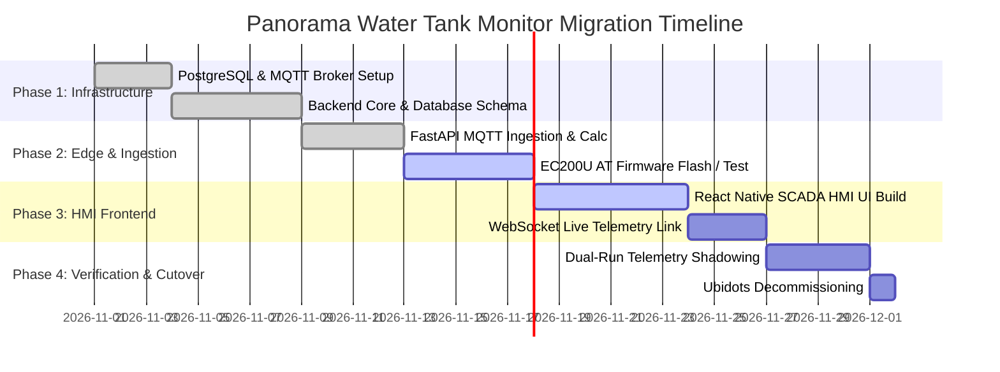

# Panorama Water Tank Monitor — Migration Plan & Cutover Strategy

This document defines the structured migration plan for transitioning from the legacy Qt/QML and Ubidots architecture to the NextGen React Native + FastAPI + PostgreSQL platform.

---

## 1. Migration Phases & Timeline



---

## 2. Firmware Migration (ESP32-S3 + Quectel EC200U)

### 2.1 Current Legacy Firmware Behavior
- The legacy code in `Hardware/WaterLevelMonitor/10_MQTT.ino` opens an MQTT connection to HiveMQ or executes HTTP POST requests containing Ubidots tokens.
- Hardcoded endpoint: `industrial.api.ubidots.com` or `broker.hivemq.com`.

### 2.2 NextGen Firmware Changes
1. **Remove Ubidots HTTP Client**: Delete all Ubidots token strings, HTTP endpoints, and JSON wrapping.
2. **Standardized MQTT Topic**: Update topic to `panorama/telemetry/{UID}` where `{UID}` is dynamically read from the EC200U IMEI via `AT+GSN`.
3. **TLS Certificate Provisioning**:
   - Store the CA certificate in the EC200U NVRAM file system:
     ```text
     AT+QFUPL="cacert.pem",1420,100
     [Upload PEM bytes]
     AT+QSSLCFG="cacert",1,"cacert.pem"
     ```
4. **Resilient Buffering**: Implement a circular ring buffer in ESP32 SPIFFS to store telemetry frames when cellular signal is lost during tunnel transit.

---

## 3. Data Cutover & Seeding Strategy

1. **Initial Device Registry**:
   - Seed primary device `0026004D4B42501120353332` for Train `12002`, Coach `B4`.
   - Seed physical parameters: Capacity `20.0 L`, Height `50.0 cm`, Area `0.04 m²`.
2. **Alarm Threshold Migration**:
   - Standardize thresholds: Critical `< 10%`, Warning `< 20%`, Overflow `≥ 100%`.
3. **Shadow Mode (Dual-Run)**:
   - During the 4-day shadowing period, telemetry is published to both the legacy HiveMQ topic and the NextGen broker.
   - Outputs are compared to verify 100% calculation parity between C++ `VolumeCalculator` and Python `calculator.py`.

---

## 4. Rollback & Contingency Plan

If unforeseen defects or cellular connectivity failures occur on edge units:
1. **Edge Rollback**: The EC200U supports dual-OTA firmware banks. The previous firmware image can be booted via AT command `AT+QFOTADL="rollback"`.
2. **Backend Redundancy**: The FastAPI ingestion service supports fallbacks to raw HTTP REST ingestion (`POST /api/v1/telemetry/ingest`) if cellular carriers block MQTT port 8883.
3. **No Legacy Modification**: The source folder `PanoramaWaterTank-Milestone2` remains untouched and functional as a standalone fallback throughout.

---

## 5. Decommissioning Checklist

- [ ] Verify NextGen PostgreSQL database receives valid telemetry continuously for 72 hours.
- [ ] Confirm zero active dependencies on `ubidots.com` domains across all edge nodes.
- [ ] Revoke and delete all Ubidots API tokens from production credentials.
- [ ] Transition operator client machines from the Qt desktop executable to the NextGen React Native / Web client.
- [ ] Archive legacy milestone artifacts to cold storage.

