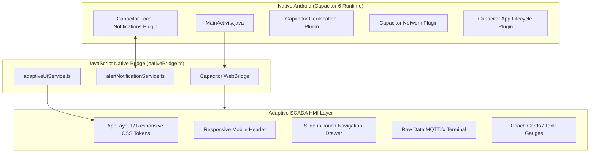

# Capacitor Android Mobile Application — Panorama NextGen

The **Panorama Water Tank Monitor — Mobile Application** provides handheld supervisory access for railway yard inspectors, rolling stock maintenance technicians, and station superintendents. It is packaged via **Capacitor 6** targeting modern Android devices (API 30 through API 35) as well as ultra-low-resource hardware.

---

## 1. Mobile Architecture Overview



---

## 2. Native Android Notification Engine

Critical water-level events (such as $\le 10\%$ reservoir capacity or transducer loss) are delivered directly to the Android System Notification Shade rather than relying exclusively on in-app browser banners.

### Features
1. **Dedicated Android Notification Channels**:
   - `critical-water-alerts`: High importance (`Importance.High`), heads-up alert banner, custom vibration pattern, LED indicator, bypasses silent mode.
   - `warning-alerts`: Default importance (`Importance.Default`) for warning thresholds ($\le 20\%$) and non-critical system updates.
2. **Actionable Deep-Linking**:
   - Tapping an alert in the Android notification shade immediately launches the app, switches to the `alerts` screen, and auto-filters by the relevant train and coach (`trainNumber`, `coachNumber`).
3. **Automated Notification Cancellation**:
   - When an operator acknowledges an alarm inside the dashboard or backend, `nativeBridge.cancelAlarmNotification(alertKey)` automatically dismisses the notification from the system shade.

---

## 3. Device-Adaptive UI Scaling Engine

To guarantee consistent readability and touch accuracy across phones with varied screen densities, physical dimensions, and aspect ratios, the app incorporates an intelligent runtime scaling engine ([adaptiveUiService.ts](file:///c:/Users/User/Documents/Antigravity_soumik/PanoramaWaterTank_NextGen/apps/mobile/src/services/adaptiveUiService.ts)).

### Device Categories & Viewport Tokens
| Category | Logical Width Range | Typical Device Example | Applied Layout Adjustments |
|:---|:---:|:---|:---|
| `compact` | $< 360\text{ px}$ | Ultra-low-resource AVD (720x1280 @ 2x) | Font scale 0.85, single-column KPI grid, compact cards |
| `standard` | $360 - 389\text{ px}$ | Pixel 4a, Galaxy A-series | Font scale 0.92, 2-column KPI grid, 44px tap targets |
| `large` | $390 - 429\text{ px}$ | iPhone 14/15, Pixel 7 | Default scale 1.00, balanced fluid SVG slosh physics |
| `xlarge` | $430 - 599\text{ px}$ | Pixel 7 Pro, Galaxy S24 Ultra | Scale 1.05, expanded metrics & wider navigation tap zones |
| `tablet` | $\ge 600\text{ px}$ | Android Tablets, Foldables (unfolded) | Dual-pane split view, persistent collapsible sidebar |

### Scoped CSS Variables (Applied only when `data-platform="capacitor-android"`)
- `--android-vw`: Screen width in physical pixels divided by DPR.
- `--android-vh`: Real screen height accounting for status bar and system navigation insets.
- `--android-scale`: Relative font and component scaling multiplier.

---

## 4. Ultra-Low-Resource Android Virtual Device (AVD)

For validation under severe hardware constraints, the project maintains an automated test harness targeting an ultra-low-resource smartphone profile:

- **AVD Name**: `Panorama_ULTRA_LOW_RESOURCE`
- **Target OS**: Android 11 (API 30) / `x86_64`
- **RAM**: $1024\text{ MB}$ (1.0 GB)
- **CPU Cores**: 2
- **VM Heap**: $128\text{ MB}$
- **Screen Resolution**: $720 \times 1280$ (hdpi)

---

## 5. Mobile Build & APK Generation

From the repository root:

```bash
# 1. Compile frontend production bundle & sync assets
npm run build

# 2. Sync web assets to Capacitor Android project
cd PanoramaWaterTank_Capacitor
npx cap sync android

# 3. Compile Debug APK via Gradle
./gradlew assembleDebug

# Output APK:
# PanoramaWaterTank_Capacitor/android/app/build/outputs/apk/debug/app-debug.apk
```
