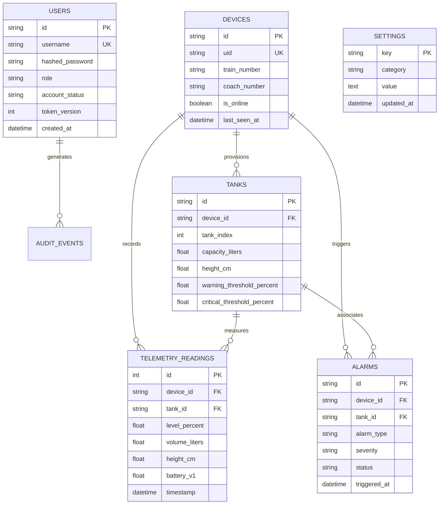

# Panorama Water Tank Monitor — Database Architecture & Schema Specification

---

### 1. Database Technology & Concurrency Model

- **Primary Supported Engines:**
  - **PostgreSQL 16:** Industrial production engine using async driver `asyncpg` with connection pooling.
  - **SQLite 3:** Local edge / development engine using `aiosqlite` with Write-Ahead Logging (`PRAGMA journal_mode=WAL`).
- **ORM & Migrations:** SQLAlchemy 2.0 async engine with Alembic declarative revision control.

---

### 2. Entity-Relationship Model

---

### 3. Data Integrity & Query Optimization

- **Composite Indexes:** `(device_id, timestamp DESC)` and `(tank_id, timestamp DESC)` enable sub-millisecond historical queries.
- **Cascading Deletion:** Deleting a physical edge device cascades to its provisioned tanks while preserving audit event history.
- **Audit Preservation:** `audit_events.user_id` uses `ondelete="SET NULL"` ensuring historical traceability even after employee offboarding.
