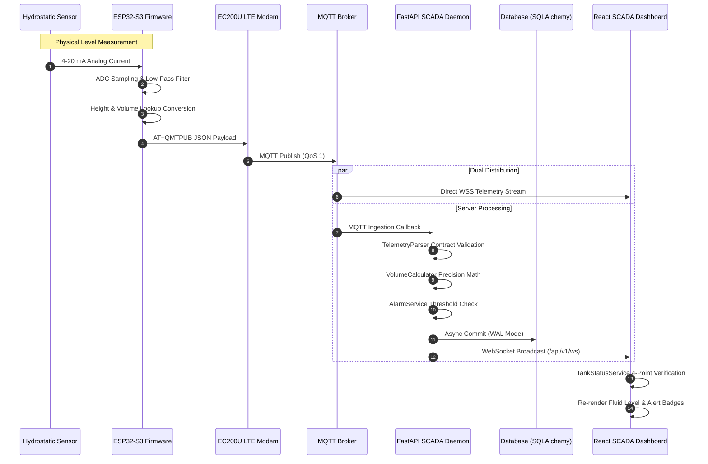

# Panorama Water Tank Monitor — End-to-End Telemetry Data Flow
## Transducer Signal Processing to SCADA Operator Visualization

---

### 1. Sequential Telemetry Pipeline

---

### 2. Mathematical Fluid Calculation Specifications

All volume calculations strictly adhere to cylindrical tank geometry:

1. **Cross-Sectional Area & Max Height:**
   $$A = 0.04 \text{ m}^2$$
   $$H_{\max} = \frac{V_{\max}}{A \cdot 1000} = \frac{20.0 \text{ L}}{0.04 \cdot 1000} = 0.50 \text{ m} \quad (50.0 \text{ cm})$$

2. **Real-Time Height & Litres Calculation:**
   $$h(t) = H_{\max} \cdot \left(\frac{\text{Level}\%(t)}{100}\right) = 0.50 \cdot \left(\frac{\text{Level}\%}{100}\right) \text{ [m]}$$
   $$V(t) = A \cdot h(t) \cdot 1000 \text{ [Liters]}$$

3. **4-Tier SCADA Operational Ranks:**
   - **CRITICAL / LOW:** $0\% \le \text{Level} < 25\%$ (Alert `#DC2626`)
   - **WARNING / MODERATE:** $25\% \le \text{Level} < 50\%$ (Alert `#D97706`)
   - **ADEQUATE / GOOD:** $50\% \le \text{Level} < 75\%$ (Nominal `#2563EB`)
   - **FULL / HIGH:** $75\% \le \text{Level} \le 100\%$ (Optimal `#16A34A`)
