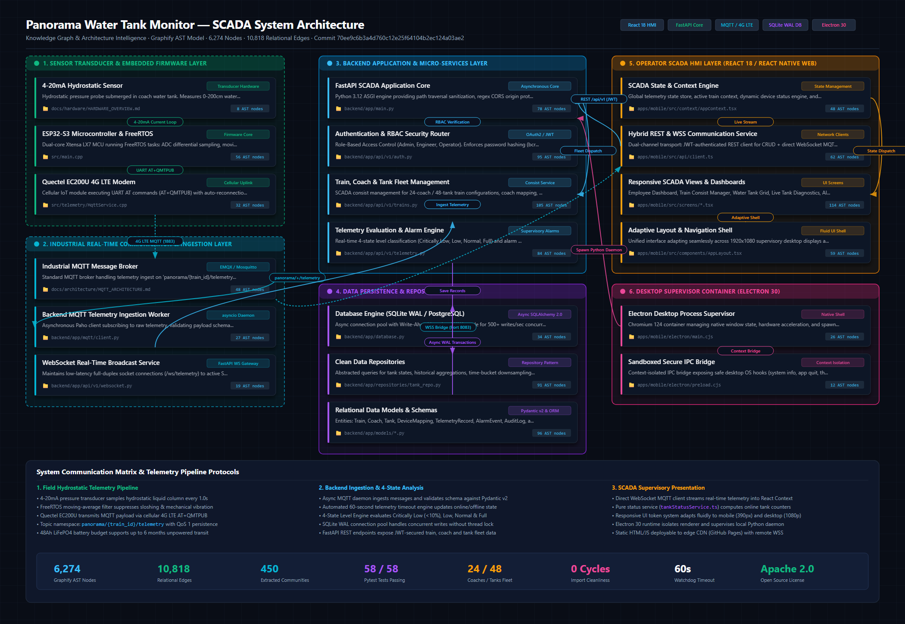

# Panorama Water Tank Monitor — Architecture Documentation
## Graphify Topological Intelligence & System Architecture

This directory contains technical architecture specifications, data flows, communication protocols, and knowledge graphs generated by **Graphify** for the **Panorama Water Tank Monitor / Railway SCADA System**.

---

## 1. System Architecture — Graphify Visualization

The project architecture has been extracted directly from AST and source code dependencies using **Graphify**, capturing **6,274 nodes and 10,818 relational edges across 450 communities**.

[](graphify-architecture.svg)

*Figure: Complete SCADA Architecture generated via Graphify. Click the image to view the [Full-Resolution SVG](graphify-architecture.svg) or inspect the intermediate metadata in [graphify-architecture.json](graphify-architecture.json).*

### Architectural Summary Table

| Metric | Graphify Measurement | Description |
|---|:---:|---|
| **Extracted AST Nodes** | `6,274` | Functions, classes, interfaces, modules, and configuration nodes |
| **Relational Edges** | `10,818` | Function calls, imports, type usages, and data associations |
| **Architectural Communities** | `450` | Isolated functional clusters detected via modularity optimization |
| **Circular Dependencies** | `0` | Import cleanliness verified across Python and TypeScript modules |
| **Backend Unit/Integration Tests** | `58 / 58 Passed` | Automated pytest suite validating API, security, and telemetry |
| **Telemetry Timeout Threshold** | `60.0 Seconds` | Dead-man watchdog for dynamic online/offline state evaluation |

---

## 2. Architectural Layers

### Layer 1: Sensor Transducer & Embedded Firmware
- **Hardware Transducer:** Submersible hydrostatic pressure sensor operating on a 4–20 mA current loop. Submerged at the tank floor, it continuously measures liquid head pressure ($h = \frac{P}{\rho \cdot g}$) over a 0–200 cm range with $\pm 0.5\%$ full-scale accuracy.
- **ESP32-S3 Microcontroller:** Dual-core Xtensa LX7 MCU executing FreeRTOS firmware tasks. Dedicated tasks handle ADC 12-bit differential sampling, exponential/moving-average digital filtering to damp vibration and liquid sloshing, and power budget scheduling for the 48Ah LiFePO4 battery pack.
- **Quectel EC200U 4G LTE Modem:** Industrial Cat-1 cellular module controlled via UART AT commands (`AT+QMTPUB`). Manages APN registration, socket lifecycles, keep-alives, and auto-reconnection backoff.

### Layer 2: Industrial Real-Time Communication & Ingestion
- **MQTT Message Broker:** Enterprise broker (EMQX / Eclipse Mosquitto) accepting telemetry publications over TCP (port 1883 / TLS 8883) and exposing WebSocket bridges (port 8083 / 8084) for browser streaming.
- **Backend MQTT Telemetry Worker:** Asynchronous Python client (`backend/app/mqtt/client.py`) subscribed to topic pattern `panorama/+/telemetry`. Deserializes JSON payloads, validates schema against Pydantic v2 models, and feeds incoming readings to the alarm evaluator.
- **FastAPI WebSocket Service:** Provides persistent duplex `/ws/telemetry` channels to client HMI consoles for real-time supervisory telemetry streaming.

### Layer 3: Backend Application & Microservices
- **FastAPI Application Core:** Asynchronous ASGI daemon (`backend/app/main.py`) providing route registration, lifespan management, path-traversal sanitization on static assets, strict regex CORS origin validation, and security response headers (CSP, HSTS, X-Content-Type-Options).
- **Authentication & RBAC Router:** OAuth2 password bearer flow with JWT signatures. Manages four distinct permission tiers: `ADMIN`, `EMPLOYEE`, `OPERATOR`, and `VIEWER`. Implements database-backed `token_version` tracking for instantaneous token revocation on logout.
- **Train & Consist Management Service:** CRUD operations for multi-train railway consists (24 coaches, 48 tanks per standard express fleet). Maps physical hardware UIDs to specific train coaches and tank positions (Arrival End vs. Departure End).
- **Telemetry Evaluation & Alarm Engine:** High-performance evaluator classifying tank water volumes into 4 operational states:
  - **Critically Low:** $\le 10\%$
  - **Low Warning:** $\le 20\%$
  - **Normal:** $20\% - 95\%$
  - **Full / Overflow:** $\ge 95\%$

### Layer 4: Data Persistence & Repository Layer
- **Async Database Engine:** SQLAlchemy 2.0 async engine (`backend/app/database.py`) supporting SQLite with Write-Ahead Logging (`PRAGMA journal_mode=WAL; PRAGMA synchronous=NORMAL;`) for development and PostgreSQL 16 (`asyncpg`) for high-concurrency production deployments.
- **Repository Pattern:** Isolated data access layers (`tank_repo.py`, `alarm_repo.py`, `telemetry_repo.py`) providing transactional query isolation and LTTB (Largest-Triangle-Three-Buckets) time-series downsampling.
- **Alembic Migrations:** Declarative, version-controlled database schema migrations in `backend/migrations/`.

### Layer 5: Operator SCADA HMI Layer
- **React 18 / React Native Web:** Modern cross-platform frontend compiled into optimized bundles via `esbuild`. Uses dynamic CSS custom properties (`--app-scale`) to guarantee visual parity across handheld phones and 4K desktop wallboards.
- **Centralized State Engine (`AppContext.tsx`):** Maintains active train context, fleet summaries, and telemetry streams. Integrates pure evaluation logic (`tankStatusService.ts`) to compute true online/offline tank tallies based on active device bindings and timestamp freshness ($\le 60$s).
- **Interactive SVG Visualizations:** Custom fluid animation engine rendering realistic liquid levels with dual sine-wave slosh physics at 60 FPS.
- **Supervisory Screens:**
  - `EmployeeDashboard.tsx`: Fleet overview, online/offline KPI counters, quick action panels.
  - `TrainManagementScreen.tsx`: Rake consist management, coach drills, and UID bindings.
  - `WaterTankScreen.tsx`: Detailed per-tank diagnostic gauges, temperature, and battery stats.
  - `AlertsScreen.tsx`: Real-time SCADA alarm grid with acknowledgement and resolution workflows.
  - `HistoryScreen.tsx`: High-resolution historical trend charts powered by LTTB downsampling.
  - `LocationScreen.tsx`: GPS corridor tracking along railway routes with station water refilling markers.

### Layer 6: Desktop Supervisor Container
- **Electron 30 Runtime:** Secure desktop container running with `contextIsolation: true` and `nodeIntegration: false`.
- **Process Supervisor:** `main.cjs` monitors and supervises the lifecycle of the local FastAPI backend daemon, spawning and terminating child processes cleanly with the desktop window.
- **Preload IPC Bridge:** `preload.cjs` exposes strictly typed APIs to the renderer without exposing Node.js primitives.

---

## 3. Communication Flows & Data Pipelines

### A. Field-to-Cloud Telemetry Flow
```text
[Hydrostatic Sensor] ──(4-20mA Current)──> [ESP32-S3 ADC]
                                                │
                                    (FreeRTOS Moving Avg Filter)
                                                │
[Quectel EC200U 4G LTE] <──(UART AT Commands)───┘
          │
  (Cellular Uplink)
          │
          ▼
[MQTT Broker (EMQX / Mosquitto)] ───(panorama/{train_id}/telemetry)───> [Backend MQTT Worker]
          │                                                                      │
  (WebSocket Port 8083)                                              (Pydantic Schema Validation)
          │                                                                      │
          ▼                                                                      ▼
[Frontend React HMI (WSS Client)]                                    [Alarm Evaluation Engine]
          │                                                                      │
  (Direct Stream)                                                    (Persist Telemetry & Alarms)
          │                                                                      │
          ▼                                                                      ▼
[AppContext State Engine]                                            [SQLite WAL / PostgreSQL]
```

### B. Frontend-Backend REST API Communication
1. **Authentication:** Frontend issues `POST /api/v1/auth/token` with credentials; backend returns signed JWT access token.
2. **Authenticated Requests:** Frontend includes `Authorization: Bearer <token>` on all requests to `/api/v1/trains`, `/api/v1/tanks`, `/api/v1/alarms`, and `/api/v1/export`.
3. **Token Invalidation:** On user logout, frontend calls `POST /api/v1/auth/logout`; backend increments user's `token_version` in the database, invalidating all outstanding tokens immediately.

---

## 4. Module Dependencies & Graphify Knowledge Graph

The dependency topology extracted by Graphify confirms clean separation of concerns:
- **No Import Cycles:** Cross-module circular dependency scan completed with zero cycles.
- **Top God Nodes (Core Abstractions):**
  1. `TankModel` (188 edges) — Central water tank state model.
  2. `SettingsManager` (177 edges) — Configuration and system thresholds.
  3. `MqttService` (85 edges) — Telemetry ingress/egress.
  4. `ApiClient` (84 edges) — Unified REST client.
  5. `LocationManager` (84 edges) — Geo-spatial corridor management.
  6. `RailwayManager` (65 edges) — Rolling stock consist coordinator.
  7. `TrainManager` (63 edges) — Multi-rake fleet manager.
  8. `ApplicationController` (62 edges) — Application lifecycle and IPC controller.

---

## 5. How to Regenerate Graphify Architecture Visualizations

To update the knowledge graph and regenerate architecture assets after codebase changes:

### Prerequisites
- Python 3.11 or 3.12 with `graphify` (`uv tool install --with matplotlib --with scipy graphifyy`)
- Google Chrome (for headless high-resolution PNG rendering)

### Execution Steps
```powershell
# 1. Update Graphify AST extraction on the codebase
cd PanoramaWaterTank_NextGen
graphify update . --force

# 2. Export Call-flow and Community Analysis
graphify export callflow-html

# 3. Generate High-Resolution Architecture SVG and PNG
python -c "
import subprocess
from pathlib import Path

# Run generator script
subprocess.run(['python', 'scratch/generate_graphify_architecture.py'], check=True)
"
```

The resulting assets will be updated at:
- `docs/architecture/graphify-architecture.svg`
- `docs/architecture/graphify-architecture.png`
- `docs/architecture/graphify-architecture.json`

---

## 6. Security Considerations
- **No Production Secrets:** No real MQTT passwords, database connection strings, or JWT signing secrets are committed to documentation or architecture assets.
- **Safe Environment Templates:** All configuration keys are represented as abstract templates (`.env.example`).
- **Sandboxed Execution:** The desktop shell isolates native OS capabilities from the web renderer.
